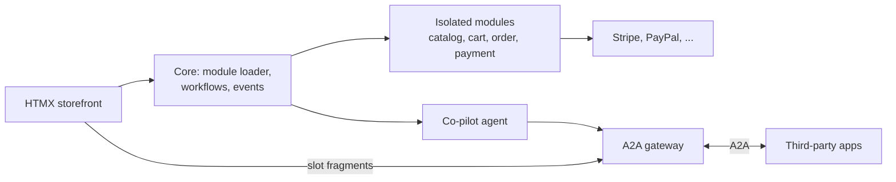

# the-market

An open-source, AI-first commerce platform: simple enough for a small shop, modular enough to take apart.

**Status: early prototype.** The server starts and answers a health check; there is no storefront yet.



## Read first

| Document | What it covers |
|---|---|
| [Phase 1: research and feasibility](docs/research/phase-1-research-and-feasibility.md) | A2A, Medusa-style modularity, HTMX theme injection |
| [Phase 2: architecture and technical design](docs/architecture/phase-2-architecture-and-tdd.md) | System diagram, monorepo layout, data model, payments |
| [Prototype roadmap](docs/plans/2026-11-15-prototype-roadmap.md) | Proposed pull requests towards a working demo |

## Code skeletons

| Skeleton | Location |
|---|---|
| Core module loader | `packages/core/src/module-loader.ts`, example module in `modules/catalog/` |
| A2A client and server handshake | `packages/a2a-gateway/src/` |
| HTMX theme injection hook | `packages/theme-engine/src/` |
| Payment gateway interface, Stripe and PayPal | `packages/payment/src/` |

Each package has one `compose.ts`, the only file that wires concrete functions together. Every other function receives what it needs as parameters.

## Run the checks

Requires Node 22.18 or newer and pnpm.

```bash
pnpm install
```

```bash
pnpm typecheck
```

```bash
pnpm test
```

## Database

Put `DATABASE_URL=postgresql://...` in a `.env` file in the repository root. Each module keeps its tables in its own PostgreSQL schema.

```bash
pnpm db catalog migrate deploy
```

`pnpm db <module> <prisma arguments>` runs any Prisma command for one module.

## Seed data

Run `pnpm seed` after the migrations to create a demo store for `localhost` with six demo products.
Set `STORE_HOST` to seed another host name. Running it again adds nothing.

## Start the server

```bash
pnpm dev
```

Then open `http://localhost:3000/health`. Set `PORT` to use another port.
Set `MERCHANT_TOKEN` to enable the merchant routes (`/api/change-sets`); they then need `Authorization: Bearer <token>`.

## Customising

Store-specific changes go in [`overrides/`](overrides/README.md) and, later, `market.config.ts`. Nothing else needs editing to change default behaviour.

## Licence

MIT. See [LICENSE](LICENSE).
