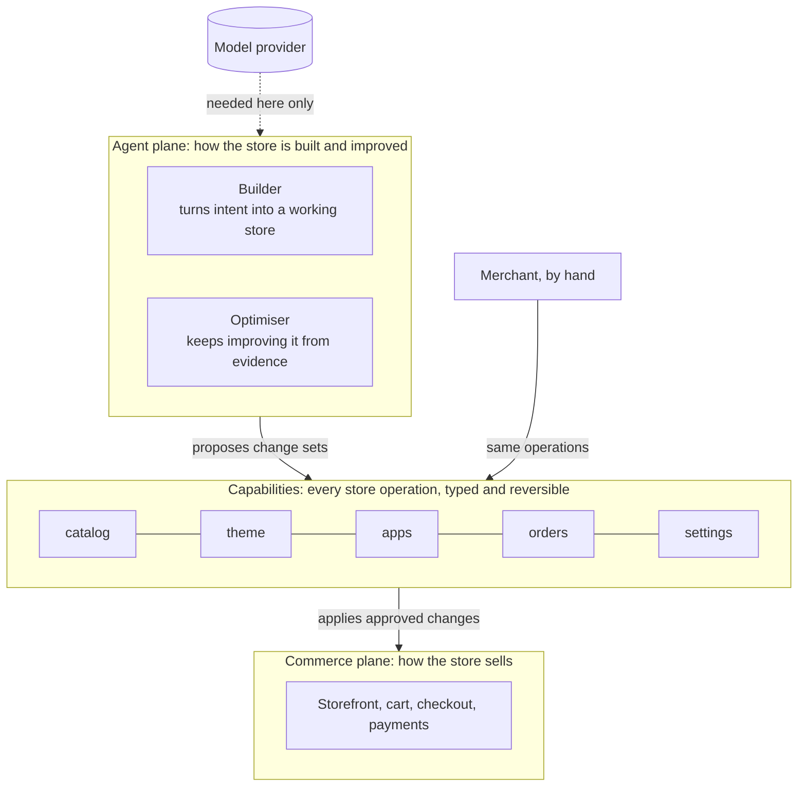
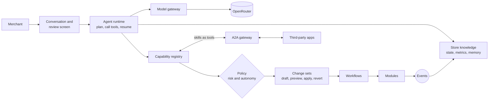
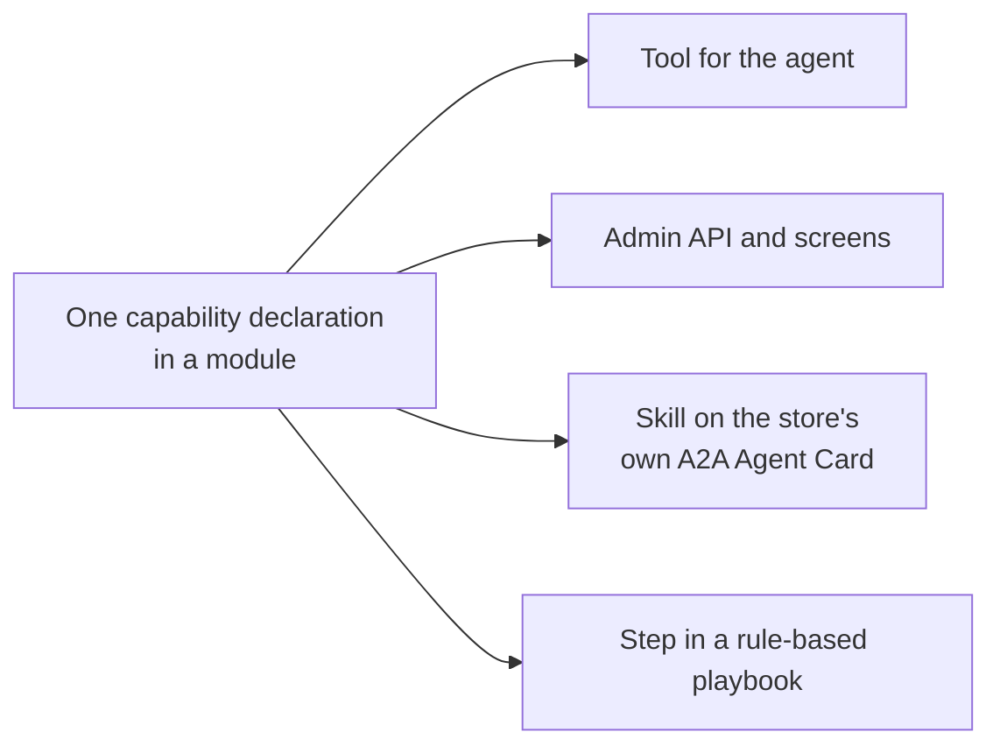
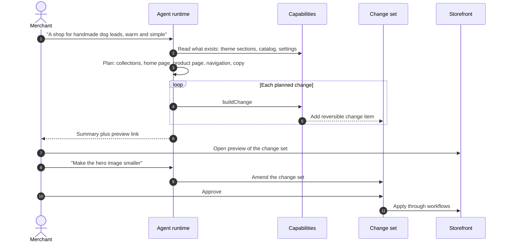
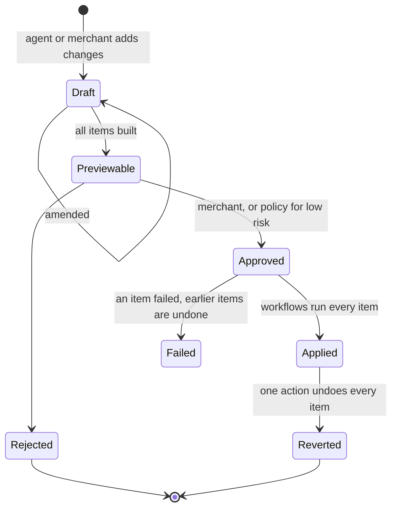

# Central agent design — part 1: core

Date: 2026-11-16. Status: **draft for owner review. Nothing here is built.**
Part 2 covers the optimiser, the model gateway, safety and the data model.

## 1. Position

Owner decision, 2026-11-16: the model is **central to the product**, a builder and optimiser of the store, not a sidekick. The store must still sell when no model is available.

Both hold if we separate two planes that share one set of operations:



- **Commerce plane:** never calls a model. A model outage cannot stop a sale.
- **Agent plane:** the primary way a store is created and changed. It needs a model.
- **Capabilities:** the only way anything changes the store. The agent and the merchant use the same ones.

So "runs with no model" means the store keeps selling and stays fully editable by hand. It does not mean the agent is optional to the product.

## 2. Principles

1. **Agent-native.** Every operation is a capability the agent can call. No admin feature exists that the agent cannot use.
2. **The store is data.** Pages, navigation, collections and settings are structured data, not code, so a model can build them safely.
3. **Nothing is applied directly.** The agent writes change sets. A change set can be previewed, approved, applied and reverted.
4. **Evidence over opinion.** The optimiser proposes experiments with a measurable goal, not just edits.
5. **The merchant stays in charge.** Autonomy is granted per kind of change and can be withdrawn.

## 3. Architecture



| Part | Job |
|---|---|
| Agent runtime | Runs a task as a loop: plan, call a capability, read the result, continue. Every step is stored, so a task survives a restart or a model outage and resumes. |
| Model gateway | The one place that talks to a model. Part 2. |
| Capability registry | Lists every capability with its input schema, risk and reversibility. |
| Store knowledge | What the agent may read: current store state, aggregated metrics, and notes it has learned about this store. |
| Policy | Decides whether a change needs approval, from its risk tier and the merchant's autonomy settings. Part 2. |
| Change sets | Holds proposed changes until they are approved, then applies them through workflows. |

## 4. Capabilities

A module declares capabilities next to its services. One declaration is exposed four ways:



Illustration only, not compiled:

```ts
defineCapability({
  name: "catalog.product.rename",
  summary: "Change a product's title",
  inputSchema: {
    type: "object",
    properties: { productId: { type: "string" }, title: { type: "string" } },
    required: ["productId", "title"],
  },
  risk: "low", // low | medium | high
  buildChange, // works out the change and how to undo it; writes nothing
  applyChange, // performs it, inside a workflow
  revertChange, // undoes it
});
```

| Field | Why it exists |
|---|---|
| `name`, `summary`, `inputSchema` | Become the tool definition the model sees. JSON Schema is what tool calling expects. |
| `risk` | Drives approval. Changing copy is low; changing a price is high. |
| `buildChange` | Lets the agent plan and preview without touching the live store. |
| `applyChange`, `revertChange` | Make every change reversible by construction. |

Skills of installed A2A apps appear in the same registry, so the agent can use a reviews app or a shipping app exactly as it uses core capabilities, within the scopes the merchant granted.

## 5. The builder

The builder turns a sentence into a working store. For that to be safe, **pages become data**: a page is an ordered list of sections with settings, and a section is a code template shipped by the theme or by a developer.

This refines the Phase 2 choice "templates are TypeScript functions": sections stay TypeScript functions, but which sections a page uses, in what order and with what settings, is data the agent can write.



What the builder can do in the first version: create collections and navigation, compose pages from existing sections, write and edit copy, set theme settings, bind apps to slots, import a product list.

What it cannot do in the first version: write new section code. Generated code that runs on the server is a different risk class and is an open question in part 2.

## 6. Change sets

A change set is to the store what a pull request is to this repository.



- A preview renders the storefront as if the change set were applied, for the merchant only.
- Applying is all or nothing: if one item fails, the items before it are undone.
- Every applied change set records who or what proposed it, who approved it, and the evidence behind it.
- An experiment variant (part 2) is a change set shown to part of the traffic.

## 7. What works with no model

| Area | With a model | With no model, or during an outage |
|---|---|---|
| Storefront, cart, checkout, payments | Works | Works, unchanged |
| Editing the store | By conversation, or by hand | By hand, through the same capabilities |
| Building a new store | From a description | From a starter template, then by hand |
| Finding problems and opportunities | Model reads the evidence and proposes | Coded rules raise findings |
| Experiments | Proposed, run and judged | Still run and are judged by the same statistics; proposed by hand |
| Running agent tasks | Proceed | Pause and resume when the model returns |

## 8. Approaches considered

| Approach | Verdict |
|---|---|
| Chat assistant beside a normal admin | Rejected: that is the sidekick the owner ruled out. Features get built for screens first and the agent lags behind. |
| Agent edits theme code and the database freely | Rejected: powerful, but not reviewable, not reversible and unsafe with untrusted content in the store. |
| **Capabilities, change sets and store-as-data** | Chosen: the agent can do everything a merchant can, every change is reviewable and reversible, and the store sells without a model. My recommendation; the owner has not approved it yet. |
