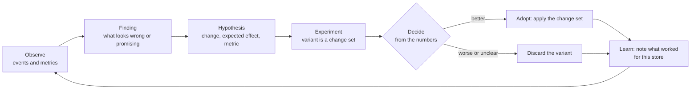
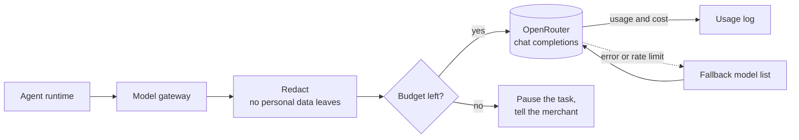
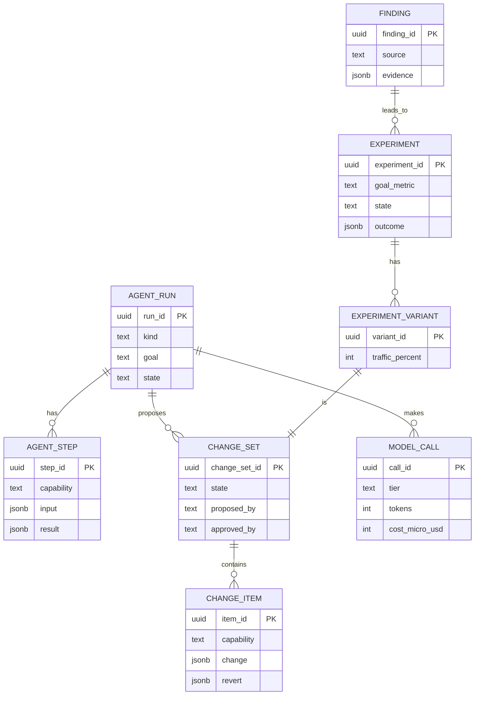
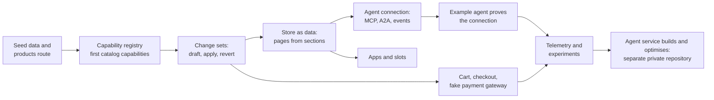

# Central agent design — part 2: optimiser, models, safety

Date: 2026-11-16. Status: **draft for owner review. Nothing here is built.**
Part 1 covers the position, capabilities, the builder and change sets. Part 3 covers the publisher, the tenant app and the separate agent service.

## 1. The optimiser

The optimiser never "just changes things". It runs a loop that ends in a measured decision.

| Step | Example |
|---|---|
| Finding | "Product pages get 900 views a week but only 1.1% add to cart; the store average is 3%." |
| Hypothesis | "Moving reviews above the description will raise add-to-cart on these pages." |
| Experiment | Half of visitors see the variant for 14 days; goal metric: add-to-cart rate; guardrail: checkout conversion must not fall. |
| Decision | Adopt, discard, or extend, with the numbers shown to the merchant. |

Rules:

- Experiments, visitor assignment and the statistics run in the tenant app. Findings and hypotheses come from the agent service.
- A variant is a change set (part 1), so it can be previewed and reverted like any other change.
- Visitors are assigned by a stable anonymous key, so one visitor always sees the same variant.
- Every experiment has one goal metric and at least one guardrail metric.
- The decision is made by fixed statistics in code, not by the model. The model proposes and explains; it does not judge its own idea.
- **Small stores have little traffic.** Many experiments will end "unclear". The design says so plainly, prefers large visible changes over tiny ones, and lets the merchant adopt on judgement.

## 2. Model gateway

The model gateway lives inside the agent service, not in the open-source tenant app (part 3). For hosted stores that is the business's CrewAI service. A self-hosted owner's agent makes its own choices; this section is a reference design.

Verified from OpenRouter's documentation on 2026-11-16:

- One endpoint, `POST https://openrouter.ai/api/v1/chat/completions`, with schemas close to OpenAI's.
- Tool calling (`tools`, `tool_choice`) and structured output (`response_format` with a JSON Schema) are supported on models that list them.
- A `models` array gives fallbacks when a provider errors or rate-limits.
- Provider preferences include `data_collection: "deny"` and `zdr: true` to restrict requests to providers that do not collect or retain data.
- Each response reports token usage and cost.

How the gateway uses this:

| Concern | Design |
|---|---|
| Model choice | Three named tiers (fast, standard, strongest) mapped to model ids in configuration. Tasks ask for a tier, never a model id. |
| Cost | A monthly budget per store; usage and cost stored per call; tasks pause when the budget is spent. |
| Privacy | Default request settings deny data collection. Customer names, emails, addresses and order contents are never sent; the agent sees aggregates and product data. |
| Outage | Fallback list first, then tasks pause and resume. The commerce plane is unaffected. |
| Other providers | Anything with the same interface can replace OpenRouter, including a local model. |

## 3. Safety

### Risk and autonomy

| Risk tier | Examples | Default | Merchant may raise to |
|---|---|---|---|
| Low | Copy edits, section order, a draft collection | Needs approval | Automatic |
| Medium | Navigation, theme settings, app slot bindings, starting an experiment | Needs approval | Automatic within limits |
| High | Prices, discounts, refunds, deleting data, installing an app, anything touching payments | Needs approval | Never automatic |

### Untrusted content

Product reviews, customer messages, app fragments and imported product data can all contain text aimed at the agent. Rules:

- Content from the store or from apps is always passed to the model as data, in a separate, labelled part of the request.
- A capability call is checked by policy code against the task the merchant actually started. The model's wish is never enough.
- Text returned by a third-party app can never cause a high-risk capability to run without the merchant's approval.
- The agent has no database access and no shell. It can only call capabilities.

### Limits

Per task: a cap on steps, on model spend and on the number of change items. Per store: a cap on concurrent experiments and on automatic changes per day.

## 4. Data model

Change sets, findings and experiments live in the tenant app, in the `agent` schema. Runs, steps and model calls belong to whichever agent service is connected and are shown for completeness. Outline only.

This replaces the `agents`, `agent_tasks` and `agent_proposals` outlines in `data-model-prisma.md`: a proposal becomes a change set, and a task becomes a run with steps.

## 5. Effect on the roadmap

The agent moves from the last milestone to the centre. Proposed order after catalog persistence:

Compared with the approved roadmap: capabilities and change sets come before the storefront grows, so every later feature is built agent-first. This repository builds the agent connection and a small example agent; the CrewAI builder and optimiser are built in the agent service. Checkout and apps keep their place.

## 6. Open questions for the owner

1. **Generated code.** Should the builder ever write new section code? If yes, it needs a sandbox and a code review step. My recommendation: not in the first version.
2. **Conversation surface.** Is the merchant's main screen a conversation with a preview beside it, with classic admin screens secondary?
3. **Default autonomy.** Everything needs approval at first, as drafted, or should low-risk changes be automatic from day one?
4. **Budget.** Answered 2026-11-16: hosted stores use the business's agent service; a self-hosted owner plugs in, and pays for, their own agent.
5. **Shopper-facing agent.** This draft covers the merchant side only. Is a shopping assistant for customers in scope later?
