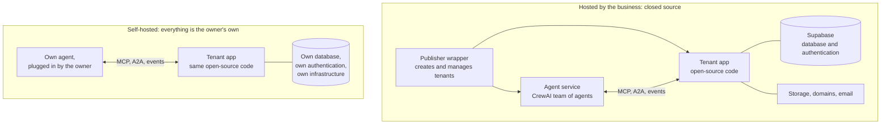
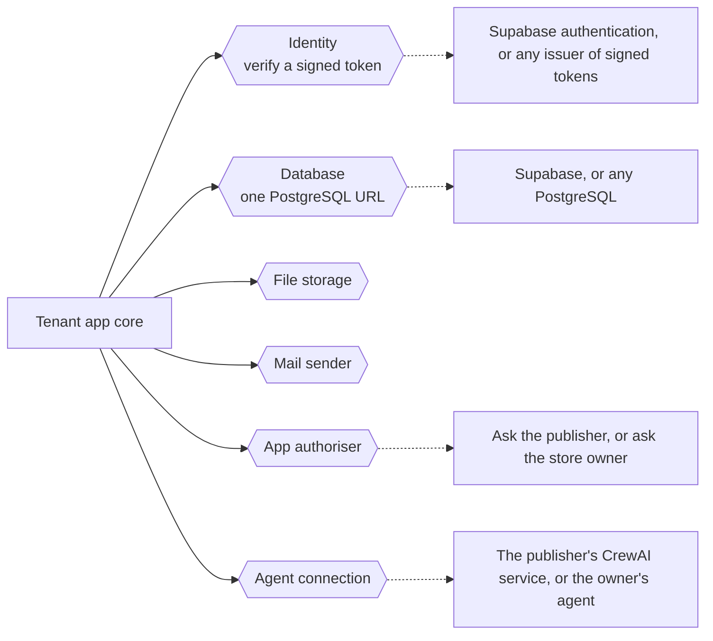
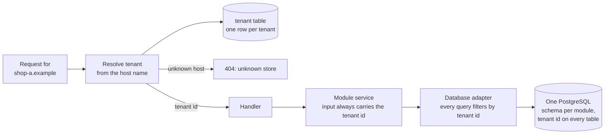
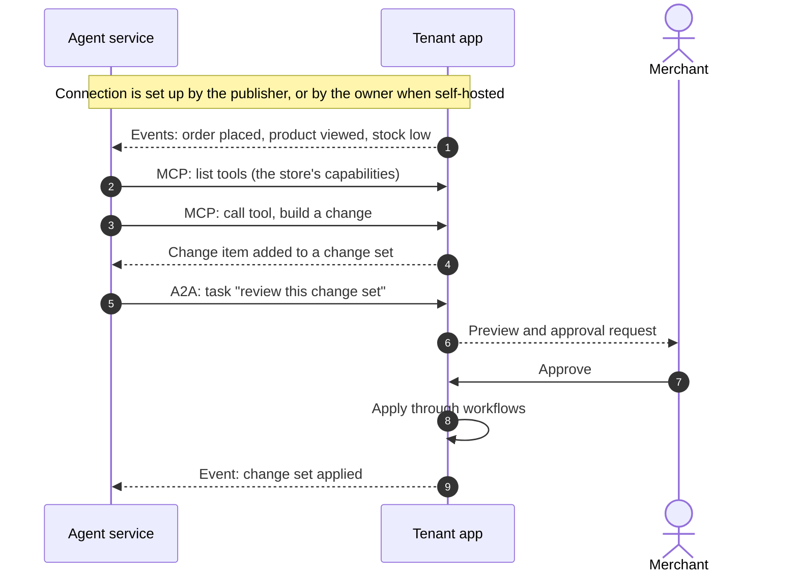
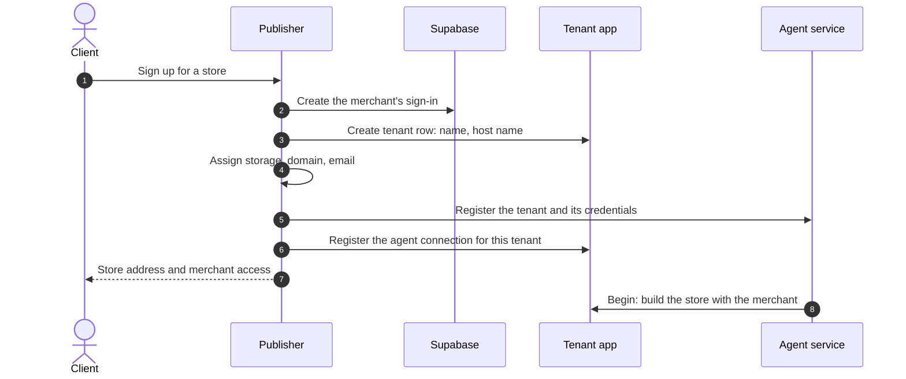

# Central agent design — part 3: publisher, tenant app and agent service

Date: 2026-11-16. Status: **draft for owner review. Nothing here is built.**
Source: the owner's diagram and clarifications of 2026-11-16. Parts 1 and 2 cover the agent core, optimiser and safety.

## 1. Two ways to run a store

Owner decision: stores created by our publisher run on our private infrastructure. Stores self-hosted from the open-source code bring their own.

The tenant app is the same code in both. It never knows which case it is in: it only sees the interfaces in section 3.

## 2. Who provides what

| Need | Hosted by the publisher | Self-hosted from source |
|---|---|---|
| Tenant app code | Open source, this repository | Open source, this repository |
| Database | One shared Supabase PostgreSQL for every tenant; each row carries its tenant | The owner's own PostgreSQL, holding one tenant |
| Authentication | Supabase authentication | The owner's own |
| Storage, domains, email | Assigned by the publisher | The owner's own |
| Agent | The publisher's agent service, built with CrewAI. Central to the product. | The owner plugs in their own agent |
| Model and its cost | Inside the agent service | Whatever the owner's agent uses |
| Authorising connected apps | The publisher | The store's owner, inside their own store |
| Publisher and agent service code | Closed source. Kept in separate folders of this repository for now, to be moved out later | Not available |

## 3. The tenant app's sockets

For one codebase to serve both cases, the tenant app depends on interfaces, never on a vendor. Each has a hosted implementation and a plain default.

| Socket | What the tenant app asks of it |
|---|---|
| Identity | "Is this token valid, and who is it?" The core never stores passwords. |
| Database | One connection URL. Each module still gets its own schema inside it, and every table carries a tenant id. |
| File storage | Put, get and delete a file. |
| Mail sender | Send one message. |
| App authoriser | "May this app be connected with these permissions?" |
| Agent connection | Section 4. |

**App authoriser, in plain words.** Before an app is connected, something must say yes. In the hosted product the publisher says yes or no. A self-hosted store has no publisher, so the store's own owner says yes or no on an approval screen in their store. It is the same question with two possible answerers.

## 4. Tenancy

Owner decision, 2026-11-16: one database for everything, and one row per tenant in a `tenant` table. One running tenant app serves every tenant.

- Every table in every module has a `tenant_id` column, and uniqueness is per tenant (two stores may both have a product called `lead`).
- Every module service takes the tenant id as part of its input. The database adapter is the only place that turns it into a filter, so a forgotten filter can only happen in one file per module.
- PostgreSQL row-level security is added later as a second line of defence.
- A self-hosted store is the same code with a single tenant row.
- The publisher creates a store by inserting a tenant row; nothing is started or provisioned per tenant inside the tenant app.

## 5. The agent connection

The agent is always outside the tenant app. The tenant app offers three channels, and any agent that speaks them can drive the store:

| Channel | Direction | Used for |
|---|---|---|
| MCP | Agent calls the store | The store's capabilities, exposed as tools. Read state, build changes. |
| A2A | Both ways | Longer tasks with a status, such as "build a store from this description". |
| Events | Store tells the agent | What happened in the store, so the agent can observe and react. |

What stays in the tenant app, in open source: capabilities, change sets, approval policy, experiments and their statistics, telemetry. These are the rules of the store and must not depend on who the agent is.

What lives in the agent service: the agents themselves, their prompts and plans, memory across stores, and all model calls.

So "the agent is central" and "the store sells with no model" both hold: a store with no agent connected still sells and can be edited by hand.

## 6. Creating a hosted store

The tenant app's part is small: store a tenant row and accept an agent connection for it. Migrations run once for the shared database, not per tenant.

## 7. What lives where

| Folder in this repository | Contents | Licence |
|---|---|---|
| `apps/`, `packages/`, `modules/`, `themes/` | Tenant app, its sockets, app SDK | Open source |
| `agent-service/` | CrewAI agents, prompts, model gateway, plus an example agent | Closed; here for now |
| `publisher/` | Tenant creation, merchant access, app authorisation | Closed; here for now |

Owner decision, 2026-11-16: closed-source parts live in separate folders of this repository for now and are migrated out later. **This repository is public, so anything committed to those folders is published.** Its visibility should change before real closed code lands.

An **example agent** is a proposal: a small scripted agent with no model, so the agent connection can be tested and self-hosters have something to copy.

## 8. Decisions and open questions

Answered by the owner on 2026-11-16:

1. Tenancy is one row per tenant in a `tenant` table, in one database for everything.
2. Closed-source design and code stay in this repository, in separate folders, for now.
3. The model gateway design in part 2 stays where it is.

Still open:

1. **Repository visibility.** When does the repository become private, or the closed folders move out?
2. **Tenant from host name.** This draft resolves the tenant from the request's host name. Is a path or header form also needed?
