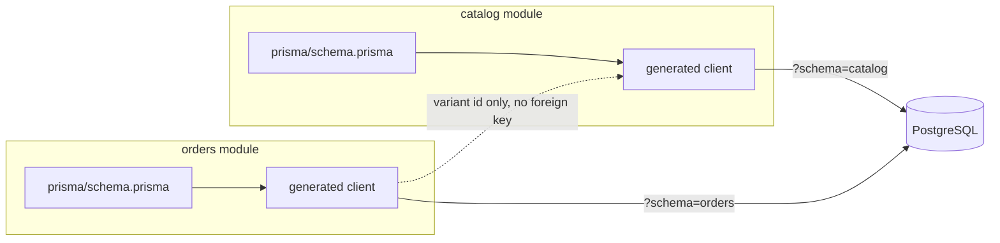

# Data model — Prisma outlines

Date: 2026-11-15. Status: outlines for review. Each module's models pass `prisma validate` on Prisma 6.19.3; none has been migrated against a database yet.

Stack: PostgreSQL through Prisma 6.19.3 (owner decision).

## One schema and one client per module



- Each module has its own `prisma/schema.prisma`, migrations folder and generated client.
- Each module's connection URL ends in `?schema=<module>`, so its client only sees its own tables. The `schema` URL parameter is documented for Prisma 6.
- Ids cross modules as plain columns. There are no relations between modules.
- **To prove in PR 3:** several generated clients in one workspace on Prisma 6.19.3, each with its own `output` folder.

Every module's schema starts with the same header, shown once here:

```prisma
generator client {
  provider = "prisma-client-js"
  output   = "../src/generated/client"
}

datasource db {
  provider = "postgresql"
  url      = env("CATALOG_DATABASE_URL") // ends in ?schema=catalog
}
```

## Catalog

```prisma
model Product {
  productId   String    @id @default(uuid()) @map("product_id") @db.Uuid
  handle      String    @unique
  title       String
  description String    @default("")
  status      String    @default("draft") // draft | active | archived
  createdAt   DateTime  @default(now()) @map("created_at") @db.Timestamptz
  updatedAt   DateTime  @updatedAt @map("updated_at") @db.Timestamptz
  variants    Variant[]

  @@map("products")
}

model Variant {
  variantId    String  @id @default(uuid()) @map("variant_id") @db.Uuid
  productId    String  @map("product_id") @db.Uuid
  sku          String  @unique
  title        String
  priceMinor   Int     @map("price_minor")
  currencyCode String  @map("currency_code")
  product      Product @relation(fields: [productId], references: [productId])

  @@map("variants")
}
```

## Orders

```prisma
model Order {
  orderId           String      @id @default(uuid()) @map("order_id") @db.Uuid
  orderNumber       Int         @unique @default(autoincrement()) @map("order_number")
  customerId        String?     @map("customer_id") @db.Uuid // id only
  status            String      @default("pending") // pending | paid | fulfilled | canceled | refunded
  currencyCode      String      @map("currency_code")
  subtotalMinor     Int         @map("subtotal_minor")
  totalMinor        Int         @map("total_minor")
  paymentProviderId String?     @map("payment_provider_id")
  paymentReference  String?     @map("payment_reference")
  placedAt          DateTime    @default(now()) @map("placed_at") @db.Timestamptz
  lines             OrderLine[]

  @@map("orders")
}

model OrderLine {
  lineId         String @id @default(uuid()) @map("line_id") @db.Uuid
  orderId        String @map("order_id") @db.Uuid
  variantId      String @map("variant_id") @db.Uuid // id only, snapshot below
  titleSnapshot  String @map("title_snapshot")
  skuSnapshot    String @map("sku_snapshot")
  quantity       Int
  unitPriceMinor Int    @map("unit_price_minor")
  order          Order  @relation(fields: [orderId], references: [orderId])

  @@map("order_lines")
}
```

## Apps

```prisma
model AppRegistration {
  appId         String           @id @default(uuid()) @map("app_id") @db.Uuid
  baseUrl       String           @unique @map("base_url")
  cardJson      Json             @map("card_json") // last validated Agent Card
  cardEtag      String?          @map("card_etag")
  cardFetchedAt DateTime         @map("card_fetched_at") @db.Timestamptz
  rpcUrl        String           @map("rpc_url") // chosen JSONRPC interface
  status        String           @default("pending") // pending | active | suspended
  grantedScopes String[]         @map("granted_scopes")
  authScheme    String           @map("auth_scheme")
  credentialRef String           @map("credential_ref") // pointer into the secret store, never the secret
  installedAt   DateTime         @default(now()) @map("installed_at") @db.Timestamptz
  slotBindings  AppSlotBinding[]

  @@map("app_registrations")
}

model AppSlotBinding {
  bindingId String          @id @default(uuid()) @map("binding_id") @db.Uuid
  appId     String          @map("app_id") @db.Uuid
  slotName  String          @map("slot_name") // for example product.below-title
  skillId   String          @map("skill_id") // the app skill that renders the fragment
  priority  Int             @default(100)
  enabled   Boolean         @default(true)
  app       AppRegistration @relation(fields: [appId], references: [appId])

  @@map("app_slot_bindings")
}
```

## Agents

```prisma
model Agent {
  agentId       String          @id @default(uuid()) @map("agent_id") @db.Uuid
  kind          String // copilot | system
  name          String
  modelName     String?         @map("model_name") // OpenRouter model id; null means rules only
  autonomyLevel String          @default("suggest") @map("autonomy_level") // suggest | approve | auto
  enabled       Boolean         @default(true)
  tasks         AgentTask[]
  proposals     AgentProposal[]

  @@map("agents")
}

model AgentTask {
  taskId       String    @id @default(uuid()) @map("task_id") @db.Uuid
  agentId      String    @map("agent_id") @db.Uuid
  appId        String?   @map("app_id") @db.Uuid // id only: set when the task runs on a remote app
  remoteTaskId String?   @map("remote_task_id")
  skillId      String    @map("skill_id")
  state        String // mirrors A2A task states
  input        Json
  output       Json?
  createdAt    DateTime  @default(now()) @map("created_at") @db.Timestamptz
  settledAt    DateTime? @map("settled_at") @db.Timestamptz
  agent        Agent     @relation(fields: [agentId], references: [agentId])

  @@map("agent_tasks")
}

model AgentProposal {
  proposalId String    @id @default(uuid()) @map("proposal_id") @db.Uuid
  agentId    String    @map("agent_id") @db.Uuid
  kind       String // slot-binding | collection-order | reorder-stock | theme-setting
  summary    String
  change     Json // what to apply
  revert     Json // how to undo it
  evidence   Json // metrics that justify it
  status     String    @default("proposed") // proposed | approved | rejected | applied | reverted
  decidedAt  DateTime? @map("decided_at") @db.Timestamptz
  agent      Agent     @relation(fields: [agentId], references: [agentId])

  @@map("agent_proposals")
}
```
