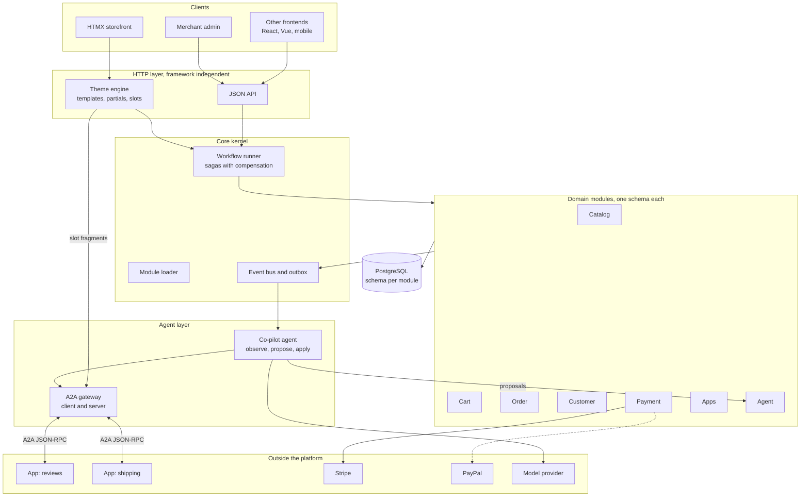
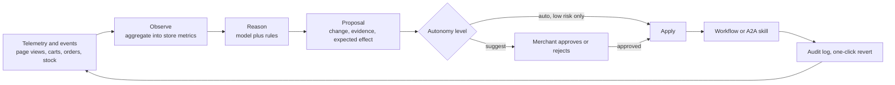
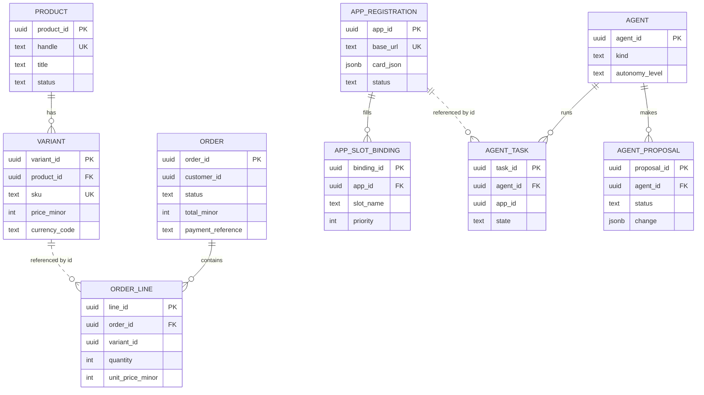
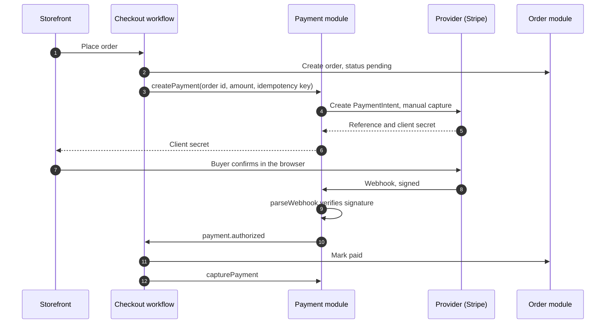

# Phase 2 — System architecture and technical design

Date: 2026-11-15. Status: draft for owner review. Builds on [Phase 1](../research/phase-1-research-and-feasibility.md).

## 1. Intent

the-market is an open-source commerce platform that a small shop can start with one command and a large one can take apart and extend. Three things make it different:

1. **Modules are truly isolated**, each with its own database schema.
2. **Apps are remote agents** that speak the A2A protocol, not code loaded into the server.
3. **A central AI agent** watches store activity and proposes changes the merchant approves.

The open-source core must run self-hosted with no paid service. The commercial offer adds hosting and a better merchant experience on top of the same core.

**Goals:** one-command start; modules replaceable one at a time; apps installable by URL; zero app JavaScript on the storefront; payment gateways as plugins; every default overridable from one folder.

**Non-goals for the MVP:** multi-tenant hosting, marketplaces with many sellers, B2B pricing, a visual theme editor, a graph query engine.

**Anti-goals:** an agent that changes a live store without the merchant's consent; a plugin system that lets third-party code run inside the server process.

## 2. Architecture



### Request flow

1. A request reaches the theme engine (HTML) or the JSON API. Both are thin: they validate input and call a workflow or a single module service.
2. A workflow runs steps across modules. Each step has a compensation, so a failed checkout releases stock and cancels the payment.
3. A module reads and writes only its own schema and publishes events to the outbox in the same transaction.
4. Events feed read models, the co-pilot agent and the A2A gateway.

### Components

| Component | Responsibility | Skeleton |
|---|---|---|
| Module loader | Orders modules by dependency, registers services, fails fast on missing modules | `packages/core/src/module-loader.ts` |
| Event bus | Publish and subscribe; in memory now, outbox later | `packages/core/src/event-bus.ts` |
| A2A gateway | Fetch Agent Cards, call skills, poll tasks, serve the platform's own card | `packages/a2a-gateway/src/` |
| Theme engine | Render templates and partials, resolve slots, sanitise app fragments | `packages/theme-engine/src/` |
| Payment | Provider contract and registry; Stripe and PayPal adapters | `packages/payment/src/` |
| Co-pilot agent | Turns telemetry into proposals; applies approved ones | Prototype plan |
| Workflow runner | Sagas with compensation | Prototype plan |

## 3. The central agent



- **Inputs:** events from modules and anonymous storefront telemetry (no personal data leaves the store by default).
- **Outputs:** proposals, never direct writes. A proposal names the change, the evidence and how to revert it.
- **What it can change:** only what a workflow or an app skill exposes, such as slot bindings, collection order, reorder suggestions and theme settings. It has no database access.
- **Autonomy** is per proposal kind: `suggest` (default), `approve` (one click), `auto` (low-risk kinds the merchant opted into).
- **Model access** sits behind one interface so a store can use a hosted model, a local model or rules only.

## 4. Monorepo layout

```text
the-market/
├── apps/
│   ├── server/              # composition root: loads modules, mounts HTTP adapter
│   └── mock-reviews-app/    # example third-party A2A app for the prototype
├── packages/
│   ├── core/                # module loader, event bus, workflow runner, HTTP port types
│   ├── a2a-gateway/         # Agent Card client, JSON-RPC client and server, task polling
│   ├── theme-engine/        # slots, sanitizer, partial handlers
│   ├── payment/             # provider contract, registry, Stripe and PayPal adapters
│   ├── agent/               # co-pilot: observe, reason, propose
│   └── app-sdk/             # helpers for third parties building A2A apps
├── modules/
│   ├── catalog/             # each module: src/, schema, migrations, tests
│   ├── cart/
│   ├── order/
│   ├── customer/
│   ├── apps/                # app registrations, slot bindings, scopes
│   └── agent/               # agents, tasks, proposals, telemetry
├── themes/
│   └── default/             # layout, pages, partials (HTMX)
├── overrides/               # merchant customisation, wins over every default
├── docs/
│   ├── research/  architecture/  plans/  journal/
└── market.config.ts         # which modules, theme, payment providers and apps are on
```

Folders marked in the table of section 2 exist today. The rest are created by the prototype plan.

### Where customisation lives

Merchants and their developers change behaviour in exactly two places:

| Place | What goes there | How it is resolved |
|---|---|---|
| `market.config.ts` | Which modules, theme and payment providers are enabled; slot order; agent autonomy | Read once at start |
| `overrides/` | Template and partial replacements, extra slots, workflow step replacements | Looked up first: `overrides/` then `themes/<active>/` then the package default |

An override mirrors the path of what it replaces, for example `overrides/themes/default/partials/product-card.ts`. A command lists every active override with the default it shadows, so nothing is hidden.

## 5. Data model

One PostgreSQL database, one schema per module. Ids cross module boundaries as plain columns with no foreign key; relations inside a module use normal foreign keys.



Solid lines are foreign keys inside one module. Dotted lines are id references across modules.

### Drizzle outlines

These are outlines for review, not yet compiled. Drizzle is chosen because each module can own its schema file and migrations; **this is my call, not something the owner decided.**

```ts
// modules/catalog/src/schema.ts
import { integer, pgSchema, text, timestamp, uuid } from "drizzle-orm/pg-core";

export const catalog = pgSchema("catalog");

export const products = catalog.table("products", {
  productId: uuid("product_id").primaryKey().defaultRandom(),
  handle: text("handle").notNull().unique(),
  title: text("title").notNull(),
  description: text("description").notNull().default(""),
  status: text("status").notNull().default("draft"), // draft | active | archived
  createdAt: timestamp("created_at", { withTimezone: true }).notNull().defaultNow(),
  updatedAt: timestamp("updated_at", { withTimezone: true }).notNull().defaultNow(),
});

export const variants = catalog.table("variants", {
  variantId: uuid("variant_id").primaryKey().defaultRandom(),
  productId: uuid("product_id").notNull().references(() => products.productId),
  sku: text("sku").notNull().unique(),
  title: text("title").notNull(),
  priceMinor: integer("price_minor").notNull(),
  currencyCode: text("currency_code").notNull(),
});
```

```ts
// modules/order/src/schema.ts
export const orders = pgSchema("orders");

export const orderRecords = orders.table("orders", {
  orderId: uuid("order_id").primaryKey().defaultRandom(),
  orderNumber: integer("order_number").notNull().unique(),
  customerId: uuid("customer_id"), // id only: customer lives in another module
  status: text("status").notNull().default("pending"), // pending | paid | fulfilled | canceled | refunded
  currencyCode: text("currency_code").notNull(),
  subtotalMinor: integer("subtotal_minor").notNull(),
  totalMinor: integer("total_minor").notNull(),
  paymentProviderId: text("payment_provider_id"),
  paymentReference: text("payment_reference"),
  placedAt: timestamp("placed_at", { withTimezone: true }).notNull().defaultNow(),
});

export const orderLines = orders.table("order_lines", {
  lineId: uuid("line_id").primaryKey().defaultRandom(),
  orderId: uuid("order_id").notNull().references(() => orderRecords.orderId),
  variantId: uuid("variant_id").notNull(), // id only, plus a snapshot below
  titleSnapshot: text("title_snapshot").notNull(),
  skuSnapshot: text("sku_snapshot").notNull(),
  quantity: integer("quantity").notNull(),
  unitPriceMinor: integer("unit_price_minor").notNull(),
});
```

```ts
// modules/apps/src/schema.ts
export const apps = pgSchema("apps");

export const appRegistrations = apps.table("app_registrations", {
  appId: uuid("app_id").primaryKey().defaultRandom(),
  baseUrl: text("base_url").notNull().unique(),
  cardJson: jsonb("card_json").notNull(), // last validated Agent Card
  cardEtag: text("card_etag"),
  cardFetchedAt: timestamp("card_fetched_at", { withTimezone: true }).notNull(),
  rpcUrl: text("rpc_url").notNull(), // chosen JSONRPC interface
  status: text("status").notNull().default("pending"), // pending | active | suspended
  grantedScopes: text("granted_scopes").array().notNull(),
  authScheme: text("auth_scheme").notNull(),
  credentialRef: text("credential_ref").notNull(), // pointer into the secret store, never the secret
  installedAt: timestamp("installed_at", { withTimezone: true }).notNull().defaultNow(),
});

export const appSlotBindings = apps.table("app_slot_bindings", {
  bindingId: uuid("binding_id").primaryKey().defaultRandom(),
  appId: uuid("app_id").notNull().references(() => appRegistrations.appId),
  slotName: text("slot_name").notNull(), // for example product.below-title
  skillId: text("skill_id").notNull(), // the app skill that renders the fragment
  priority: integer("priority").notNull().default(100),
  enabled: boolean("enabled").notNull().default(true),
});
```

```ts
// modules/agent/src/schema.ts
export const agent = pgSchema("agent");

export const agents = agent.table("agents", {
  agentId: uuid("agent_id").primaryKey().defaultRandom(),
  kind: text("kind").notNull(), // copilot | system
  name: text("name").notNull(),
  modelName: text("model_name"), // null means rules only
  autonomyLevel: text("autonomy_level").notNull().default("suggest"), // suggest | approve | auto
  enabled: boolean("enabled").notNull().default(true),
});

export const agentTasks = agent.table("agent_tasks", {
  taskId: uuid("task_id").primaryKey().defaultRandom(),
  agentId: uuid("agent_id").notNull().references(() => agents.agentId),
  appId: uuid("app_id"), // id only: set when the task runs on a remote app
  remoteTaskId: text("remote_task_id"),
  skillId: text("skill_id").notNull(),
  state: text("state").notNull(), // mirrors A2A task states
  input: jsonb("input").notNull(),
  output: jsonb("output"),
  createdAt: timestamp("created_at", { withTimezone: true }).notNull().defaultNow(),
  settledAt: timestamp("settled_at", { withTimezone: true }),
});

export const agentProposals = agent.table("agent_proposals", {
  proposalId: uuid("proposal_id").primaryKey().defaultRandom(),
  agentId: uuid("agent_id").notNull().references(() => agents.agentId),
  kind: text("kind").notNull(), // slot-binding | collection-order | reorder-stock | theme-setting
  summary: text("summary").notNull(),
  change: jsonb("change").notNull(), // what to apply
  revert: jsonb("revert").notNull(), // how to undo it
  evidence: jsonb("evidence").notNull(), // metrics that justify it
  status: text("status").notNull().default("proposed"), // proposed | approved | rejected | applied | reverted
  decidedAt: timestamp("decided_at", { withTimezone: true }),
});
```

## 6. Payments



- The order and cart modules know only the `PaymentProvider` contract in `packages/payment/src/payment-provider.ts`.
- A provider is one file that implements five functions. Adding a gateway touches no other package.
- Amounts are integers in minor units. Every write carries an idempotency key.
- Card data never touches the server: the buyer confirms with the gateway in the browser.

## 7. Approaches considered

| Decision | Options | Choice and reason |
|---|---|---|
| App integration | In-process plugins; webhooks plus REST; A2A agents | A2A, as the owner specified. It gives discovery, auth and async tasks in one standard. |
| Module isolation | Convention only; schema per module; database per module | Schema per module. Real enforcement without the cost of many databases. |
| ORM | Prisma; Drizzle; raw SQL | Drizzle. One schema file per module fits isolation. My call. |
| HTTP framework | Express; Fastify; Hono | Hono behind a port. Small, and handlers stay framework independent. My call. |
| Templates | A template language; TypeScript functions | TypeScript functions for the MVP. No parser, full type checking. Revisit if theme authors ask. My call. |
| App UI injection | Client scripts; iframes; server-side fragments | Server-side fragments. Only this keeps third-party JavaScript off the storefront. |
| Local database | Docker PostgreSQL; embedded PGlite | PGlite for one-command start, real PostgreSQL in production. To verify in the prototype. My call. |

## 8. Risks

| Risk | Impact | Mitigation |
|---|---|---|
| Sanitizer bypass in app fragments | Code runs in shoppers' browsers | Parser-based allowlist, strict CSP, htmx eval and script tags off |
| No apps exist for a new protocol | Empty ecosystem at launch | App SDK and first-party apps; installs need only a URL |
| Cross-module reads get slow or stale | Poor listing pages | Read models from events; checkout reads the owner module directly |
| Agent proposes harmful changes | Lost sales, lost trust | Suggest-only default, evidence on every proposal, audit log, one-click revert |
| A2A spec changes again | Rework | Protocol types live in one package; version pinned in a header |

## 9. What the skeletons prove today

`pnpm typecheck` passes and `pnpm test` runs 11 passing tests covering: dependency-ordered module loading, an end-to-end A2A discover, send and poll handshake against a fake app, slot rendering with sanitising, ordering, timeout and failure isolation, and the Stripe adapter including webhook signature checks. Nothing talks to a database, a browser or a real gateway yet.
