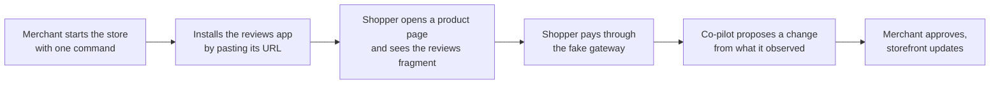
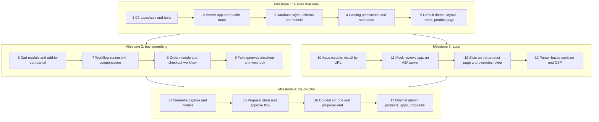

# Prototype roadmap

Date: 2026-11-15. Status: **proposed, waiting for owner approval.** Nothing in this file has been built.

This is a roadmap at pull-request level. Each PR gets its own detailed plan, with its own diagram, just before it is built.

## The demo this prototype must give

If all six steps work on a laptop with a local PostgreSQL, the prototype is done.

## Order of work

Milestones 2 and 3 do not depend on each other and can be built in either order.

## Pull requests

Every PR is at most 200 changed lines, includes its tests, and passes `pnpm typecheck` and `pnpm test`. A PR that would exceed 200 lines is split before it is opened.

| # | PR | Done when |
|---|---|---|
| 1 | CI workflow | Typecheck and tests run on every PR |
| 2 | `apps/server` with Hono adapter and health route | `pnpm dev` starts and `/health` answers |
| 3 | Database layer (Prisma 6.19.3) | Each module migrates its own schema with its own Prisma client; a module cannot query another schema |
| 4 | Catalog persistence | Products and variants are stored, listed and seeded |
| 5 | Default theme | Home and product pages render through HTMX partials |
| 6 | Cart module | Add to cart updates the cart partial without a page reload |
| 7 | Workflow runner | A failing step triggers compensation of earlier steps |
| 8 | Order module and checkout workflow | Placing an order creates order lines with price snapshots |
| 9 | Fake payment gateway | A fake provider pays an order through the same contract and webhook path; Stripe keys are added later by the owner |
| 10 | Apps module | Pasting a URL fetches, validates and stores an Agent Card |
| 11 | Mock reviews app | A separate process serves a card and a `render-fragment` skill |
| 12 | Slots and overrides | The reviews fragment appears on the product page; an override replaces a partial |
| 13 | Sanitizer and CSP | Parser-based allowlist replaces the regex sanitizer; CSP header is set |
| 14 | Telemetry | Page views and cart events are stored and aggregated |
| 15 | Proposals | A proposal can be approved, applied and reverted |
| 16 | Co-pilot v0 (OpenRouter) | The agent creates one evidence-backed proposal from real telemetry |
| 17 | Admin | A merchant can manage products, apps and proposals in the browser |

Several rows will need more than one PR to stay under 200 lines; the per-PR plan says so when it does.

## Decisions

| Question | Answer (owner, 2026-11-15) |
|---|---|
| How are PRs opened? | Feature branches may be pushed; `main` is never pushed directly |
| Model provider for co-pilot v0 | OpenRouter |
| Database | PostgreSQL through Prisma 6.19.3 |
| Payments in the demo | A fake gateway; the owner adds Stripe keys afterwards |

## Still open

| Question | Why it matters |
|---|---|
| Where does the local PostgreSQL come from? | The development machine has no PostgreSQL or Docker; PR 3 needs a database URL |
| Must the store run with no model at all? | Decides whether co-pilot v0 needs a rules-only path |
