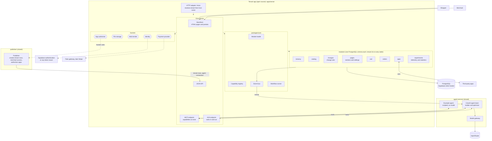
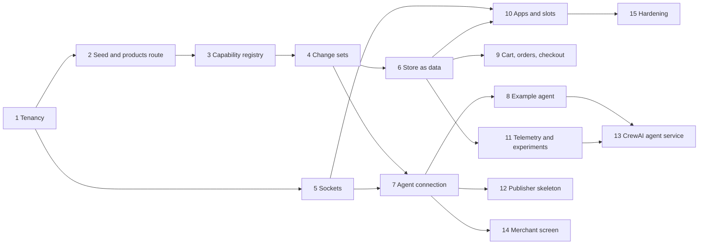

# Build plan — master

Date: 2026-11-16. Status: **proposed, for owner approval.** Supersedes `2026-11-15-prototype-roadmap.md`.

**For whoever implements this, human or AI:** read sections 2 and 3, pick the first work package in section 4 that is not done, open its plan file, and do its tasks in order. One task is one pull request.

**Goal:** an open-source, multi-tenant commerce app that an outside agent service builds and optimises through typed, reversible capabilities.

**Design:** `docs/architecture/agent-design-part-1-core.md`, `-part-2-optimiser-and-safety.md`, `-part-3-publisher-and-tenant.md`, and `phase-2-architecture-and-tdd.md`.

**Tech stack:** Node 22.18+, TypeScript (strict, run directly by Node with type stripping), pnpm 12.8.1 workspaces, Hono, Prisma 6.19.3 on PostgreSQL, HTMX for the storefront, `node --test` for tests. The agent service is Python with CrewAI.

## 1. The whole system



## 2. Repository map

| Path | Holds | State |
|---|---|---|
| `apps/server` | Composition root, Hono adapter, routes | Health route only |
| `packages/core` | Module loader, event bus, HTTP types, database URL helper | Built |
| `packages/a2a-gateway`, `packages/theme-engine`, `packages/payment` | A2A client and server, slot rendering, payment contract | Skeletons with tests |
| `modules/catalog` | Products and variants in schema `catalog` | Built, not yet tenant-scoped |
| `modules/<name>` | One module per row of the diagram | To build |
| `scripts/run-prisma.ts` | `pnpm db <module> <prisma arguments>` | Built |
| `agent-service/`, `publisher/` | Closed parts, kept here for now | To build |
| `docs/plans/` | This file and one plan per work package | |
| `docs/journal/session-log.md` | One entry per pull request | |

## 3. Rules every change must follow

**Pull requests**
1. One task is one pull request, based on `main`. Never base a pull request on another branch. Never push to `main`.
2. At most 200 changed lines, not counting `pnpm-lock.yaml`. If a task would exceed it, split it and say so in the description.
3. The description starts with a Mermaid diagram of the change, then "What changes", "Checked", "Not in this PR".
4. No reference to any AI tool or assistant in commits, descriptions, code or docs.
5. Stage files by name. Never `git add -A`. Read `git status` before committing. `generated/` folders are never committed.
6. Append an entry to `docs/journal/session-log.md` in the same pull request.

**Code**
7. Names: variables are nouns of 3 letters or more (`productId`, never `id`); functions are verbs (`buildCartChange`).
8. A function reads nothing outside its own scope except constants and language built-ins. Everything else, including other functions, the clock, `fetch`, the environment and the database, is passed in.
9. More than 2 parameters are passed as one flat object of plain values and functions.
10. At most 2 branches per function. Split instead of adding a third.
11. Each package has one `compose.ts` (or a module's `index.ts`), the only place that wires concrete functions together.
12. Only an adapter file imports a vendor library: `hono-adapter.ts` for Hono, `prisma-<module>-database.ts` for Prisma.
13. Files stay under 500 lines; file names are lowercase with hyphens.

**Modules and tenancy**
14. A module never imports another module. Modules communicate through events; only workflows and the server composition call several modules.
15. Each module owns one PostgreSQL schema, its own `prisma/schema.prisma`, migrations and generated client.
16. Every table has a `tenant_id` column; uniqueness is per tenant.
17. Every public service takes one flat input object that includes `tenantId: string`.
18. Only the module's database adapter turns `tenantId` into a query filter.

**Testing**
19. Write the failing test first, see it fail, then implement.
20. Unit tests use fakes for ports. Database tests are skipped when `DATABASE_URL` is unset and run in CI against its PostgreSQL service.
21. Before opening a pull request: `pnpm typecheck` and `pnpm test` pass; if a database is configured, also `node --env-file=.env --test <database test file>`.

**Shell setup** (a fresh shell may default to an older Node without pnpm):

```bash
export PATH="$HOME/Library/pnpm/bin:$PATH"; source ~/.nvm/nvm.sh; nvm use 22
```

## 4. Work packages

| # | Work package | Needs | Outcome | Plan |
|---|---|---|---|---|
| 1 | Tenancy | — | `tenancy` module, tenant resolved from host, catalog scoped by tenant | `2026-11-16-wp1-tenancy.md` |
| 2 | Seed data and products route | 1 | `pnpm seed`; `GET /api/products` per tenant | `2026-11-16-wp2-seed-and-products-route.md` |
| 3 | Capability registry | 2 | Modules declare capabilities; first catalog capability; `GET /api/capabilities` | `2026-11-16-wp3-capability-registry.md` |
| 4 | Change sets | 3 | `changes` module: draft, preview data, apply, revert | `2026-11-17-wp4-change-sets.md` |
| 5 | Sockets | 1 | Identity, file storage, mail, app authoriser ports with default implementations | To write |
| 6 | Store as data | 4 | `pages` module; storefront home and product pages rendered from sections | To write |
| 7 | Agent connection | 4, 5 | MCP endpoint, A2A endpoint, event delivery, per tenant | To write |
| 8 | Example agent | 7 | Scripted agent builds a change set over MCP | To write |
| 9 | Cart, orders, checkout | 6 | Workflow runner, cart and order modules, fake payment gateway | To write |
| 10 | Apps and slots | 5, 6 | Install by Agent Card, authoriser, fragments on the product page | To write |
| 11 | Telemetry and experiments | 6, 4 | Events stored, variants assigned, outcome decided by statistics | To write |
| 12 | Publisher skeleton | 5, 7 | Creates a tenant, grants merchant access, registers the agent connection | To write |
| 13 | CrewAI agent service | 8, 11 | Builder v0 and optimiser v0 on OpenRouter | To write |
| 14 | Merchant screen | 6, 7 | Conversation, preview and approvals | To write |
| 15 | Hardening | 10 | Parser-based sanitizer, CSP, row-level security, per-module database roles | To write |



Plans marked "To write" are written when the package before them is merged, because their exact interfaces depend on what was built. Each follows the format of the three written plans.

## 5. Done means

On one database with two tenant rows: the example agent builds a small store for tenant A through capabilities; the merchant previews and approves the change set; a shopper on tenant A's host name buys through the fake gateway; tenant B sees none of it; an experiment on tenant A reaches a decision; then the CrewAI service does the same build from one sentence.
