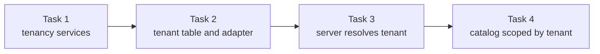

# Work package 1 — Tenancy: implementation plan

**For whoever implements this, human or AI:** do the tasks in order. One task is one pull request. Steps use checkboxes for tracking.

**Goal:** one running app serves many stores from one database; each request is tied to one row of a `tenant` table and catalog data is isolated per tenant.

**Architecture:** a new `tenancy` module owns the `tenant` table. The HTTP adapter resolves the tenant from the request's host name and passes `tenantId` to handlers. Catalog tables gain `tenant_id`, and the catalog database adapter filters by it.

**Design:** `docs/architecture/agent-design-part-3-publisher-and-tenant.md`, section 4.

**Global constraints:** every rule in section 3 of `2026-11-16-build-plan-master.md` applies. The `tenant` table is the one table without a `tenant_id` column.



## Review focus

Inputs the design implies; each has a test in the task named.

1. Host name with a port or capitals (`Shop-A.example:3000`) resolves like `shop-a.example`. Task 1.
2. An unknown host, or a request with no `Host` header, gets 404 and never reaches a handler. Task 3.
3. A tenant whose status is not `active` is treated as unknown. Task 1.
4. Two tenants may use the same product handle and the same SKU. Task 4.
5. Tenant A can never list tenant B's products. Task 4.

---

### Task 1: Tenancy services

**Files**
- Create: `modules/tenancy/src/tenancy-services.ts` (no `package.json` yet: `pnpm generate` fails for a module folder that has one but no Prisma schema; task 2 adds both together)
- Test: `modules/tenancy/src/tenancy-services.test.ts`

**Interfaces produced**

```ts
export interface TenantRecord { tenantId: string; slug: string; name: string; primaryHost: string; status: string }
export interface TenancyDatabase {
  findTenantByHost: (input: { host: string }) => Promise<TenantRecord | undefined>;
  insertTenant: (input: { slug: string; name: string; primaryHost: string }) => Promise<TenantRecord>;
}
export function normaliseHost(host: string): string; // lowercase, port removed
export function resolveTenant(input: { host: string; findTenantByHost: TenancyDatabase["findTenantByHost"]; normalise: (host: string) => string }): Promise<string | undefined>; // tenantId, only when status is "active"
export function buildTenancyServices(input: { database: TenancyDatabase; resolve: typeof resolveTenant; normalise: typeof normaliseHost }): ServiceMap;
// ServiceMap keys: resolveTenant(input: { host: string }) => Promise<string | undefined>
//                  createTenant(input: { slug: string; name: string; primaryHost: string }) => Promise<TenantRecord>   (stores the normalised host)
```

- [ ] **Step 1: write the failing tests** with a fake `TenancyDatabase` backed by an array:
  - `normaliseHost("Shop-A.example:3000")` equals `"shop-a.example"`.
  - after `createTenant({ slug: "shop-a", name: "Shop A", primaryHost: "Shop-A.example:3000" })`, `resolveTenant({ host: "SHOP-A.example" })` returns that tenant's `tenantId`.
  - `resolveTenant({ host: "nobody.example" })` returns `undefined`.
  - a stored tenant with `status: "suspended"` resolves to `undefined`.
- [ ] **Step 2: run** `pnpm test`; expect the new file to fail with module not found.
- [ ] **Step 3: implement** the four exports above.
- [ ] **Step 4: run** `pnpm typecheck && pnpm test`; expect all to pass.
- [ ] **Step 5: commit** the two files; open the pull request.

### Task 2: Tenant table and Prisma adapter

**Files**
- Create: `modules/tenancy/prisma/schema.prisma`, `modules/tenancy/prisma/migrations/20261116000000_init/migration.sql`, `modules/tenancy/prisma/migrations/migration_lock.toml` (copy the catalog one)
- Create: `modules/tenancy/src/prisma-tenancy-database.ts`, `modules/tenancy/src/index.ts`
- Test: `modules/tenancy/src/tenancy-database.test.ts`
- Create: `modules/tenancy/package.json` (copy `modules/catalog/package.json`; name `@the-market/module-tenancy`)
- Modify: `.github/workflows/ci.yml` (add `- run: pnpm db tenancy migrate deploy` after the catalog one)

**Schema** (generator and datasource blocks copied from `modules/catalog/prisma/schema.prisma`):

```prisma
model Tenant {
  tenantId    String   @id @default(uuid()) @map("tenant_id") @db.Uuid
  slug        String   @unique
  name        String
  primaryHost String   @unique @map("primary_host")
  status      String   @default("active") // active | suspended
  createdAt   DateTime @default(now()) @map("created_at") @db.Timestamptz

  @@map("tenant")
}
```

**Interfaces produced**

```ts
// prisma-tenancy-database.ts: the only file importing ./generated/client/index.js
export function buildTenancyDatabase(input: { databaseUrl: string }): TenancyDatabase & { disconnect: () => Promise<void> };
// index.ts
export const tenancyModule: ModuleDefinition; // name "tenancy", schemaName "tenancy", dependsOn []
```

- [ ] **Step 1: write the schema**, then generate the migration without a database:

```bash
MODULE_DATABASE_URL="postgresql://u:p@localhost:5432/db?schema=tenancy" pnpm --filter @the-market/module-tenancy exec prisma migrate diff --from-empty --to-schema-datamodel prisma/schema.prisma --script > modules/tenancy/prisma/migrations/20261116000000_init/migration.sql
```

  The first statement must be `CREATE SCHEMA IF NOT EXISTS "tenancy";`.
- [ ] **Step 2: write the failing database test**, skipped when `DATABASE_URL` is unset, following `modules/catalog/src/catalog-database.test.ts`: insert a tenant with a unique slug and host, find it by host, assert the `tenant` table exists in schema `tenancy` only, delete it in `finally`.
- [ ] **Step 3: implement** the adapter and `index.ts` (`register` wires `buildTenancyDatabase` into `buildTenancyServices`, as `modules/catalog/src/index.ts` does).
- [ ] **Step 4: run** `pnpm install`, `pnpm db tenancy migrate deploy`, `pnpm typecheck && pnpm test`, then `node --env-file=.env --test modules/tenancy/src/tenancy-database.test.ts`; expect 1 pass.
- [ ] **Step 5: commit** the named files plus `pnpm-lock.yaml`; open the pull request.

### Task 3: The server resolves the tenant

**Files**
- Create: `apps/server/src/compose-modules.ts`
- Modify: `apps/server/src/compose.ts`, `apps/server/src/hono-adapter.ts`, `apps/server/src/main.ts`, `apps/server/src/health.test.ts`, `apps/server/package.json` (add `@the-market/module-tenancy`)
- Test: `apps/server/src/tenant-resolution.test.ts`

**Interfaces produced**

```ts
// compose-modules.ts
export function composeModules(input: { databaseUrl: string }): Promise<ModuleRegistry>; // loads tenancyModule, catalogModule
// compose.ts: no longer takes a database URL, so tests pass a fake registry
export function composeServer(input: { readUptime: () => number; registry: ModuleRegistry }): Promise<Hono>;
// hono-adapter.ts
export interface RouteRequest { tenantId: string; pathParams: Record<string, string>; queryValues: Record<string, string>; bodyText: string }
export interface Route { method: "GET" | "POST"; path: string; tenantScoped: boolean; handleRequest: (request: RouteRequest) => Promise<HttpReply> }
export function mountRoutes(input: { app: Hono; routes: Route[]; answerRoute: typeof answerWithRoute; resolveTenant: (host: string) => Promise<string | undefined> }): Hono;
```

Behaviour: for a `tenantScoped` route the adapter reads the `Host` header (empty string when missing), calls `resolveTenant`, and answers `404` with body `{"error":"unknown_store"}` when it returns `undefined`. Routes that are not tenant scoped receive `tenantId: ""`. `/health` is not tenant scoped. `composeServer` takes `resolveTenant` from the registry: module `tenancy`, service `resolveTenant`.

- [ ] **Step 1: write the failing tests** using a fake registry `{ tenancy: { resolveTenant: async ({ host }) => (host === "shop-a.example" ? "tenant-a" : undefined) }, catalog: {} }` and one extra tenant-scoped test route `GET /whoami` that echoes `tenantId`, mounted through `mountRoutes`:
  - `Host: shop-a.example` returns 200 and body `tenant-a`.
  - `Host: nobody.example` returns 404 and `{"error":"unknown_store"}`.
  - no `Host` header returns 404.
  - `GET /health` returns 200 with any host.
- [ ] **Step 2: run** `pnpm test`; expect failures.
- [ ] **Step 3: implement**; update `health.test.ts` to pass a fake registry instead of a database URL; `main.ts` calls `composeModules` then `composeServer`.
- [ ] **Step 4: run** `pnpm typecheck && pnpm test`; start the server with `pnpm dev` and confirm `/health` answers 200.
- [ ] **Step 5: commit** the named files plus `pnpm-lock.yaml`; open the pull request.

### Task 4: Catalog scoped by tenant

**Files**
- Modify: `modules/catalog/prisma/schema.prisma`; create `modules/catalog/prisma/migrations/20261116010000_add_tenant_id/migration.sql`
- Modify: `modules/catalog/src/catalog-services.ts`, `modules/catalog/src/prisma-catalog-database.ts`, `modules/catalog/src/catalog-services.test.ts`, `modules/catalog/src/catalog-database.test.ts`

**Schema changes:** add `tenantId String @map("tenant_id") @db.Uuid` to `Product` and `Variant`; replace `@unique` on `handle` with `@@unique([tenantId, handle])` and on `sku` with `@@unique([tenantId, sku])`; add `@@index([tenantId])` to both.

**Interfaces changed**

```ts
export interface NewProduct { tenantId: string; handle: string; title: string; sku: string; priceMinor: number; currencyCode: string }
export interface CatalogDatabase {
  findProducts: (input: { tenantId: string }) => Promise<ProductSummary[]>;
  insertProduct: (product: NewProduct) => Promise<ProductSummary>;
}
// services: listProducts(input: { tenantId: string }), addProduct(product: NewProduct)
// event "catalog.product.created" payload becomes { tenantId, productId }
```

- [ ] **Step 1: generate the migration** without a database. Save the current schema as `/tmp/catalog-old.prisma` before editing, then:

```bash
MODULE_DATABASE_URL="postgresql://u:p@localhost:5432/db?schema=catalog" pnpm --filter @the-market/module-catalog exec prisma migrate diff --from-schema-datamodel /tmp/catalog-old.prisma --to-schema-datamodel prisma/schema.prisma --script > modules/catalog/prisma/migrations/20261116010000_add_tenant_id/migration.sql
```

  The catalog tables hold no rows yet, so adding a required column needs no default.
- [ ] **Step 2: update the unit test**: `addProduct` with `tenantId: "tenant-a"` publishes `{ tenantId: "tenant-a", productId: "prod_1" }`; `listProducts({ tenantId: "tenant-b" })` returns `[]` when the fake filters by tenant.
- [ ] **Step 3: update the database test** to use two random tenant ids (`crypto.randomUUID()`): insert the same handle and SKU under both; each `findProducts` returns exactly its own product; clean both up in `finally`.
- [ ] **Step 4: run** `pnpm test`; expect failures. **Implement** the adapter and service changes.
- [ ] **Step 5: run** `pnpm db catalog migrate deploy`, `pnpm typecheck && pnpm test`, and the database test with `--env-file=.env`; expect all to pass.
- [ ] **Step 6: commit** the named files; open the pull request.

## Done when

All four pull requests are merged, CI runs both modules' migrations, and the two-tenant database test passes in CI.
