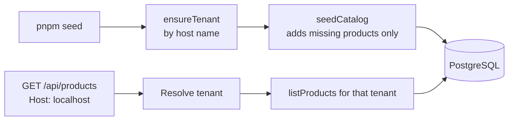

# Work package 2 — Seed data and products route: implementation plan

**For whoever implements this, human or AI:** do the tasks in order. One task is one pull request. Steps use checkboxes for tracking. Work package 1 must be merged first.

**Goal:** one command creates a tenant with example products, and `GET /api/products` returns that tenant's products as JSON.

**Architecture:** seeding goes through the public services of the tenancy and catalog modules, never straight to the database, so it also exercises them. The route handler takes plain values and a `listProducts` function.

**Design:** `docs/architecture/agent-design-part-3-publisher-and-tenant.md`, section 4.

**Global constraints:** every rule in section 3 of `2026-11-16-build-plan-master.md` applies.



## Review focus

1. Running `pnpm seed` twice adds nothing the second time. Tasks 1 and 2.
2. `GET /api/products` for a tenant with no products returns `{"products":[]}`, not an error. Task 3.
3. `GET /api/products` on an unknown host returns 404 (already covered by work package 1; assert it once here). Task 3.
4. A missing `DATABASE_URL` makes `pnpm seed` stop with a clear message. Task 2.

---

### Task 1: Seed functions

**Files**
- Create: `modules/catalog/src/seed-products.ts`
- Modify: `modules/tenancy/src/tenancy-services.ts`
- Test: `modules/catalog/src/seed-products.test.ts`; extend `modules/tenancy/src/tenancy-services.test.ts`

**Interfaces produced**

```ts
// modules/catalog/src/seed-products.ts
export type SeedProduct = Omit<NewProduct, "tenantId">;
export const SEED_PRODUCTS: readonly SeedProduct[]; // exactly the six rows below
export function seedCatalog(input: {
  tenantId: string;
  seedProducts: readonly SeedProduct[];
  listProducts: (input: { tenantId: string }) => Promise<ProductSummary[]>;
  addProduct: (product: NewProduct) => Promise<ProductSummary>;
}): Promise<number>; // number of products added

// modules/tenancy/src/tenancy-services.ts: new service, also exposed in the ServiceMap as ensureTenant
export function ensureTenant(input: {
  slug: string; name: string; primaryHost: string;
  findTenantByHost: TenancyDatabase["findTenantByHost"];
  insertTenant: TenancyDatabase["insertTenant"];
  normalise: (host: string) => string;
}): Promise<TenantRecord>; // the existing tenant for that host, or a new one
```

Seed rows (`currencyCode` is `"GBP"` for all):

| handle | title | sku | priceMinor |
|---|---|---|---|
| `rope-lead` | Rope lead | `LEAD-ROPE` | 1800 |
| `leather-collar` | Leather collar | `COLLAR-LEATHER` | 2400 |
| `treat-pouch` | Treat pouch | `POUCH-TREAT` | 1200 |
| `travel-bowl` | Travel bowl | `BOWL-TRAVEL` | 900 |
| `chew-toy` | Chew toy | `TOY-CHEW` | 700 |
| `drying-towel` | Drying towel | `TOWEL-DRY` | 1500 |

- [ ] **Step 1: write the failing tests** with array-backed fakes:
  - `seedCatalog` on an empty tenant returns `6` and `listProducts` then has six handles.
  - a second `seedCatalog` call returns `0`.
  - with `rope-lead` already present, it returns `5`.
  - `ensureTenant` called twice with host `LOCALHOST:3000` returns the same `tenantId` and the fake holds one tenant.
- [ ] **Step 2: run** `pnpm test`; expect failures.
- [ ] **Step 3: implement.** `seedCatalog` lists once, filters the seed rows whose handle is absent, and adds them one after another.
- [ ] **Step 4: run** `pnpm typecheck && pnpm test`; expect all to pass.
- [ ] **Step 5: commit** the named files; open the pull request.

### Task 2: The `pnpm seed` command

**Files**
- Create: `scripts/seed.ts`
- Modify: `package.json` (add `"seed": "node --env-file-if-exists=.env scripts/seed.ts"`), `README.md` (one "Seed data" section, three lines)
- Test: `scripts/seed.test.ts`; add `"scripts/**/*.test.ts"` to the `test` script's globs

**Interfaces produced**

```ts
// scripts/seed.ts
export function runSeed(input: {
  storeHost: string;
  ensureTenant: (input: { slug: string; name: string; primaryHost: string }) => Promise<{ tenantId: string }>;
  seedProducts: (input: { tenantId: string }) => Promise<number>;
  writeLine: (line: string) => void;
}): Promise<void>;
```

Behaviour: `runSeed` ensures a tenant with slug `demo`, name `Demo store` and the given host, seeds it, and writes exactly `Seeded <n> products for <host>`. The bottom of the file is the composition: it reads `DATABASE_URL` (throws `DATABASE_URL is not set. Add it to .env in the repository root.` when missing) and `STORE_HOST` (default `localhost`), calls `composeModules` from `apps/server/src/compose-modules.ts`, resolves the services with `resolveService`, runs `runSeed`, then calls `process.exit(0)` so open database connections do not keep the process alive. Guard the composition with `if (import.meta.main)` so importing the file in a test runs nothing.

- [ ] **Step 1: write the failing test** with fakes: `runSeed` calls `ensureTenant` with `{ slug: "demo", name: "Demo store", primaryHost: "localhost" }`, passes the returned `tenantId` to `seedProducts`, and writes `Seeded 6 products for localhost`.
- [ ] **Step 2: run** `pnpm test`; expect failure. **Implement.**
- [ ] **Step 3: run** `pnpm typecheck && pnpm test`. With a database: `pnpm db tenancy migrate deploy`, `pnpm db catalog migrate deploy`, then `pnpm seed` twice; expect `Seeded 6 products for localhost`, then `Seeded 0 products for localhost`.
- [ ] **Step 4: commit** the named files; open the pull request.

### Task 3: `GET /api/products`

**Files**
- Create: `apps/server/src/products-handler.ts`
- Modify: `apps/server/src/compose.ts`
- Test: `apps/server/src/products-route.test.ts`

**Interfaces produced**

```ts
export function handleListProducts(input: {
  tenantId: string;
  listProducts: (input: { tenantId: string }) => Promise<unknown[]>;
}): Promise<HttpReply>; // 200, content-type application/json, body { "products": [...] }
```

`compose.ts` adds the route `{ method: "GET", path: "/api/products", tenantScoped: true }`, taking `listProducts` from the registry: module `catalog`, service `listProducts`.

- [ ] **Step 1: write the failing tests** through `composeServer` with a fake registry (tenancy resolves `shop-a.example` to `tenant-a`; catalog `listProducts` returns one product for `tenant-a` and `[]` otherwise):
  - `Host: shop-a.example` returns 200 and `{ products: [{ handle: "rope-lead", ... }] }`.
  - a host that resolves to a tenant with no products returns 200 and `{"products":[]}`.
  - `Host: nobody.example` returns 404.
- [ ] **Step 2: run** `pnpm test`; expect failures. **Implement.**
- [ ] **Step 3: run** `pnpm typecheck && pnpm test`. With a seeded database: `pnpm dev`, then `curl -s -H "Host: localhost" http://localhost:3000/api/products`; expect six products.
- [ ] **Step 4: commit** the named files; open the pull request.

## Done when

All three pull requests are merged and, on a fresh database, `pnpm seed` followed by the `curl` above returns the six seed products.
