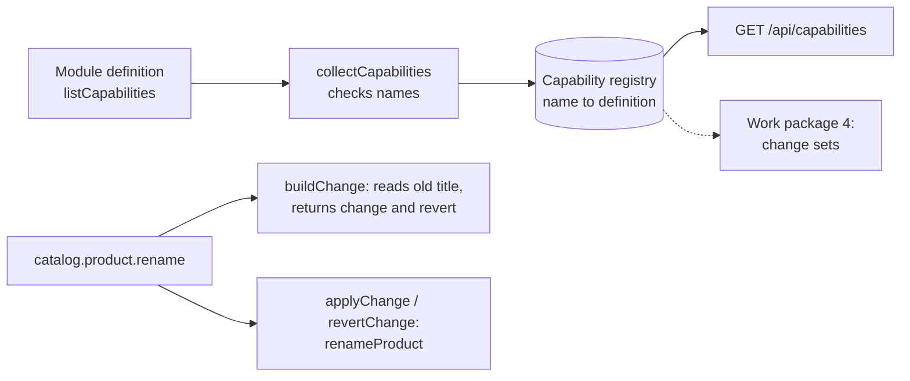

# Work package 3 — Capability registry: implementation plan

**For whoever implements this, human or AI:** do the tasks in order. One task is one pull request. Steps use checkboxes for tracking. Work package 2 must be merged first.

**Goal:** modules declare capabilities (typed, reversible store operations); the server collects them into one registry and lists them over HTTP. The first capability renames a product.

**Architecture:** a capability is data plus three functions: `buildChange` works out a change and its undo without writing, `applyChange` performs it, `revertChange` undoes it. Nothing calls `applyChange` in this package; change sets (work package 4) will. The registry is what the agent connection later exposes as tools.

**Design:** `docs/architecture/agent-design-part-1-core.md`, section 4.

**Global constraints:** every rule in section 3 of `2026-11-16-build-plan-master.md` applies.



## Review focus

1. Two modules declaring the same capability name must fail at start-up, not silently overwrite. Task 1.
2. A capability whose name does not start with its module's name and a dot must fail at start-up. Task 1.
3. Input with a missing required field or a wrong type is reported by field name before `buildChange` runs. Task 2.
4. Renaming a product of another tenant, or one that does not exist, fails with `Product not found` and changes nothing. Tasks 3 and 4.
5. `revert` restores the exact previous title. Task 4.

---

### Task 1: Capability types and collection

**Files**
- Create: `packages/core/src/capability-types.ts`, `packages/core/src/capability-registry.ts`
- Modify: `packages/core/src/module-types.ts`, `packages/core/src/index.ts` (export the new names)
- Test: `packages/core/src/capability-registry.test.ts`

**Interfaces produced**

```ts
// capability-types.ts
export type RiskTier = "low" | "medium" | "high";
export interface ChangeItem { capabilityName: string; tenantId: string; summary: string; change: unknown; revert: unknown }
export interface CapabilityDefinition {
  name: string; // "<module>.<noun>.<verb>", for example "catalog.product.rename"
  summary: string;
  inputSchema: Record<string, unknown>; // JSON Schema of type "object"
  risk: RiskTier;
  buildChange: (input: { tenantId: string; candidate: unknown }) => Promise<ChangeItem>;
  applyChange: (input: { tenantId: string; change: unknown }) => Promise<void>;
  revertChange: (input: { tenantId: string; revert: unknown }) => Promise<void>;
}
export type CapabilityRegistry = Record<string, CapabilityDefinition>;

// module-types.ts: one optional field added to ModuleDefinition
listCapabilities?: (input: { services: ServiceMap }) => CapabilityDefinition[];

// capability-registry.ts
export function collectCapabilities(input: { definitions: ModuleDefinition[]; registry: ModuleRegistry }): CapabilityRegistry;
```

Errors, exact text: `Capability "<name>" is declared twice` and `Capability "<name>" must start with "<module>."`.

- [ ] **Step 1: write the failing tests** with two inline module definitions:
  - a module with one capability yields a registry with that single key.
  - a module without `listCapabilities` contributes nothing.
  - the same name from two modules throws the "declared twice" error.
  - module `catalog` declaring `orders.order.cancel` throws the "must start with" error.
- [ ] **Step 2: run** `pnpm test`; expect failures. **Step 3: implement.**
- [ ] **Step 4: run** `pnpm typecheck && pnpm test`. **Step 5: commit** the named files; open the pull request.

### Task 2: Input checking

**Files**
- Create: `packages/core/src/capability-input.ts`; modify `packages/core/src/index.ts`
- Test: `packages/core/src/capability-input.test.ts`

**Interface produced**

```ts
export function listInputProblems(input: { inputSchema: Record<string, unknown>; candidate: unknown }): string[];
```

Supported schema subset: top-level `required: string[]` and `properties: { [field]: { type: "string" | "number" | "boolean" } }`. Problem texts, exact: `Input must be an object`, `Missing field: <field>`, `Field <field> must be a <type>`. Unknown extra fields are allowed.

- [ ] **Step 1: write the failing tests** for schema `{ type: "object", required: ["productId", "title"], properties: { productId: { type: "string" }, title: { type: "string" } } }`:
  - `{ productId: "p1", title: "Lead" }` gives `[]`.
  - `{ productId: "p1" }` gives `["Missing field: title"]`.
  - `{ productId: 7, title: "Lead" }` gives `["Field productId must be a string"]`.
  - `"text"` gives `["Input must be an object"]`.
- [ ] **Step 2: run**, expect failures. **Step 3: implement** as small functions, each within the two-branch rule.
- [ ] **Step 4: run** `pnpm typecheck && pnpm test`. **Step 5: commit**; open the pull request.

### Task 3: Catalog can find and rename a product

**Files**
- Modify: `modules/catalog/src/catalog-services.ts`, `modules/catalog/src/prisma-catalog-database.ts`, `modules/catalog/src/catalog-services.test.ts`, `modules/catalog/src/catalog-database.test.ts`

**Interfaces produced**

```ts
// added to CatalogDatabase
findProductById: (input: { tenantId: string; productId: string }) => Promise<ProductSummary | undefined>;
updateProductTitle: (input: { tenantId: string; productId: string; title: string }) => Promise<number>; // rows changed: 0 or 1
// added services
findProduct(input: { tenantId: string; productId: string }): Promise<ProductSummary | undefined>
renameProduct(input: { tenantId: string; productId: string; title: string }): Promise<void> // throws Error("Product not found") when 0 rows changed
```

The adapter must filter both queries by `tenantId` and `productId` together (`updateMany` for the rename).

- [ ] **Step 1: extend the unit test**: rename then find returns the new title; renaming an unknown id rejects with `Product not found`.
- [ ] **Step 2: extend the database test**: with two tenants, renaming tenant A's product while passing tenant B's id rejects and leaves the title unchanged.
- [ ] **Step 3: run**, expect failures. **Step 4: implement.**
- [ ] **Step 5: run** `pnpm typecheck && pnpm test` and the database test with `--env-file=.env`. **Step 6: commit**; open the pull request.

### Task 4: The `catalog.product.rename` capability

**Files**
- Create: `modules/catalog/src/catalog-capabilities.ts`; modify `modules/catalog/src/index.ts` (set `listCapabilities`)
- Test: `modules/catalog/src/catalog-capabilities.test.ts`

**Interface produced**

```ts
export function buildRenameCapability(input: {
  findProduct: (input: { tenantId: string; productId: string }) => Promise<{ title: string } | undefined>;
  renameProduct: (input: { tenantId: string; productId: string; title: string }) => Promise<void>;
}): CapabilityDefinition;
```

Fixed values: `name: "catalog.product.rename"`, `summary: "Change a product's title"`, `risk: "low"`, and the schema used in task 2. `buildChange` returns `{ capabilityName, tenantId, summary: 'Rename "<old>" to "<new>"', change: { productId, title: <new> }, revert: { productId, title: <old> } }` and throws `Product not found` for an unknown product. `applyChange` and `revertChange` call `renameProduct` with the stored title.

- [ ] **Step 1: write the failing tests** with fake services holding one product titled `Lead`:
  - `buildChange` for title `Rope lead` returns the summary `Rename "Lead" to "Rope lead"` and the `change` and `revert` above, and does not call `renameProduct`.
  - `applyChange` then `revertChange` leaves the title `Lead`.
  - `buildChange` for an unknown product rejects with `Product not found`.
- [ ] **Step 2: run**, expect failures. **Step 3: implement.**
- [ ] **Step 4: run** `pnpm typecheck && pnpm test`. **Step 5: commit**; open the pull request.

### Task 5: `GET /api/capabilities`

**Files**
- Create: `apps/server/src/capabilities-handler.ts`
- Modify: `apps/server/src/compose-modules.ts` (return `{ registry, capabilities }`), `apps/server/src/compose.ts`, `apps/server/src/main.ts`, `scripts/seed.ts`, existing server tests that build a fake registry
- Test: `apps/server/src/capabilities-route.test.ts`

**Interface produced**

```ts
export function handleListCapabilities(input: { capabilities: CapabilityRegistry }): Promise<HttpReply>;
// 200, body { "capabilities": [{ "name", "summary", "inputSchema", "risk" }] } sorted by name; functions are never serialised
```

The route is `{ method: "GET", path: "/api/capabilities", tenantScoped: false }`. `composeServer` gains a `capabilities: CapabilityRegistry` input.

- [ ] **Step 1: write the failing test**: with a registry holding the rename capability, the route returns 200 and one entry whose keys are exactly `name`, `summary`, `inputSchema`, `risk`.
- [ ] **Step 2: run**, expect failure. **Step 3: implement.**
- [ ] **Step 4: run** `pnpm typecheck && pnpm test`; with `pnpm dev`, `curl -s http://localhost:3000/api/capabilities` lists `catalog.product.rename`.
- [ ] **Step 5: commit**; open the pull request.

## Done when

All five pull requests are merged and the running server lists `catalog.product.rename` at `/api/capabilities`.
