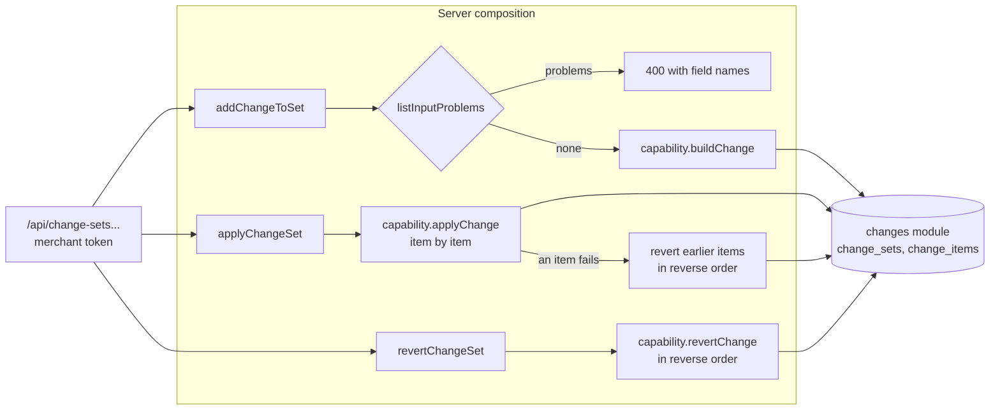
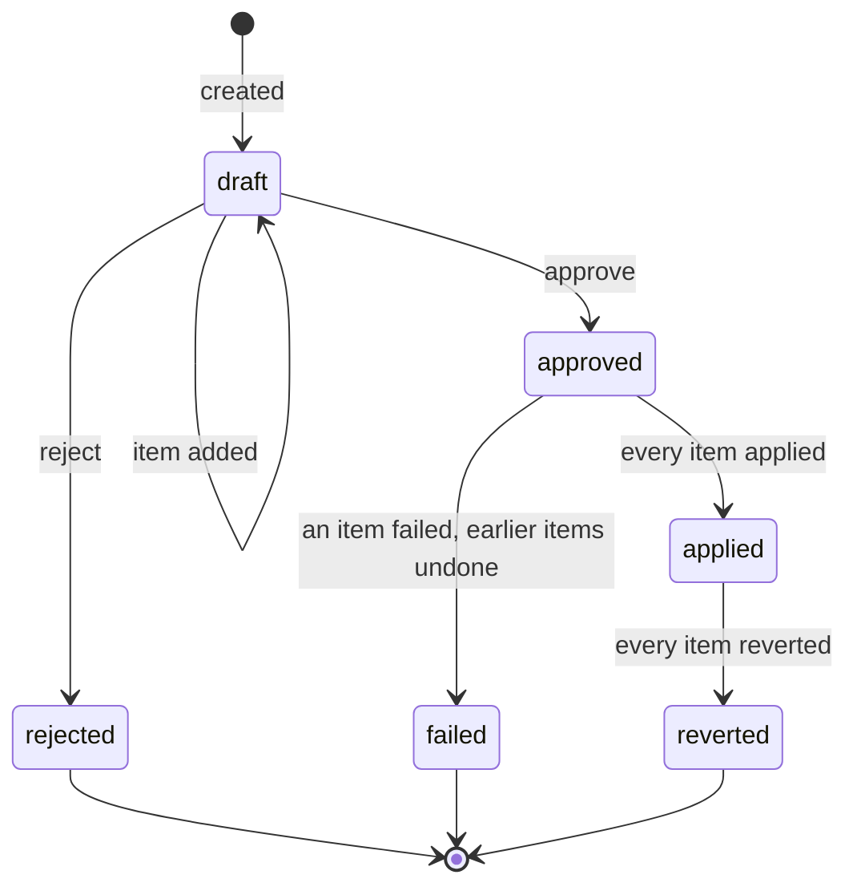

# Work package 4 — Change sets: implementation plan

**For whoever implements this, human or AI:** do the tasks in order. One task is one pull request. Steps use checkboxes for tracking. Work package 3 must be merged first.

**Goal:** a merchant or an agent collects capability changes into a change set, reads what it will do, approves or rejects it, applies it all or nothing, and reverts it with one action.

**Architecture:** a new `changes` module stores change sets and their items, and owns the state rules. It never imports another module and never calls a capability. The steps that need both the change set and the capability registry (adding an item, applying, reverting) are workflows in `apps/server/src/change-sets/`, composed by the server. Merchant routes are guarded by a token until the identity socket exists (work package 5).

**Design:** `docs/architecture/agent-design-part-1-core.md`, section 6; risk tiers in `agent-design-part-2-optimiser-and-safety.md`, section 3.

**Global constraints:** every rule in section 3 of `2026-11-16-build-plan-master.md` applies.





The design's "Previewable" state is not stored: every item is built when it is added, so a draft can always be read. Rendering the storefront as if the change set were applied comes with store as data (work package 6). Automatic approval of low-risk changes comes with the agent connection (work package 7); in this package every change set needs an explicit approval.

## Review focus

1. Applying is all or nothing: when the second of three items fails, the first is reverted, the third is never applied, and the change set ends `failed` with the error message stored. Task 5.
2. A change set of tenant A cannot be read, changed, applied or reverted through tenant B's host: it answers 404 `Change set not found`. Tasks 3 and 7.
3. State moves are checked in the database, not only in memory: of two concurrent `apply` calls on one approved change set, only one moves it to `applying`; the other rejects with `Change set cannot move from approved to applying` and applies nothing. Tasks 1, 2 and 5.
4. Items cannot be added to a change set that is not `draft`. Task 3.
5. With `MERCHANT_TOKEN` unset, no change-set route exists (404); with it set, a wrong or missing token answers 401. Task 6.

---

### Task 1: The `changes` module and its tables

**Files**
- Create: `modules/changes/package.json` (copy of the catalog module's, name `@the-market/module-changes`), `modules/changes/prisma/schema.prisma`, `modules/changes/prisma/migrations/20261117000000_init/migration.sql`, `modules/changes/src/prisma-changes-database.ts`, `modules/changes/src/index.ts`
- Modify: `apps/server/package.json` (dependency `@the-market/module-changes: workspace:*`), `apps/server/src/compose-modules.ts` (add `changesModule` to the list), `.github/workflows/ci.yml` (add `pnpm db changes migrate deploy`), `pnpm-lock.yaml`
- Test: `modules/changes/src/changes-database.test.ts` (database test, skipped without `DATABASE_URL`)

**Schema** (PostgreSQL schema `changes`):

```prisma
model ChangeSet {
  changeSetId   String       @id @default(uuid()) @map("change_set_id") @db.Uuid
  tenantId      String       @map("tenant_id") @db.Uuid
  title         String
  state         String       @default("draft") // draft | approved | rejected | applying | applied | failed | reverting | reverted
  proposedBy    String       @map("proposed_by")
  approvedBy    String       @default("") @map("approved_by")
  failureReason String       @default("") @map("failure_reason")
  createdAt     DateTime     @default(now()) @map("created_at") @db.Timestamptz
  updatedAt     DateTime     @updatedAt @map("updated_at") @db.Timestamptz
  items         ChangeItem[]

  @@index([tenantId])
  @@map("change_sets")
}

model ChangeItem {
  itemId         String    @id @default(uuid()) @map("item_id") @db.Uuid
  tenantId       String    @map("tenant_id") @db.Uuid
  changeSetId    String    @map("change_set_id") @db.Uuid
  position       Int
  capabilityName String    @map("capability_name")
  summary        String
  change         Json
  revert         Json
  changeSet      ChangeSet @relation(fields: [changeSetId], references: [changeSetId])

  @@unique([changeSetId, position])
  @@index([tenantId])
  @@map("change_items")
}
```

`applying` and `reverting` are short-lived states held while a workflow runs; they make a second concurrent apply or revert fail (Review focus 3).

**Port produced** (`modules/changes/src/changes-services.ts` declares it in task 2; in this task the adapter defines and exports the same interface):

```ts
export interface ChangeItemRecord { itemId: string; position: number; capabilityName: string; summary: string; change: unknown; revert: unknown }
export interface ChangeSetRecord { changeSetId: string; tenantId: string; title: string; state: string; proposedBy: string; approvedBy: string; failureReason: string; items: ChangeItemRecord[] }
export interface ChangesDatabase {
  insertChangeSet: (input: { tenantId: string; title: string; proposedBy: string }) => Promise<ChangeSetRecord>;
  findChangeSet: (input: { tenantId: string; changeSetId: string }) => Promise<ChangeSetRecord | undefined>; // items ordered by position
  insertChangeItem: (input: { tenantId: string; changeSetId: string; capabilityName: string; summary: string; change: unknown; revert: unknown }) => Promise<ChangeItemRecord>; // position = current item count
  updateState: (input: { tenantId: string; changeSetId: string; fromState: string; toState: string; approvedBy: string; failureReason: string }) => Promise<number>; // rows changed, 0 or 1; matches tenant, id and fromState together
}
```

`approvedBy` and `failureReason` of `""` leave the stored value unchanged.

- [ ] **Step 1: write the failing database test**: with two random tenants, insert a change set for A with two items; `findChangeSet` for A returns both items in position order 0, 1; for B returns `undefined`; `updateState` from `draft` to `approved` returns 1, again from `draft` returns 0; with tenant B's id returns 0. Clean up both tenants' rows in `finally`.
- [ ] **Step 2: write the schema, run** `pnpm db changes migrate dev --name init --create-only` against a scratch database or write the migration SQL by hand from the schema; check it creates schema-qualified tables in `changes`.
- [ ] **Step 3: implement the adapter**, then `pnpm install`, `pnpm typecheck && pnpm test`, `pnpm db changes migrate deploy`, and `node --env-file=.env --test modules/changes/src/changes-database.test.ts`.
- [ ] **Step 4: commit** the named files (never `generated/`); open the pull request. The lockfile does not count towards the 200 lines.

### Task 2: Change set services and state rules

**Files**
- Create: `modules/changes/src/changes-services.ts`, `modules/changes/src/change-set-states.ts`
- Modify: `modules/changes/src/index.ts` (register the services), `modules/changes/src/prisma-changes-database.ts` (import the port from the services file)
- Test: `modules/changes/src/change-set-states.test.ts`, `modules/changes/src/changes-services.test.ts`

**Interfaces produced**

```ts
// change-set-states.ts
export const ALLOWED_MOVES: Readonly<Record<string, readonly string[]>> = {
  draft: ["approved", "rejected"],
  approved: ["applying"],
  applying: ["applied", "failed"],
  applied: ["reverting"],
  reverting: ["reverted"],
};
export function isAllowedMove(input: { fromState: string; toState: string }): boolean;

// changes-services.ts, exposed in the ServiceMap under the same names
createChangeSet(input: { tenantId: string; title: string; proposedBy: string }): Promise<ChangeSetRecord>
findChangeSet(input: { tenantId: string; changeSetId: string }): Promise<ChangeSetRecord | undefined>
addChangeItem(input: { tenantId: string; changeSetId: string; capabilityName: string; summary: string; change: unknown; revert: unknown }): Promise<ChangeItemRecord>
moveChangeSet(input: { tenantId: string; changeSetId: string; fromState: string; toState: string; approvedBy: string; failureReason: string }): Promise<void>
```

Errors, exact text:
- `Change set not found`: the tenant has no such change set (any service).
- `Change set is not a draft`: `addChangeItem` on a change set whose state is not `draft`.
- `Change set cannot move from <fromState> to <toState>`: `isAllowedMove` is false, or `updateState` changed 0 rows because the stored state is no longer `fromState`.

- [ ] **Step 1: write the failing tests**, with an array-backed fake `ChangesDatabase`:
  - `isAllowedMove` is true for every pair in `ALLOWED_MOVES`, and false for `draft → applied`, `rejected → approved` and `reverted → reverting`.
  - create, add two items, find: items at positions 0 and 1.
  - `addChangeItem` after `moveChangeSet` to `approved` rejects with `Change set is not a draft`.
  - `moveChangeSet` from `draft` to `applied` rejects with `Change set cannot move from draft to applied` and changes nothing.
  - `moveChangeSet` with a stale `fromState` (stored state is `approved`, caller says `draft` to `rejected`) rejects with `Change set cannot move from draft to rejected`.
  - every service with another tenant's id rejects with `Change set not found` (find returns `undefined`).
- [ ] **Step 2: run**, expect failures. **Step 3: implement**, each function within two branches; called functions passed in as in `catalog-services.ts`.
- [ ] **Step 4: run** `pnpm typecheck && pnpm test`. **Step 5: commit**; open the pull request.

### Task 3: The add-change workflow

**Files**
- Create: `apps/server/src/change-sets/add-change-workflow.ts`
- Test: `apps/server/src/change-sets/add-change-workflow.test.ts`

**Interface produced**

```ts
export function addChangeToSet(input: {
  tenantId: string;
  changeSetId: string;
  capabilityName: string;
  candidate: unknown;
  capabilities: CapabilityRegistry;
  listProblems: typeof listInputProblems;
  addItem: (input: { tenantId: string; changeSetId: string; capabilityName: string; summary: string; change: unknown; revert: unknown }) => Promise<ChangeItemRecord>;
}): Promise<ChangeItemRecord>;
```

Order: find the capability (`Unknown capability: <name>`), check the input (`Invalid input: <problems joined with "; ">`), `buildChange`, then `addItem` with the built `summary`, `change` and `revert`. Nothing is stored when any step fails.

- [ ] **Step 1: write the failing tests** with a fake registry holding a rename-like capability and an array `addItem`:
  - valid input stores one item whose summary, change and revert come from `buildChange`.
  - unknown name rejects with `Unknown capability: catalog.product.delete` and stores nothing.
  - `{ productId: "p1" }` rejects with `Invalid input: Missing field: title`, does not call `buildChange` and stores nothing.
  - a `buildChange` that rejects with `Product not found` stores nothing and rejects with the same message.
  - an `addItem` that rejects with `Change set is not a draft` passes that error through.
- [ ] **Step 2: run**, expect failures. **Step 3: implement.** **Step 4: run** `pnpm typecheck && pnpm test`. **Step 5: commit**; open the pull request.

Tasks 4 to 7 (approve and reject, apply and revert, the merchant token guard, the routes) and the "Done when" line are in part 2: `2026-11-17-wp4-change-sets-part-2.md`.
