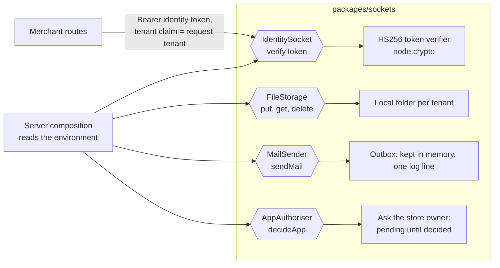

# Work package 5 — Sockets: implementation plan

**For whoever implements this, human or AI:** do the tasks in order. One task is one pull request. Steps use checkboxes for tracking. Work package 1 must be merged first; tasks 6 and 7 also need work package 4.

**Goal:** the tenant app depends on four interfaces, never on a vendor: identity, file storage, mail and app authorisation. Each has a plain default that a self-hosted store can run with nothing else, and merchants sign in with an identity token instead of the shared merchant token.

**Architecture:** a new package `packages/sockets` holds the interfaces and the defaults. Defaults use only Node built-ins. The server composition picks the implementations from the environment. Hosted implementations (Supabase, the publisher) are added later behind the same interfaces, in the publisher's folder.

**Design:** `docs/architecture/agent-design-part-3-publisher-and-tenant.md`, sections 2 and 3.

**Global constraints:** every rule in section 3 of `2026-11-16-build-plan-master.md` applies. Size each pull request at about 120 lines of code and tests, so that it stays under 200 with its log entry.



## Interfaces (task 1 produces them; every later task uses them)

```ts
export interface Identity { subject: string; tenantId: string; role: string }
export interface IdentitySocket { verifyToken: (input: { token: string }) => Promise<Identity | undefined> }
export interface StoredFile { contentType: string; bytes: Uint8Array }
export interface FileStorage {
  putFile: (input: { tenantId: string; fileKey: string; contentType: string; bytes: Uint8Array }) => Promise<void>;
  getFile: (input: { tenantId: string; fileKey: string }) => Promise<StoredFile | undefined>;
  deleteFile: (input: { tenantId: string; fileKey: string }) => Promise<void>;
}
export interface MailSender { sendMail: (input: { tenantId: string; toAddress: string; subject: string; textBody: string }) => Promise<void> }
export type AppDecision = "allowed" | "refused" | "pending";
export interface AppAuthoriser {
  decideApp: (input: { tenantId: string; appUrl: string; permissions: string[] }) => Promise<AppDecision>;
}
export const FILE_KEY_PATTERN = /^[a-z0-9][a-z0-9._-]{0,127}$/; // no slashes, no "..", lowercase
```

## Review focus

1. A token signed with another secret, an expired token, a token with `alg` other than `HS256` (including `none`), or a malformed token is refused, never accepted. Task 2.
2. A merchant token for tenant A cannot act on tenant B's host. Task 6.
3. A file key such as `../other-tenant/logo.png` or `a/b` is refused before touching the disk; one tenant cannot read another's file. Task 3.
4. The defaults start with no configuration except where stated; a missing `IDENTITY_SECRET` disables identity (every token refused), it does not accept everything. Tasks 2 and 7.
5. The app authoriser never returns `allowed` without a recorded owner decision. Task 5.

---

### Task 1: The sockets package and its interfaces

**Files:** create `packages/sockets/package.json` (name `@the-market/sockets`, no dependencies), `packages/sockets/src/socket-types.ts` (the block above), `packages/sockets/src/index.ts`; modify `apps/server/package.json` (dependency `workspace:*`), `pnpm-lock.yaml`. Test: `packages/sockets/src/socket-types.test.ts`.

- [ ] **Step 1: write the failing test:** `FILE_KEY_PATTERN` accepts `logo.png`, `hero-1.webp`; refuses `../x`, `a/b`, `.hidden`, `Logo.png`, `""`, and a 129-character key.
- [ ] **Step 2: run**, expect failure. **Step 3: implement.** **Step 4:** `pnpm install`, `pnpm typecheck && pnpm test`. **Step 5: commit**; open the pull request.

### Task 2: Identity default — signed token verifier

**Files:** create `packages/sockets/src/token-identity.ts`; test `token-identity.test.ts`.

```ts
export function buildTokenIdentity(input: { secret: string; readNow: () => number }): IdentitySocket;
```

A token is `header.payload.signature`, each base64url. Accepted only when: the secret is non-empty; the header's `alg` is exactly `HS256`; the HMAC-SHA256 of `header.payload` with the secret equals the signature (constant-time compare); `exp` is a number greater than `readNow()` in seconds; `sub` is a non-empty string; the tenant claim is a non-empty string. Tenant claim: `app_metadata.tenant_id` (a convention the publisher sets; a self-hosted owner sets it in their own issuer). Role: `app_metadata.role`, default `"merchant"`.

- [ ] **Step 1: write the failing tests** with tokens built in the test by a small `signTestToken(payload, secret)` helper: valid token returns `{ subject, tenantId, role }`; wrong secret, `exp` in the past, `alg: "none"`, `alg: "HS512"`, two-part token, non-JSON payload, missing tenant claim, and empty configured secret each return `undefined`.
- [ ] **Step 2: run**, expect failures. **Step 3: implement** as small functions (split, decode, verify signature, read claims), each within two branches.
- [ ] **Step 4: run** checks. **Step 5: commit**; open the pull request.

### Task 3: File storage default — local folder

**Files:** create `packages/sockets/src/folder-storage.ts`, `packages/sockets/src/memory-storage.ts`; test `folder-storage.test.ts`.

```ts
export function buildFolderStorage(input: { rootFolder: string; files: FolderFiles }): FileStorage;
export interface FolderFiles { // node:fs/promises, passed in
  writeFile: (path: string, bytes: Uint8Array) => Promise<void>;
  readFile: (path: string) => Promise<Uint8Array>;
  rm: (path: string, options: { force: boolean }) => Promise<void>;
  mkdir: (path: string, options: { recursive: boolean }) => Promise<unknown>;
}
export function buildMemoryStorage(): FileStorage; // for tests and for running with no disk
```

Layout: `<rootFolder>/<tenantId>/<fileKey>` plus `<fileKey>.type` holding the content type. A key failing `FILE_KEY_PATTERN` rejects with `Invalid file key`. `getFile` of a missing file returns `undefined`.

- [ ] **Step 1: write the failing tests** against a temporary folder (`fs.mkdtemp`): put then get returns the bytes and type; tenant B gets `undefined` for tenant A's key; `../x` and `a/b` reject with `Invalid file key` and write nothing; delete then get is `undefined`. The same put/get/tenant tests run against `buildMemoryStorage`.
- [ ] **Step 2–5:** run, implement, run checks, commit; open the pull request.

### Task 4: Mail default — outbox

**Files:** create `packages/sockets/src/outbox-mail.ts`; test `outbox-mail.test.ts`.

```ts
export function buildOutboxMail(input: { writeLine: (line: string) => void }): MailSender & { listSent: (input: { tenantId: string }) => SentMail[] };
export interface SentMail { toAddress: string; subject: string; textBody: string }
```

Sends nothing over the network: keeps each message per tenant and writes `Mail to <address>: <subject>`. An address without exactly one `@` with text on both sides rejects with `Invalid mail address`.

- [ ] **Step 1: write the failing tests:** two sends for tenant A are listed in order for A and not for B; the log line is exact; `nobody` and `a@b@c` reject.
- [ ] **Step 2–5:** run, implement, run checks, commit; open the pull request.

### Task 5: App authoriser default — ask the store owner

**Files:** create `packages/sockets/src/owner-authoriser.ts`; test `owner-authoriser.test.ts`.

```ts
export function buildOwnerAuthoriser(): AppAuthoriser & {
  recordDecision: (input: { tenantId: string; appUrl: string; decision: "allowed" | "refused" }) => void;
  listPending: (input: { tenantId: string }) => Array<{ appUrl: string; permissions: string[] }>;
};
```

`decideApp` returns the recorded decision for `(tenantId, appUrl)` or records the request as pending and returns `"pending"`. A decision covers the permissions asked when it was recorded; asking again with a permission not in that set returns `"pending"` again. Decisions are kept in memory in this package; work package 10 stores them.

- [ ] **Step 1: write the failing tests:** first ask is `pending` and listed; after `allowed`, the same ask is `allowed`; asking with an extra permission is `pending`; tenant B's ask for the same app is `pending`; `refused` is returned as `refused`.
- [ ] **Step 2–5:** run, implement, run checks, commit; open the pull request.

### Task 6: Merchants sign in with an identity token

**Files:** modify `apps/server/src/merchant-token.ts` (rename the guard input), `apps/server/src/compose.ts`; test: extend `merchant-token.test.ts`.

```ts
export function matchesMerchant(input: {
  authorization: string; tenantId: string; merchantToken: string;
  verifyToken: IdentitySocket["verifyToken"];
}): Promise<boolean>;
```

Allowed when either the shared `MERCHANT_TOKEN` matches (kept for local development), or the bearer token verifies and its `tenantId` equals the request's tenant and its role is `merchant` or `owner`. Merchant routes are mounted when `MERCHANT_TOKEN` or `IDENTITY_SECRET` is set.

- [ ] **Step 1: write the failing tests:** a valid identity token for tenant A is allowed on A's host and refused (401) on B's host; a token with role `shopper` is refused; the shared token still works; with neither configured, routes are not mounted.
- [ ] **Step 2–5:** run, implement, run checks, commit; open the pull request.

### Task 7: Compose the sockets from the environment

**Files:** create `apps/server/src/compose-sockets.ts`; modify `apps/server/src/main.ts`, `README.md` (one "Sockets" section); test `compose-sockets.test.ts`.

```ts
export function composeSockets(input: { environment: Record<string, string | undefined>; readNow: () => number; writeLine: (line: string) => void; files: FolderFiles }): { identity: IdentitySocket; storage: FileStorage; mail: MailSender; authoriser: AppAuthoriser };
```

`IDENTITY_SECRET` (empty: every token refused), `FILES_FOLDER` (unset: memory storage), mail and authoriser always the defaults until hosted ones exist.

- [ ] **Step 1: write the failing tests:** empty environment gives memory storage and an identity that refuses a well-signed token; with `IDENTITY_SECRET` the same token verifies; with `FILES_FOLDER` a put lands in that folder.
- [ ] **Step 2–5:** run, implement, run checks; start the server with `IDENTITY_SECRET` set and call `GET /api/change-sets/<id>` with a signed token for `localhost`'s tenant (200 or 404, not 401) and for another tenant (401). Commit; open the pull request.

## Done when

All seven pull requests are merged, and a merchant with a signed identity token for one store can use that store's change-set routes and no other store's.

## Open for later

- Which signing method the hosted Supabase project uses (a shared HS256 secret, or asymmetric keys published as a JSON Web Key Set) must be checked in its settings before work package 12. If it is asymmetric keys, the hosted `IdentitySocket` verifies against that key set; the default here stays HS256.
