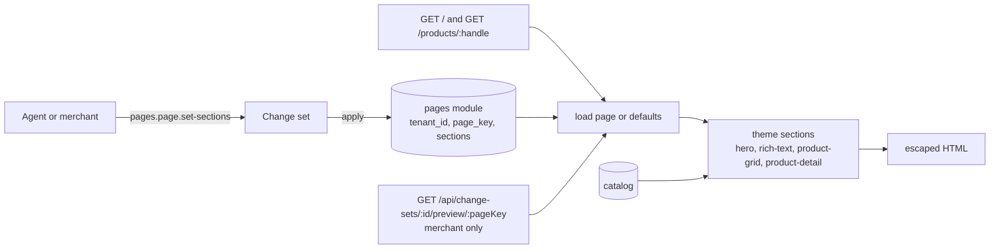

# Work package 6 — Store as data: implementation plan

**For whoever implements this, human or AI:** do the tasks in order. One task is one pull request. Steps use checkboxes for tracking. Work package 4 must be merged first.

**Goal:** a page is data — an ordered list of sections with settings — and the storefront renders the home page and each product page from it. The agent (or the merchant) changes a page through a capability, so the change goes through a change set and can be previewed and reverted. A store with no saved pages still renders, from default sections.

**Architecture:** a new `pages` module stores one row per page per tenant. Section code lives in `packages/theme-engine/src/sections/`: each section is a TypeScript function with a settings schema. The `pages.page.set-sections` capability checks a candidate page against those schemas. The server renders storefront routes as HTML with every value escaped; no script runs in this package (app slots and HTMX arrive with work package 10).

**Design:** `docs/architecture/agent-design-part-1-core.md`, sections 2 and 5.

**Global constraints:** every rule in section 3 of `2026-11-16-build-plan-master.md` applies. Size each pull request at about 120 lines of code and tests.



## Shared shapes

```ts
// packages/theme-engine/src/sections/section-types.ts
export interface PageSection { sectionType: string; settings: Record<string, unknown> }
export interface ProductCard { handle: string; title: string; priceText: string }
export interface PageData { storeName: string; products: ProductCard[]; product: ProductCard | undefined }
export interface SectionDefinition {
  sectionType: string;
  pageKeys: readonly string[];            // where it may be used: "home", "product"
  settingsSchema: Record<string, unknown>; // same subset as capability input
  renderSection: (input: { settings: Record<string, unknown>; pageData: PageData; escape: (text: string) => string }) => string;
}
export const PAGE_KEYS = ["home", "product"] as const;
```

## Review focus

1. Every value from the store (titles, settings, handles) is HTML-escaped: a product titled `<script>alert(1)</script>` renders as text. Task 4.
2. A page with an unknown section type, a section not allowed on that page, or settings failing the section's schema is refused by the capability before anything is stored. Task 5.
3. Tenant A's page never renders on tenant B's host; a store with no saved page renders the default sections. Task 6.
4. Reverting a `set-sections` change on a page that did not exist before removes it, so the defaults show again. Task 5.
5. Preview shows a draft change set's page without applying it, and only to a merchant of that store. Task 7.

---

### Task 1: Capability input accepts arrays and objects

**Files:** modify `packages/core/src/capability-input.ts`; extend `capability-input.test.ts`.

A property type may also be `"array"` (checked with `Array.isArray`) or `"object"` (a plain object, not an array, not null). Problem texts: `Field <field> must be an array` and `Field <field> must be an object`; the existing `must be a string`, `a number`, `a boolean` stay as they are.

- [ ] **Step 1: failing tests:** `{ sections: [] }` passes for type array; `{ sections: {} }` gives `Field sections must be an array`; `{ settings: [] }` gives `Field settings must be an object`; `{ settings: null }` gives `Field settings must be an object`; existing string, number and boolean tests still pass.
- [ ] **Step 2–5:** run, implement as one more small function chosen by a lookup table of type checks (no new branches), run checks, commit; open the pull request.

### Task 2: The `pages` module and its table

**Files:** create `modules/pages/` (package, Prisma schema, migration `20261118000000_init`, adapter `prisma-pages-database.ts`, `pages-types.ts`, `index.ts`, database test); modify `apps/server/package.json`, `apps/server/src/compose-modules.ts`, `.github/workflows/ci.yml`, `pnpm-lock.yaml`. Split into the table and the adapter if it exceeds 200 lines, as done for the changes module.

```prisma
model Page {
  pageId    String   @id @default(uuid()) @map("page_id") @db.Uuid
  tenantId  String   @map("tenant_id") @db.Uuid
  pageKey   String   @map("page_key")   // home | product
  sections  Json                         // PageSection[]
  updatedAt DateTime @updatedAt @map("updated_at") @db.Timestamptz
  @@unique([tenantId, pageKey])
  @@map("pages")
}
```

```ts
export interface PagesDatabase {
  findPage: (input: { tenantId: string; pageKey: string }) => Promise<PageSection[] | undefined>;
  savePage: (input: { tenantId: string; pageKey: string; sections: PageSection[] }) => Promise<void>; // upsert
  removePage: (input: { tenantId: string; pageKey: string }) => Promise<void>;
}
```

- [ ] **Step 1: failing database test** with two random tenants: save then find returns the sections in order; tenant B finds `undefined`; saving again replaces; remove then find is `undefined`.
- [ ] **Step 2–5:** migration by `prisma migrate diff --from-empty`, implement, `pnpm db pages migrate deploy`, run the database test, commit; open the pull request(s).

### Task 3: Pages services

**Files:** create `modules/pages/src/pages-services.ts`; modify `index.ts`; test `pages-services.test.ts`. Services `findPage`, `savePage`, `removePage`, each taking `tenantId`; `pageKey` must be in `PAGE_KEYS` or the call rejects with `Unknown page: <key>`.

- [ ] Steps: failing tests with an array fake (save/find per tenant, unknown page key refused), implement, run checks, commit; open the pull request.

### Task 4: Theme sections and page rendering

**Files:** create `packages/theme-engine/src/sections/section-types.ts`, `escape-html.ts`, `default-sections.ts`, `render-page.ts`; modify `packages/theme-engine/src/index.ts`; tests beside each.

```ts
export function escapeHtml(text: string): string; // & < > " ' → entities
export const DEFAULT_SECTIONS: readonly SectionDefinition[]; // hero, rich-text, product-grid, product-detail
export const DEFAULT_PAGES: Readonly<Record<string, PageSection[]>>; // home: hero + product-grid; product: product-detail
export function renderPage(input: { sections: PageSection[]; pageData: PageData; definitions: readonly SectionDefinition[]; escape: typeof escapeHtml }): string; // a full HTML document
export function formatPrice(input: { priceMinor: number; currencyCode: string }): string; // Intl.NumberFormat("en-GB", currency) → "£18.00"
```

Sections: `hero` (`heading`, `subheading`; home), `rich-text` (`text`; home, product), `product-grid` (`heading`; home; lists every product as a link to `/products/<handle>` with its price), `product-detail` (no settings; product; title and price). An unknown section type renders nothing. The document has `<title>` = store name, `<main>` holding the sections in order, and no `<script>`.

- [ ] **Step 1: failing tests:** escaping of all five characters; the default home page shows the hero heading and one link per product; a product titled `<script>alert(1)</script>` appears escaped; `formatPrice({ priceMinor: 1800, currencyCode: "GBP" })` is `£18.00`; an unknown section type adds nothing.
- [ ] **Step 2–5:** run, implement, run checks, commit; open the pull request. Split sections from the page renderer if over 200 lines.

### Task 5: The `pages.page.set-sections` capability

**Files:** create `modules/pages/src/pages-capabilities.ts`; modify `modules/pages/src/index.ts` (`listCapabilities`), `modules/pages/package.json` (dependency on `@the-market/theme-engine`); test `pages-capabilities.test.ts`.

Fixed values: name `pages.page.set-sections`, summary `Set the sections of a page`, risk `low`, schema `{ required: ["pageKey", "sections"], properties: { pageKey: { type: "string" }, sections: { type: "array" } } }`. `buildChange` checks every section: known type (`Unknown section: <type>`), allowed on the page (`Section <type> cannot be used on <pageKey>`), settings valid (`Invalid settings for <type>: <problems>`). Summary: `Set <n> sections on the <pageKey> page`. Change `{ pageKey, sections }`; revert `{ pageKey, sections: <previous> }` or `{ pageKey, remove: true }` when no page existed. `revertChange` with `remove` calls `removePage`.

- [ ] **Step 1: failing tests** with fake services: a valid home page builds the right change and revert and stores nothing; each of the three refusals; apply then revert restores the previous sections; revert of a first-ever page removes it.
- [ ] **Step 2–5:** run, implement, run checks, commit; open the pull request.

### Task 6: Storefront routes

**Files:** create `apps/server/src/storefront/storefront-handlers.ts`, `apps/server/src/storefront/compose-storefront.ts`; modify `apps/server/src/compose.ts`; test `storefront-routes.test.ts`.

Routes, tenant-scoped, not merchant-only: `GET /` renders the `home` page; `GET /products/:handle` renders the `product` page for that product, or 404 HTML `Product not found` when the tenant has no product with that handle. Both use the saved page or `DEFAULT_PAGES`. Replies are `text/html; charset=utf-8`. Products come from the catalog's `listProducts` (filtered by handle for the product page; a direct lookup by handle can come later). Store name: the tenant's `name` — add a `findTenant({ tenantId })` service to tenancy if it is not there.

- [ ] **Step 1: failing tests** through `composeServer` with fakes: home lists both products of tenant A and none of tenant B; a saved page's hero heading replaces the default; `/products/rope-lead` shows its title and `£18.00`; `/products/nope` is 404; tenant B's saved page never shows on A's host.
- [ ] **Step 2–5:** run, implement, run checks; with the server running and the database seeded, `curl -H "Host: localhost" http://localhost:3000/` shows the six products. Commit; open the pull request.

### Task 7: Preview a change set's page

**Files:** create `apps/server/src/storefront/preview-handler.ts`; modify the change-set composition; test `preview-route.test.ts`.

`GET /api/change-sets/:changeSetId/preview/:pageKey`, merchant-only and tenant-scoped: renders the page as if the change set's `pages.page.set-sections` items for that page were applied (the last such item wins), without applying anything. Other items are ignored in this package.

- [ ] **Step 1: failing tests:** a draft with a hero change previews the new heading while `GET /` still shows the old one; a change set of another tenant is 404; without merchant access 401.
- [ ] **Step 2–5:** run, implement, run checks, commit; open the pull request.

## Done when

All pull requests are merged, and on the development database a change set that sets the home page's hero is previewed, applied (the storefront shows it), and reverted (the defaults show again).
