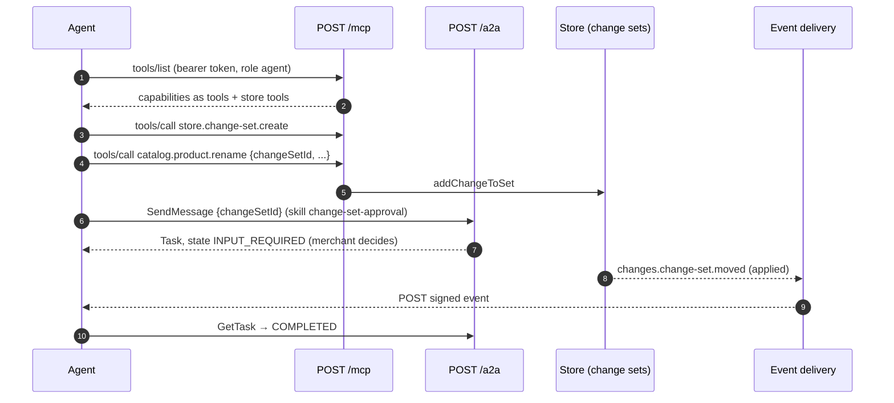

# Work package 7 — Agent connection: implementation plan

**For whoever implements this, human or AI:** do the tasks in order. One task is one pull request. Work packages 4 and 5 must be merged first.

**Goal:** any agent that speaks MCP, A2A and webhooks can drive one store: list the store's capabilities as tools, build changes into a change set, ask the merchant to approve through an A2A task, and hear what happened in the store through signed events.

**Architecture:** all three channels live in the server composition (they join several modules). Agents authenticate with an identity token whose role is `agent` and whose tenant is the request's store. MCP follows revision `2026-07-28`: one POST endpoint, no sessions, every request carries its version in `_meta`. A2A follows 1.0, the version of the existing `packages/a2a-gateway`. Events go to the store's registered agent URL, signed with HMAC-SHA256.

**Design:** `docs/architecture/agent-design-part-3-publisher-and-tenant.md`, section 5. MCP: https://modelcontextprotocol.io/specification/2026-07-28 (tools, `server/discover`, Streamable HTTP, versioning), read on 2026-11-17.

**Global constraints:** every rule in section 3 of `2026-11-16-build-plan-master.md` applies. Size each pull request at about 120 lines of code and tests.



## Review focus

1. A token for store A, or with a role other than `agent`, cannot reach store B's MCP or A2A endpoint (401). Tasks 1 and 3.
2. MCP header/body mismatches are refused with `400` and `-32020`; an unsupported version with `400` and `-32022` listing `["2026-07-28"]`; an invalid `Origin` with `403`. Task 2.
3. A failing capability call returns a tool result with `isError: true` and the message, not a JSON-RPC error; an unknown tool is a `-32602` JSON-RPC error. Task 3.
4. An agent can never approve: the A2A task only reports state; approval stays with the merchant. Task 5.
5. Events are signed and delivered only to the event's own store's connection; a delivery failure is logged and never breaks the request that caused the event. Task 8.

---

### Task 1: Agent access

**Files:** modify `apps/server/src/hono-adapter.ts` (add `headerValues: Record<string, string>` to `RouteRequest`, names lowercased), `apps/server/src/merchant-token.ts` (generalise `isMerchantOf` to `hasRoleIn({ identityTenantId, identityRole, tenantId, roles })`), create `apps/server/src/agent-access.ts`; test `agent-access.test.ts`.

```ts
export const AGENT_ROLES: readonly string[] = ["agent"];
export function matchesAgent(input: { authorization: string; tenantId: string; verifyToken; readBearer; hasRole }): Promise<boolean>;
export function guardAgentRoutes(input: { routes: Route[]; enabled: boolean; matches }): Route[]; // 401 {"error":"agent_token_required"}
```

Agent routes are mounted when `IDENTITY_SECRET` is set. The shared `MERCHANT_TOKEN` never opens agent routes.

- [ ] Steps: failing tests (agent token for A on A: allowed; on B: 401; role `owner`: 401; no identity configured: routes absent), implement, run checks, commit; open the pull request.

### Task 2: MCP endpoint — envelope, versions, discovery

**Files:** create `apps/server/src/mcp/mcp-envelope.ts`, `apps/server/src/mcp/mcp-handlers.ts`; tests beside them.

`POST /mcp` (tenant-scoped, agent-only). Order of checks, each with its exact reply:
1. `Origin` present and not `https://<request host>` or `http://<request host>` → `403`.
2. Body not JSON, or not a JSON-RPC request with `jsonrpc: "2.0"`, string-or-number `id` and string `method` → `400`, code `-32600`.
3. `params._meta["io.modelcontextprotocol/protocolVersion"]` missing, or `clientCapabilities` missing → `400`, `-32602`.
4. `MCP-Protocol-Version` header missing or ≠ the `_meta` version; `Mcp-Method` ≠ `method`; for `tools/call`, `Mcp-Name` ≠ `params.name` (decode the `=?base64?…?=` form first) → `400`, `-32020`.
5. Version not in `["2026-07-28"]` → `400`, `-32022`, `data: { supported: ["2026-07-28"], requested }`.
6. Unknown method → `404`, `-32601`.

`server/discover` result: `{ resultType: "complete", supportedVersions: ["2026-07-28"], capabilities: { tools: {} }, _meta: { "io.modelcontextprotocol/serverInfo": { name: "the-market", version: "0.0.0" } }, instructions: "Build changes into a change set; the merchant approves them." }`. Every reply is `application/json`; every result has `resultType: "complete"` and the `serverInfo` `_meta`.

- [ ] Steps: failing tests for each numbered check and for `server/discover`; implement as a list of check functions where the first failure wins (no branch chains); run checks; commit; open the pull request. Split envelope and handlers if over 200 lines.

### Task 3: MCP tools

**Files:** create `apps/server/src/mcp/mcp-tools.ts`; modify the MCP composition; test `mcp-tools.test.ts`.

`tools/list` returns, sorted by name: every capability as a tool (`name` = capability name, `description` = summary plus `Risk: <risk>.`, `inputSchema` = the capability's schema with a required string `changeSetId` added), and three store tools:
- `store.change-set.create` `{ title }` → creates a draft with `proposedBy: "agent:<subject>"`, returns `{ changeSetId }`.
- `store.change-set.read` `{ changeSetId }` → the change set with its items.
- `store.products.list` `{}` → the store's products.

`tools/call`: unknown name → JSON-RPC `-32602` `Unknown tool: <name>`. Otherwise the result is `{ resultType: "complete", content: [{ type: "text", text: <JSON of the value> }], structuredContent: <value>, isError: false }`; any error thrown by the workflow becomes `{ content: [{ type: "text", text: <message> }], isError: true }`. A capability tool calls `addChangeToSet` with `changeSetId` removed from the input.

- [ ] Steps: failing tests (list is sorted and includes `changeSetId`; create then rename then read shows one item; a rename of a missing product is `isError: true` with `Product not found`; unknown tool `-32602`), implement, run checks, commit; open the pull request.

### Task 4: Older MCP clients (optional, decide at the time)

Clients on revision `2025-11-25` open with `initialize` and send no `_meta`. If the agent service's MCP client (work package 13) does not support `2026-07-28` yet, add dual-era support: answer `initialize` with `protocolVersion: "2025-11-25"`, `capabilities: { tools: {} }`, `serverInfo`; accept `notifications/initialized` with `202`; accept later requests whose `MCP-Protocol-Version` header is `2025-11-25` without `_meta`; never mint `Mcp-Session-Id`. Otherwise answer `initialize` with `-32022` naming `2026-07-28`, as the specification recommends.

### Task 5: Agent card and A2A approval tasks

**Files:** create `apps/server/src/a2a/store-agent-card.ts`, `apps/server/src/a2a/a2a-handlers.ts`; tests beside them.

- `GET /.well-known/agent-card.json` (tenant-scoped, public): `name` = store name, one interface `{ url: "https://<host>/a2a", protocolBinding: "JSONRPC", protocolVersion: "1.0" }`, one skill `change-set-approval` ("Ask the merchant to review a change set"), bearer security scheme.
- `POST /a2a` (agent-only), JSON-RPC methods `SendMessage` and `GetTask`. `SendMessage` takes a message whose first data part is `{ changeSetId }`; the task id is the change set id. State map: `draft` → `TASK_STATE_INPUT_REQUIRED`, `approved`/`applying`/`reverting` → `TASK_STATE_WORKING`, `applied` → `TASK_STATE_COMPLETED`, `rejected` → `TASK_STATE_REJECTED`, `failed` → `TASK_STATE_FAILED`, `reverted` → `TASK_STATE_CANCELED`. A missing change set is JSON-RPC error `-32001` `Task not found` (A2A).
- [ ] Steps: failing tests (card fields; send returns `INPUT_REQUIRED` for a draft; get after approve-and-apply is `COMPLETED`; another store's change set is not found), implement reusing `packages/a2a-gateway` types, run checks, commit; open the pull request.

### Task 6: The `connections` module

**Files:** `modules/connections/` (table, adapter, services; split like the changes module). Table `agent_connections`: `tenant_id` (unique), `events_url`, `signing_secret`, `event_names` (text array), `created_at`. Services: `saveConnection` (upsert), `findConnection`, `removeConnection`. The signing secret is generated by the server (`randomBytes(32)`, hex), returned once on save and never by `findConnection` (which returns `{ eventsUrl, eventNames }` plus a function-free `hasSecret: true`).

### Task 7: Register an agent connection

Merchant routes (owner role only, or the shared token): `PUT /api/agent-connection` `{ eventsUrl, eventNames }` → 200 `{ signingSecret }`; `GET` → the connection without the secret; `DELETE` → 204. `eventsUrl` must be `https://`, or `http://localhost…` when `NODE_ENV` is not `production`.

### Task 8: Event delivery

**Files:** create `apps/server/src/events/deliver-events.ts`; modify the changes module (`moveChangeSet` publishes `changes.change-set.moved` with `{ tenantId, changeSetId, fromState, toState }`) and the server composition (subscribe to `catalog.product.created` and `changes.change-set.moved`).

On an event whose payload has `tenantId`: find that tenant's connection; if its `eventNames` include the event, `POST` to `eventsUrl` the body `{ eventName, tenantId, occurredAt, payload }` with headers `content-type: application/json` and `x-market-signature: sha256=<hex HMAC-SHA256 of the body with the signing secret>`, timeout 5 seconds. Failures are logged as `Event delivery failed: <eventName> to <host>: <message>` and never thrown. `fetch` and the clock are passed in.

- [ ] Steps: failing tests (delivered once with a verifiable signature; another tenant's connection never receives it; an unlisted event is not sent; a failing `fetch` logs and does not throw), implement, run checks; on the development server, register `http://localhost:<port>/hook` of a small listener and see a signed `changes.change-set.moved` after applying a change set. Commit; open the pull request.

## Done when

All pull requests are merged, and a script acting as the agent lists tools over MCP, builds a rename into a change set, opens an A2A approval task, sees `INPUT_REQUIRED`, and after the merchant approves and applies, receives the signed event and sees `COMPLETED`.

## Open for later

- Whether the agent service's MCP client speaks `2026-07-28` (task 4).
- Retrying failed event deliveries from an outbox.
