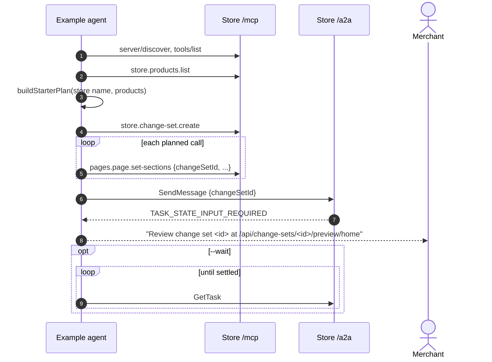

# Work package 8 — Example agent: implementation plan

**For whoever implements this, human or AI:** do the tasks in order. One task is one pull request. Work package 7 must be merged first.

**Goal:** a small scripted agent, with no model, that builds a starter store through the store's agent connection: it reads the store over MCP, builds the home and product pages into one change set, asks the merchant to approve it over A2A, and can wait for the outcome. It proves the agent connection end to end and gives self-hosters an agent to copy.

**Architecture:** `apps/example-agent`, open source like the rest of `apps/`. It talks to the store only through the three public channels (MCP, A2A, events), never through the database or internal code. The MCP client is small and local to this app (stateless POST, revision `2026-07-28`); A2A uses `packages/a2a-gateway`'s client. The plan of tool calls is pure data built from the store's products, so it is easy to test and to change.

**Design:** `docs/architecture/agent-design-part-3-publisher-and-tenant.md`, section 7 ("an example agent"); `docs/plans/2026-11-17-wp7-agent-connection.md`.

**Global constraints:** every rule in section 3 of `2026-11-16-build-plan-master.md` applies. Size each pull request at about 120 lines of code and tests.



## Review focus

1. A tool result with `isError: true` stops the run with that message and does not ask for approval. Task 1 and 3.
2. A store without the `pages.page.set-sections` tool is refused before any change set is created, with `The store does not offer pages.page.set-sections`. Task 3.
3. Waiting gives up after the configured number of polls with a clear message, and never approves anything. Task 3.
4. The agent token is read from the environment (`AGENT_TOKEN`), never from the command line, so it does not end up in shell history. Task 4.

---

### Task 1: MCP client

**Files:** create `apps/example-agent/package.json` (name `@the-market/example-agent`, dependency `@the-market/a2a-gateway`), `apps/example-agent/src/mcp-client.ts`; test `mcp-client.test.ts`; modify `pnpm-lock.yaml`.

```ts
export type PostJson = (input: { url: string; headers: Record<string, string>; bodyText: string }) => Promise<{ status: number; bodyText: string }>;
export function buildMcpClient(input: { endpointUrl: string; agentToken: string; post: PostJson }): {
  callMethod: (input: { method: string; params: Record<string, unknown> }) => Promise<Record<string, unknown>>; // the result; throws "MCP <method> failed (<code>): <message>" on a JSON-RPC error
  callTool: (input: { name: string; toolArguments: Record<string, unknown> }) => Promise<unknown>; // structuredContent; throws the text content when isError
};
```

Every request carries `_meta` with `io.modelcontextprotocol/protocolVersion: "2026-07-28"`, `clientCapabilities: {}` and `clientInfo: { name: "the-market example agent", version: "0.0.0" }`, and the headers `MCP-Protocol-Version`, `Mcp-Method`, `Mcp-Name` (for `tools/call`), `Accept: application/json, text/event-stream`, `Authorization: Bearer <token>`. Request ids count up from 1.

- [ ] Steps: failing tests with a recording fake `post` (headers and `_meta` exact; `callTool` returns `structuredContent`; `isError` throws its text; a JSON-RPC error throws with its code), implement, run checks, commit; open the pull request.

### Task 2: The starter plan

**Files:** create `apps/example-agent/src/starter-plan.ts`; test `starter-plan.test.ts`.

```ts
export interface PlannedCall { name: string; toolArguments: Record<string, unknown> }
export function buildStarterPlan(input: { storeName: string; productCount: number }): PlannedCall[];
```

Exactly two calls, both `pages.page.set-sections` (the `changeSetId` is added by the runner):
- home: `hero` `{ heading: "Welcome to <storeName>", subheading: "<productCount> products, chosen with care." }` (`1 product` when there is one), `rich-text` `{ text: "Every order is packed by hand and sent within two working days." }`, `product-grid` `{ heading: "Shop the range" }`.
- product: `product-detail` `{}`, `rich-text` `{ text: "Free returns within 30 days." }`.

- [ ] Steps: failing tests for the exact calls, the singular, and a store name with `<b>` passed through as text (escaping is the store's job), implement, run checks, commit; open the pull request.

### Task 3: The runner

**Files:** create `apps/example-agent/src/run-agent.ts`; test `run-agent.test.ts`.

```ts
export function runExampleAgent(input: {
  storeName: string;
  callTool: (input: { name: string; toolArguments: Record<string, unknown> }) => Promise<unknown>;
  listToolNames: () => Promise<string[]>;
  askApproval: (input: { changeSetId: string }) => Promise<string>; // the A2A task state
  readTaskState: (input: { changeSetId: string }) => Promise<string>;
  buildPlan: typeof buildStarterPlan;
  pauseFor: (milliseconds: number) => Promise<void>;
  waitPolls: number; // 0: do not wait
  writeLine: (line: string) => void;
}): Promise<{ changeSetId: string; finalState: string }>;
```

Order: check `pages.page.set-sections` is offered; list products; create the change set `Starter store for <storeName>`; run each planned call with `changeSetId` added, writing `Added: <summary>`; ask approval, writing `Waiting for the merchant to review change set <id>` and the preview path; when `waitPolls > 0`, poll every 2 seconds until the state is not `TASK_STATE_INPUT_REQUIRED` or `TASK_STATE_WORKING`, writing the final state, or stop with `Gave up waiting after <n> checks`.

- [ ] Steps: failing tests with fakes for every input (happy path lines in order; missing tool refused before any change set; a failing call stops before approval; waiting stops at `TASK_STATE_COMPLETED`; giving up), implement, run checks, commit; open the pull request.

### Task 4: Command line and run against a store

**Files:** create `apps/example-agent/src/main.ts`; modify root `package.json` (`"example-agent": "node apps/example-agent/src/main.ts"`), `README.md` (one "Example agent" section).

`pnpm example-agent --store http://localhost:3000 [--host localhost] [--wait 30]` with `AGENT_TOKEN` in the environment. `--host` sets the `Host` header for local runs where many stores share one address. Discovery reads the store's agent card first and uses its JSON-RPC interface for A2A.

- [ ] Steps: failing test for argument parsing (`--wait` defaults to 0, missing `AGENT_TOKEN` stops with `Set AGENT_TOKEN to an agent token for the store`), implement; then on the development database: start the server with `IDENTITY_SECRET`, sign an agent token for `localhost`, run the agent, approve and apply as the merchant, and see `--wait` report `TASK_STATE_COMPLETED` and the storefront show "Welcome to Demo store"; revert. Commit; open the pull request.

## Done when

All four pull requests are merged and the run in task 4 works on the development database.
