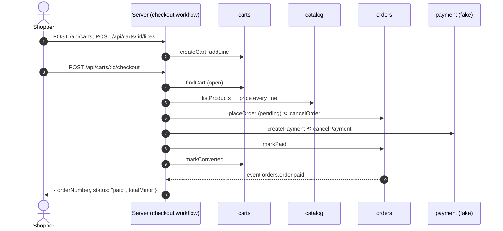

# Work package 9 — Cart, orders, checkout: implementation plan

**For whoever implements this, human or AI:** do the tasks in order. One task is one pull request. Work package 6 must be merged first.

**Goal:** a shopper on a store's host adds products to a cart, checks out, pays through the fake gateway, and gets an order with a number; another store sees none of it. The store sells with no agent and no model.

**Architecture:** two new modules, `carts` and `orders`, each with its own schema; neither imports the other or the catalog. Checkout is a workflow in the server that joins them: a small workflow runner in `packages/core` runs steps in order and, when one fails, undoes the earlier ones in reverse (the same idea as applying a change set). Payments go through `packages/payment`'s provider contract; a fake provider stands in for Stripe until keys are added.

**Design:** `docs/architecture/phase-2-architecture-and-tdd.md` (modules, workflows, payment interface); `docs/architecture/data-model-prisma.md` (orders).

**Global constraints:** every rule in section 3 of `2026-11-16-build-plan-master.md` applies. Size each pull request at about 120 lines of code and tests.



## Review focus

1. Prices come from the catalog at checkout, never from the shopper's request; a product missing from the catalog fails checkout with `Product not available: <productId>` and nothing is charged. Task 7.
2. When payment fails, the pending order is cancelled and the cart stays open, so the shopper can try again. Tasks 1 and 7.
3. A cart can be checked out once: a second checkout of a converted cart is refused with `Cart is already checked out`. Tasks 3 and 7.
4. Cart ids are random UUIDs and every cart and order query filters by tenant: a cart id from store A is `Cart not found` on store B. Tasks 3 and 5.
5. Quantities are whole numbers from 1 to 99; anything else is refused by field. Tasks 3 and 8.

---

### Task 1: Workflow runner

**Files:** create `packages/core/src/workflow-runner.ts`; export from `index.ts`; test beside it.

```ts
export interface WorkflowStep<State> { stepName: string; run: (state: State) => Promise<State>; undo: (state: State) => Promise<void> }
export function runWorkflow<State>(input: { steps: readonly WorkflowStep<State>[]; initialState: State; describe: (error: unknown) => string }): Promise<State>;
```

Runs steps in order, each receiving the state the previous returned. When step `n` throws, runs `undo` of steps `n-1 … 0` with the state each of them produced, then rejects with `<stepName> failed: <message>`. An `undo` that throws is recorded and the others still run; the rejection then ends with `; undo of <stepName> failed: <message>` for each.

- [ ] Steps: failing tests (all steps in order; failure at step 2 undoes 1 and 0 in reverse with their own states; a failing undo does not stop the others and is named), implement, run checks, commit; open the pull request.

### Task 2: The fake payment provider

**Files:** create `packages/payment/src/fake-provider.ts`; export; test `fake-provider.test.ts`.

`buildFakeProvider({ declineAmountMinor: number })` implements `PaymentProvider` with `providerId: "fake"`: `createPayment` returns `{ providerReference: "fake_<idempotencyKey>", status: "authorized" }`, except when `amountMinor === declineAmountMinor`, which rejects with `Payment declined` (so tests and demos can fail a payment on purpose); `capturePayment` → `captured`; `refundPayment` → `refunded`; `cancelPayment` → `canceled`; `parseWebhook` rejects with `The fake provider sends no webhooks`. The same idempotency key always gives the same reference.

- [ ] Steps: failing tests, implement, run checks, commit; open the pull request.

### Task 3: The `carts` module (table, adapter, services)

**Files:** `modules/carts/` like the changes module, split into table / adapter / services pull requests if over 200 lines. Tables `carts` (`cart_id` uuid, `tenant_id`, `status` `open|converted`, timestamps) and `cart_lines` (`cart_id`, `tenant_id`, `product_id`, `quantity`; unique per cart and product). Services: `createCart({ tenantId })`, `findCart({ tenantId, cartId })` (lines included), `setLine({ tenantId, cartId, productId, quantity })` (quantity 0 removes the line), `markConverted({ tenantId, cartId })` (conditional on `open`; else `Cart is already checked out`). Unknown or other-tenant cart: `Cart not found`; non-UUID ids are not queried.

### Task 4: The `orders` module (table, adapter, services)

**Files:** `modules/orders/`, split as above. Tables `orders` (`order_id`, `tenant_id`, `order_number` integer unique per tenant, `status` `pending|paid|canceled`, `currency_code`, `total_minor`, `payment_provider_id`, `payment_reference`, `placed_at`) and `order_lines` (snapshots: `product_id`, `title_snapshot`, `quantity`, `unit_price_minor`). The order number is the tenant's highest number plus one, assigned inside the insert's transaction (unique constraint `(tenant_id, order_number)` catches a race; the insert retries once). Services: `placeOrder` (status `pending`, publishes nothing), `markPaid` (`pending` → `paid`, records provider and reference, then publishes `orders.order.paid` with `{ tenantId, orderId, orderNumber, totalMinor }`), `cancelOrder` (`pending` → `canceled`), `findOrder`.

### Task 5: Cart routes

`POST /api/carts` → 201 `{ cartId }`; `GET /api/carts/:cartId` → the cart with each line priced from the catalog (`title`, `unitPriceMinor`, `lineTotalMinor`) and `totalMinor`; `PUT /api/carts/:cartId/lines/:productId` `{ quantity }` → the priced cart. Tenant-scoped, public (the cart id is the shopper's key). Errors through the change-set error table extended with `Cart not found` (404) and `Cart is already checked out` (409).

### Task 6: Price a cart

**Files:** `apps/server/src/checkout/price-cart.ts`. `priceCart({ lines, products })` → `{ currencyCode, totalMinor, lines: [{ productId, title, quantity, unitPriceMinor, lineTotalMinor }] }`; a line whose product is missing throws `Product not available: <productId>`; mixed currencies throw `Cart mixes currencies`; an empty cart throws `Cart is empty`.

### Task 7: The checkout workflow and route

**Files:** `apps/server/src/checkout/checkout-workflow.ts`, route `POST /api/carts/:cartId/checkout`. Steps with `runWorkflow`: load the open cart; price it; `placeOrder` (undo: `cancelOrder`); `createPayment` with idempotency key = order id (undo: `cancelPayment`); `markPaid`; `markConverted`. Reply 201 `{ orderId, orderNumber, status: "paid", totalMinor, currencyCode }`. The payment provider is chosen by `PAYMENT_PROVIDER` (`fake` by default; `stripe` only when `STRIPE_SECRET_KEY` is set).

- [ ] Tests through `composeServer` with fakes: a full checkout; a declined payment leaves the order `canceled` and the cart `open`; a second checkout of the same cart is 409; a cart id from another store is 404. On the development database: seed, create a cart for `localhost`, add two products, check out, see the order paid with the right total; check out again and see 409.

### Task 8: Storefront cart pages

HTML forms with a `cart_id` cookie (`HttpOnly`, `SameSite=Lax`, `Path=/`): an "Add to cart" form on the product page (`POST /cart/lines`), `GET /cart` (lines, totals, a "Pay" button), `POST /cart/checkout` → redirect to `/orders/<orderNumber>` showing "Thank you". Cookies need two small additions to the Hono adapter (`RouteRequest.cookieValues`, `HttpReply` `set-cookie` and `location` headers), done in this task. Every value is escaped as in work package 6.

## Done when

All pull requests are merged, and on one database with two stores a shopper on store A's host buys two products through the fake gateway, store A has a paid order with the right total, and store B has no cart or order of it.
