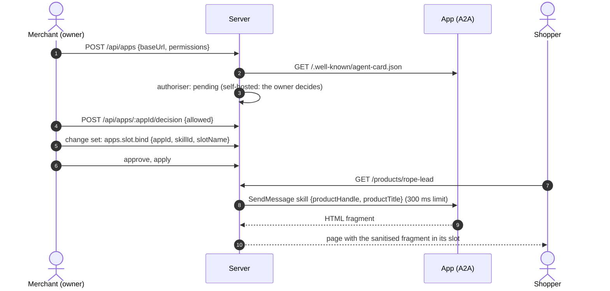

# Work package 10 — Apps and slots: implementation plan

**For whoever implements this, human or AI:** do the tasks in order. One task is one pull request, opened only after the one before it is merged (no stacked pull requests). Work packages 5 and 6 are on `main`.

**Goal:** a merchant installs a third-party app by its address; the store reads the app's A2A Agent Card, the app authoriser (the store owner, when self-hosted) approves it, a change set binds one of the app's skills to a slot on a page, and the storefront shows the app's HTML fragment there, sanitised, within a time limit, and without breaking the page when the app is slow or down.

**Architecture:** a new `apps` module stores, per tenant, app registrations (from the Agent Card) and slot bindings. Installing is a merchant route in the server that fetches the card with `packages/a2a-gateway`'s client. Binding is a capability, so it goes through change sets. Rendering happens on the server, before the page is sent: no script runs on storefront pages yet. Fragments are cleaned by the theme engine's sanitizer, which work package 15 replaces with a parser-based one.

**Design:** `docs/architecture/phase-2-architecture-and-tdd.md` (theme engine, slots); `docs/architecture/data-model-prisma.md` (apps); `docs/architecture/agent-design-part-3-publisher-and-tenant.md`, section 3 (app authoriser).

**Global constraints:** every rule in section 3 of `2026-11-16-build-plan-master.md` applies, except that pull requests are never stacked. Size each pull request at about 120 lines of code and tests.

## Slots and the fragment contract

- Slot names, fixed in this package: `product.below-detail`, `home.below-hero`.
- An app offers a skill for slots by tagging it `storefront-slot` in its Agent Card.
- The store sends `SendMessage` with one data part `{ skillId, input: { slotName, productHandle, productTitle } }` (plain strings only) and reads the first text part of the reply message, or of the completed task's first artifact, as the fragment.
- A fragment is sanitised, wrapped in `
">`, and limited to 20 000 characters; an app that does not answer within 300 ms, fails, or sends nothing adds nothing.

## Review focus

1. Installing fetches only `https://` addresses (plain `http://localhost` outside production), never a private or loopback address in production, so the store cannot be used to reach its own network. Task 3.
2. An app is never shown, and never bindable, until it is `active`; a refused app stays refused. Tasks 2 and 4.
3. A fragment with `<script>`, `onclick=` or a `javascript:` link renders without them; one slow or failing app never delays the page past the limit or breaks it. Task 5.
4. Store A's apps and bindings never appear on store B. Tasks 1 and 5.
5. Unbinding through a change set's revert removes the fragment from the page. Task 4.

---

### Task 1: The `apps` module (tables, adapter)

Split like the carts module. Tables `apps` (`app_id`, `tenant_id`, `base_url` unique per tenant, `name`, `rpc_url`, `slot_skills` text array, `permissions` text array, `status` `pending|active|refused`, `installed_at`) and `app_slot_bindings` (`binding_id`, `tenant_id`, `app_id`, `slot_name`, `skill_id`, `priority` default 100; unique per tenant, slot and app). Port: `insertApp`, `findApp`, `listApps`, `updateAppStatus` (conditional on the stored status), `setBinding` (upsert), `removeBinding`, `listBindings({ tenantId, slotName })` (only bindings of active apps, by priority). Database test with two tenants.

### Task 2: Apps services

`registerApp` (status from the authoriser's answer: `allowed` → `active`, `refused` → `refused`, `pending` → `pending`; registering the same address again returns the existing app), `decideApp({ tenantId, appId, decision })` (only from `pending`; else `App is not waiting for a decision`), `listApps`, `findApp`, `setBinding`, `removeBinding`, `listBindings`. Errors: `App not found`, `App is not active`.

### Task 3: Install routes

Merchant routes: `POST /api/apps` `{ baseUrl, permissions: string[] }` → discovers the card (A2A client), requires a JSON-RPC interface and at least one `storefront-slot` skill (`The app offers no storefront slots`), asks the authoriser, registers; `GET /api/apps`; `POST /api/apps/:appId/decision` `{ decision: "allowed" | "refused" }`. `checkAppAddress({ baseUrl, allowLocalHttp, lookupAddress })` refuses anything but `https://`, and in production any host that resolves (with `dns.lookup`, passed in) to a loopback, private, link-local or unique-local address: `Invalid input: baseUrl must be a public https address`. The self-hosted authoriser answers `pending`, so the owner decides with the decision route.

### Task 4: The `apps.slot.bind` capability

Risk `medium`. Input `{ appId, skillId, slotName, priority? }`. `buildChange` checks the slot name is known, the app is active and offers that skill; summary `Show <app name> in <slot name>`. Change: the binding; revert: the previous binding of that app in that slot, or `{ remove: true }`. Tests: bind, revert to none, revert to the previous priority, refusals for an inactive app, an unknown skill and an unknown slot.

### Task 5: Render slots on the storefront

A new section type `app-slot` `{ slotName }` (home and product pages) renders `pageData.slots[slotName]`, which the server fills before rendering: for each binding, `SendMessage` to the app with a 300 ms limit, sanitise with `cleanFragment`, wrap, cap the length; all bindings of a page are asked at the same time. The default product page gains `app-slot` `product.below-detail`; the default home page `home.below-hero`. Tests with a fake A2A sender: fragment shown and cleaned; slow app skipped within the limit; failing app skipped; other store's binding absent.

### Task 6: An example app, and the real check

`apps/example-app`: a tiny A2A server (`node:http`) with an Agent Card offering one `storefront-slot` skill, `review-stars`, answering `
★★★★☆ 4.6 from 128 reviews
`; `pnpm example-app --port 4200`. On the development database: install it for `localhost`, approve it as the owner, bind it through a change set, see the stars under the rope lead, stop the app and see the page still render without them, revert the change set and see them gone.

## Done when

All pull requests are merged and the run in task 6 works on the development database.
