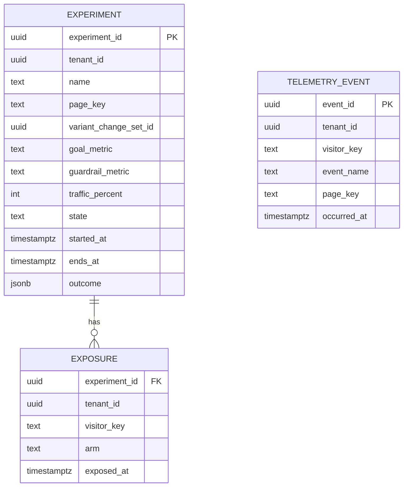

# Work package 11 — Telemetry and experiments: implementation plan

**For whoever implements this, human or AI:** do the tasks in order. One task is one pull request on `main`. A task that needs an open pull request carries its commits and says "Includes #N" in its title. Work packages 4, 6 and 9 are on `main`.

**Goal:** the storefront records anonymous events. A merchant (or an agent, with approval) starts an experiment whose variant is a change set of page sections. Half of the visitors see the variant, and each visitor always sees the same arm. When the experiment ends, fixed statistics in code decide `adopt`, `discard` or `unclear`, and adopting applies the change set.

**Architecture:** a new `experiments` module stores events, experiments and exposures per tenant. Assignment and statistics are pure functions in that module. The storefront gives each visitor a random `visitor_id` cookie, records `page_view`, `add_to_cart` and `checkout_paid`, and renders variant visitors' pages with the change set's sections, reusing the preview code (`findPreviewSections`). Starting an experiment is a capability, so it goes through change sets. The model never judges the outcome.

**Design:** `docs/architecture/agent-design-part-2-optimiser-and-safety.md`, section 1 (the optimiser loop and its rules).

**Global constraints:** every rule in section 3 of `2026-11-16-build-plan-master.md` applies, except that pull requests are never stacked. Size each pull request at about 120 lines of code and tests. No personal data: no IP address, user agent or account in any event.

```mermaid
sequenceDiagram
    autonumber
    actor M as Merchant
    participant SV as Server
    actor V as Visitor
    M->>SV: change set A: pages.page.set-sections (the variant), approved, not applied
    M->>SV: change set B: experiments.start {variantChangeSetId: A, goal, guardrail}
    M->>SV: approve B, apply B → experiment running
    V->>SV: GET /products/rope-lead (cookie visitor_id)
    SV->>SV: assign arm = hash(experimentId, visitorId) → record exposure, page_view
    SV-->>V: control page, or the page with A's sections
    V->>SV: POST /cart/lines → add_to_cart; POST /cart/checkout → checkout_paid
    M->>SV: after the end: POST /api/experiments/:id/decide
    SV->>SV: two-proportion z-test → adopt | discard | unclear
    M->>SV: POST /api/experiments/:id/adopt → applies change set A
```



## Rules fixed in this package

- Events: `page_view`, `add_to_cart`, `checkout_paid`. Metrics: `add_to_cart` and `checkout_paid`. A metric's rate per arm is the number of exposed visitors with at least one such event after their exposure, divided by the number of exposed visitors.
- Arms: `control` and `variant`. The arm is `variant` when the first 4 bytes of `sha256("<experimentId>:<visitorKey>")`, read as an unsigned 32-bit integer, modulo 100, are below `trafficPercent` (default 50).
- An experiment has one goal metric and one guardrail metric, and they differ. One running experiment per page key per store.
- Decision, in this order:
  1. Fewer than 100 exposed visitors in either arm → `unclear`, "Not enough visitors".
  2. Guardrail worse in the variant, one-sided, z ≤ −1.645 → `discard`, "Guardrail fell".
  3. Goal z ≥ 1.96 → `adopt`; z ≤ −1.96 → `discard`; otherwise `unclear`, "No clear difference".
- z is the pooled two-proportion z-score (variant minus control); the p-value is two-sided.

## Review focus

1. A visitor sees the same arm on every visit, and the split is close to the traffic percent. Task 2.
2. A failed event write never breaks or slows a storefront page. Task 4.
3. An experiment can be decided only after `ends_at`, once; adopting is allowed only for `adopt` or `unclear`. Task 5.
4. Store A's events, experiments and exposures never count for store B. Tasks 1 and 4.
5. The variant change set holds only `pages.page.set-sections` items for the experiment's page, is approved, and is not applied. Task 3.

---

### Task 1: The `experiments` module (tables, adapter)

Split like the apps module, in schema `experiments`. The tables are as drawn above. `exposures` is unique per experiment and visitor. `state` is one of `running|stopped|decided|adopted`.

Port:
- `insertEvent`
- `insertExperiment`
- `findExperiment`
- `listExperiments`
- `findRunningExperiment({ tenantId, pageKey })`
- `updateExperimentState` (conditional on the stored state; returns the count)
- `recordExposure` (insert, or return the arm already stored)
- `countMetric({ tenantId, experimentId, eventName })`, which returns `{ control: { visitors, conversions }, variant: { visitors, conversions } }`; counted with one SQL query (`$queryRaw`, parameters bound).

Every `where` is built from named keys. Database test with two tenants.

### Task 2: Assignment and statistics (pure)

- `assignArm({ experimentId, visitorKey, trafficPercent, digest })`, where `digest` is the injected sha256.
- `scoreProportions({ control, variant })`, which returns `{ zScore, pValue }`. The normal CDF comes from an `erf` approximation (Abramowitz–Stegun 7.1.26) and must be accurate to 1e-4.
- `decideOutcome({ goal, guardrail })`, which returns `{ decision, reason, goal: {...arms, zScore, pValue}, guardrail: {...} }`.

Tests:
- Exact values: control 30/1000 against variant 55/1000 gives z 2.7712 and p 0.0056, so `adopt`. 30/1000 against 36/1000 gives z 0.7510 and p 0.4526, so `unclear`. 60/1000 against 40/1000 gives z −2.0520, so `discard`.
- A guardrail at −2.052 discards even when the goal z is 2.77.
- 99 visitors in an arm gives `unclear`.
- The same key gets the same arm every time.
- Across 10 000 generated keys at 50%, the variant share is between 48% and 52%.

### Task 3: Services and the `experiments.start` capability

Services: `startExperiment`, `stopExperiment`, `findExperiment`, `listExperiments`, `findRunningExperiment`, `recordEvent`, `recordExposure`, `measureExperiment` (goal and guardrail counts), `decideExperiment({ tenantId, experimentId, now })` and `markAdopted`.

`decideExperiment`:
- Refuses while `now < ends_at` with `Experiment is still running`.
- Refuses any state but `running` with `Experiment is not running`.
- Stores the outcome and moves the state to `decided`.

Capability `experiments.start`:
- Risk `medium`.
- Input: `{ name, pageKey, variantChangeSetId, goalMetric, guardrailMetric, trafficPercent?, durationHours? }`. `trafficPercent` runs 10–90 and defaults to 50. `durationHours` runs 1–1440 and defaults to 336.
- `buildChange` checks four things, each with its own error:
  - the variant change set is `approved`;
  - it holds only `pages.page.set-sections` items for `pageKey` (`The variant may only change the experiment's page`);
  - the metrics differ;
  - no experiment is running on that page.
- Summary: `Start experiment "<name>" on <pageKey>`.
- Revert stops the experiment.

The services reach the changes module only through an injected `findChangeSet`.

### Task 4: Storefront telemetry and variant pages

- A `visitor_id` cookie: a random UUID, `HttpOnly; SameSite=Lax; Path=/`, kept for one year, set on the first storefront page.
- Events:
  - `page_view` on home and product pages;
  - `add_to_cart` on `POST /cart/lines`;
  - `checkout_paid` after a successful checkout (read the cookie before it is cleared).
- Event writes do not delay the reply (they are not awaited), and their errors are dropped.
- When a running experiment covers the page, the visitor is assigned, the exposure is recorded (awaited, with a 200 ms limit; a timeout or failure renders control), and a `variant` visitor's page is rendered with `findPreviewSections` over the variant change set.

Tests with fakes:
- The same cookie gets the same arm twice.
- A variant visitor sees the variant sections.
- A failing event writer still gives a 200 page.
- Store B's page view does not record for store A.

### Task 5: Experiment routes

Merchant routes:
- `GET /api/experiments`;
- `GET /api/experiments/:experimentId` (the experiment, plus live counts per arm);
- `POST /api/experiments/:experimentId/decide`;
- `POST /api/experiments/:experimentId/adopt`, which applies the variant change set through the change-set apply workflow and marks the experiment `adopted`. It is refused unless the decision is `adopt` or `unclear` (`Only an adopt or unclear outcome can be adopted`).

Errors map to these statuses:
- `Experiment not found`: 404;
- `Experiment is still running`: 409;
- `Experiment is not running`: 409.

Tests cover the two refusals, adopt applying the change set, and another store's experiment giving 404.

### Task 6: The real check

`scripts/simulate-visitors.ts --host localhost --port 3933 --visitors 400`:
- Each simulated visitor has its own cookie jar and opens the product page.
- It adds to cart with probability 0.25 when the page shows the variant's marker section, and 0.05 otherwise.
- It pays for a third of the carts.
- The probabilities come from a seeded random generator, so runs repeat.

On the development database:
1. Build a variant change set (a `rich-text` section saying "Free UK delivery" above the product detail) and approve it.
2. Start an experiment through a second change set with `durationHours: 1`.
3. Run the script.
4. Set `ends_at` to the past with a one-off SQL statement in the check script.
5. Decide, and see `adopt` with the numbers.
6. Adopt, and see the section on every visitor's page.
7. Check that store B shows no experiment.

## Done when

All pull requests are merged and the run in task 6 works on the development database.
