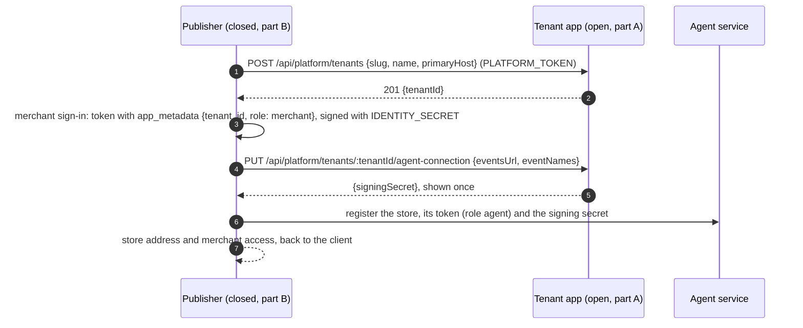

# Work package 12 — Publisher skeleton: implementation plan

**For whoever implements this, human or AI:** do the tasks in order. One task is one pull request on `main`. A task that needs an open pull request carries its commits and says "Includes #N" in its title. Work packages 5 and 7 are on `main`.

**Goal:** a publisher can create a hosted store from outside the tenant app, in one sequence:
1. create the tenant row;
2. give the merchant access;
3. register the store's agent connection.

The tenant app's part is open source and is built here. The publisher service itself is closed source and is built in the private repository `the-market-org/factory` (part B), never here.

**Architecture:** the tenant app gains platform routes under `/api/platform/`. They are not scoped to a store's host, and they are guarded by a separate `PLATFORM_TOKEN`. Merchant access needs no new code in the tenant app: the identity socket already accepts a signed token (the Supabase JWT shape: `sub`, `exp`, `app_metadata.tenant_id`, `app_metadata.role`), so the publisher, or Supabase Auth with the same secret, issues such tokens. The agent connection reuses the connections module's services.

**Design:** `docs/architecture/agent-design-part-3-publisher-and-tenant.md`, sections 1, 4 and 6.

**Global constraints:** every rule in section 3 of `2026-11-16-build-plan-master.md` applies, except that pull requests are never stacked. Size each pull request at about 120 lines of code and tests. Nothing closed-source is committed to this repository while it is public.

## Rules fixed in this package

- `PLATFORM_TOKEN` is unset by default. Then every `/api/platform/` route answers 404, as if it did not exist.
- When it is set, a request without `Authorization: Bearer <PLATFORM_TOKEN>` gets 401. The comparison is constant time.
- A merchant token or an agent token never opens a platform route, and the platform token never opens a store's merchant or agent routes.
- Slugs are 3–40 characters of lower-case letters, digits and hyphens. Hosts are normalised the way tenant resolution does it.
- A host or a slug that is already taken answers 409 (`Host is already used`, `Slug is already used`); it never returns the existing store.

## Review focus

1. The platform token and store tokens never open each other's routes. Task 1.
2. With `PLATFORM_TOKEN` unset, platform routes are absent (404), not open. Task 1.
3. Creating a store whose host or slug is taken never hands back the existing store. Task 2.
4. A new store is served at its host at once, with an empty catalog, and is isolated from other stores. Tasks 2 and 4.
5. The signing secret appears only in the reply that created the connection. Task 3.

---

## Part A: the tenant app (open source)

### Task 1: Platform access

`apps/server/src/platform-access.ts`:
- `matchesPlatformToken({ authorization, platformToken })` uses `timingSafeEqual`, and is false whenever the token is empty.
- `guardPlatformRoutes({ routes, platformToken, matches })`: no token means no routes (404); a wrong token gives 401 with `{ error: "unauthorized" }`.
- Platform routes are `tenantScoped: false`.
- `main.ts` reads `PLATFORM_TOKEN`.

Tests:
- With the token unset, `GET /api/platform/tenants/x` answers 404.
- A wrong token answers 401, and so do a merchant token and an agent identity token.
- The platform token on `/api/change-sets` answers 401.

### Task 2: Creating stores

Tenancy services gain:
- `createTenant({ slug, name, primaryHost })`, which checks the slug pattern and refuses a taken host or slug with 409;
- `findTenantById`.

Routes:
- `POST /api/platform/tenants` answers 201 `{ tenantId, slug, name, primaryHost, status }`;
- `GET /api/platform/tenants/:tenantId` answers 200, or 404 `Tenant not found`.

Tests:
- Create, then read.
- A taken host gives 409, and so does a taken slug.
- A bad slug gives 400.
- The new store's host serves `/` with 200 at once.

### Task 3: Registering a store's agent connection

`PUT /api/platform/tenants/:tenantId/agent-connection` takes `{ eventsUrl, eventNames }` and checks the address exactly as `/api/agent-connection` does. It saves through the connections module and answers 200 with the connection, including its `signingSecret`, for that tenant. `DELETE` on the same path removes the connection.

An unknown tenant id gives 404 `Tenant not found`.

Tests:
- Register, after which a merchant `GET /api/agent-connection` on the store's host returns the connection.
- An unknown tenant gives 404.

### Task 4: The real check

`scripts/create-store.ts --name "Shop D" --host shop-d.localhost --events-url http://localhost:4300/events` calls the platform routes on a running server and prints the tenant id. It also prints a one-hour merchant token (`sub`, `exp`, `app_metadata.tenant_id`, `app_metadata.role: merchant`) signed with `IDENTITY_SECRET`, and the signing secret.

On the development database:
1. Create the store.
2. Open `http://localhost:<port>/` with `Host: shop-d.localhost`.
3. List change sets with the printed merchant token, and get 200 and `[]`.
4. Check that the same token on `localhost` gets 401.
5. Seed products with `STORE_HOST=shop-d.localhost pnpm seed` and see them on the store.
6. Apply a change set on shop D and see its `changes.change-set.moved` event arrive, signed, at the events address.

## Part B: the publisher service (closed source, in `the-market-org/factory`)

The service signs merchants up and creates their stores through part A. It then grants sign-in with Supabase Auth, setting `app_metadata.tenant_id` and `app_metadata.role` on the user, and registers the store with the agent service (work package 13).

**Where it lives:** owner decision, 2026-11-25: the publisher is built in the private repository `the-market-org/factory`, never in this public one. It talks to the tenant app only through part A's platform routes. Its plan is written in `factory` once part A is merged; until then, `scripts/create-store.ts` stands in for it.

## Done when

Part A is merged and the run in task 4 works on the development database. Part B is planned and built in `the-market-org/factory`.
