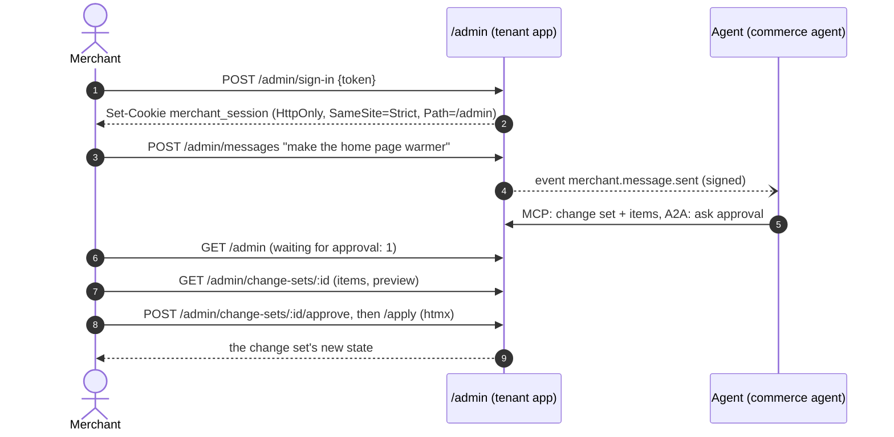

# Work package 14 — Merchant screen: implementation plan

**For whoever implements this, human or AI:** do the tasks in order. One task is one pull request on `main`. A task that needs an open pull request carries its commits and says "Includes #N" in its title. Work packages 6, 7, 10 and 11 are on `main`.

**Goal:** a merchant signs in to `/admin` on their store's host. There they:
- talk to the store's agent;
- see what the agent proposed, preview it, and approve, reject, apply or revert it;
- decide and adopt experiments;
- allow or refuse waiting apps.

All of it is server-rendered HTML with htmx, like the storefront.

**Architecture:** the screen is a set of tenant-scoped routes under `/admin`, rendered by the theme engine's escaping helpers. It calls the same services as the merchant API routes. It adds no new business rules, so every rule stays where it is. A browser cannot send a bearer header, so a sign-in form exchanges the merchant's token for an `HttpOnly` cookie. The agent hears the merchant's messages as a new signed event on the store's existing agent connection. Its answers come back as change sets and approval requests, which the screen already shows.

**Design:** `docs/architecture/agent-design-part-1-core.md`, sections 5 to 7 (the builder, change sets, and what works with no agent).

**Global constraints:** every rule in section 3 of `2026-11-16-build-plan-master.md` applies, except that pull requests are never stacked. Size each pull request at about 120 lines of code and tests.

## Rules fixed in this package

- **Sign-in:** `POST /admin/sign-in` takes the same tokens as the merchant API: an identity token whose store is this host's and whose role is `merchant` or `owner`, or the shared `MERCHANT_TOKEN` in development. The cookie `merchant_session` holds the token, with `HttpOnly; SameSite=Strict; Path=/admin`, `Secure` outside development, and `Max-Age` up to the token's `exp` (12 hours for the shared token). `POST /admin/sign-out` clears it.
- Every `/admin` page checks the cookie the same way as a bearer token, on every request. A missing or refused cookie on a `GET` redirects to `/admin/sign-in`. On a `POST` it answers 401.
- **Every `/admin` `POST` checks `Origin`.** It must be this store's own origin, or the request answers 403. With the `SameSite=Strict` cookie, this is the screen's protection against cross-site requests.
- Everything shown is escaped with `escapeHtml`. Agent-written text (change set titles, item summaries, messages) is data, never markup.
- Messages are 1–2000 characters. They are stored per store, and delivered to the agent only as the event `merchant.message.sent` `{ messageId, text }`, and only when the connection lists that event.

## Review focus

1. A cookie from store A never opens store B's `/admin`. Task 1.
2. A cross-site form post (wrong or missing `Origin`) never changes anything. Task 1.
3. Text written by the agent with `<script>` or `onclick` shows as text. Tasks 2 and 3.
4. A button for a move the change set cannot make (approve when applied, for example) answers with the existing refusal and changes nothing. Task 3.
5. A store with no agent connection still sells, and the screen says the message was saved but no agent is connected. Task 5.

---

### Task 1: Merchant session

`apps/server/src/admin/admin-session.ts`:
- `readSessionToken(cookieHeader)`.
- `buildSessionCookie({ token, maxAgeSeconds, secure })` and `clearSessionCookie()`.
- `checkOrigin({ origin, host, allowLocalHttp })`.
- `guardAdminRoutes({ routes, matches })` reuses `matchesMerchant` with the cookie's token.

Pages: `GET /admin/sign-in` (a form with one password field, and a hint for development) and `POST /admin/sign-in`, which answers 303 to `/admin` with the cookie, or 401 with the form again.

Tests:
- Sign in with an identity token and with the shared token.
- A wrong token is refused.
- A store A cookie on store B redirects to sign-in.
- A `POST` with a foreign `Origin` answers 403, and with none, 403.
- Sign-out clears the cookie.

### Task 2: Listing change sets, and the home page

The changes module gains `listChangeSets({ tenantId, limit })`, newest first, with an item count and no items. It needs a database test with two stores.

`GET /admin` shows four parts:
- the store's name;
- the change sets waiting for approval (`draft`), each linking to its page;
- the last 10 others, with their state;
- a message box.

Tests:
- Store B's change sets never show on store A.
- An agent-written title with `<script>` shows escaped.

### Task 3: The change set page and its actions

`GET /admin/change-sets/:changeSetId` shows:
- the title, who proposed it, its state, and the item summaries in order;
- the pages it changes, each previewed in an `<iframe sandbox>` of `/admin/change-sets/:changeSetId/preview/:pageKey`. That route reuses `handlePreview` with the cookie session.

Buttons send htmx `POST`s:
- `/admin/change-sets/:changeSetId/approve` (with the signed-in name);
- `/reject`, `/apply` and `/revert`.

Each uses the existing decide and apply workflows and swaps in the new state. A refusal shows its message, for example `Change set cannot move from applied to approved`.

Tests:
- Approve, then apply, and see the state.
- Approve on an applied set shows the refusal and changes nothing.
- The preview shows the change set's sections.

### Task 4: Experiments and apps

`GET /admin/experiments` lists the store's experiments with live counts per arm. A decided one shows its outcome: decision, reason, counts and z-scores. Buttons call decide and adopt through the existing services.

`GET /admin/apps` lists apps with their status. A `pending` app has allow and refuse buttons, which use `decideApp`.

Tests:
- An outcome is shown with its numbers.
- Adopting a `discard` shows the refusal.
- Allowing a pending app makes it `active`.
- Store B's apps never show.

### Task 5: The conversation

The connections module gains a `merchant_messages` table: `message_id`, `tenant_id`, `text` and `sent_at`.

`POST /admin/messages`:
- It saves the message.
- It publishes `merchant.message.sent` through the event bus, so the existing delivery signs it and posts it to the agent connection.
- It answers with the message list.

The home page shows the last 20 messages. It also says whether an agent is connected, and whether that connection listens to `merchant.message.sent`.

Tests:
- A message is saved and delivered, with a valid signature, to a fake events address.
- A store with no connection saves the message and says so.
- An empty message is refused, and so is one of 2001 characters.

### Task 6: The real check

On the development database, with a store made by `pnpm create-store --events changes.change-set.moved,merchant.message.sent` and a local events receiver:
1. Sign in at `/admin` with the printed token.
2. Send a message, and see the signed event at the receiver.
3. Run `pnpm example-agent` for the store, and see its change set waiting on `/admin`.
4. Preview it, approve it and apply it from the screen.
5. See the storefront change.
6. Revert it from the screen.

## Done when

All pull requests are merged and the run in task 6 works on the development database.
