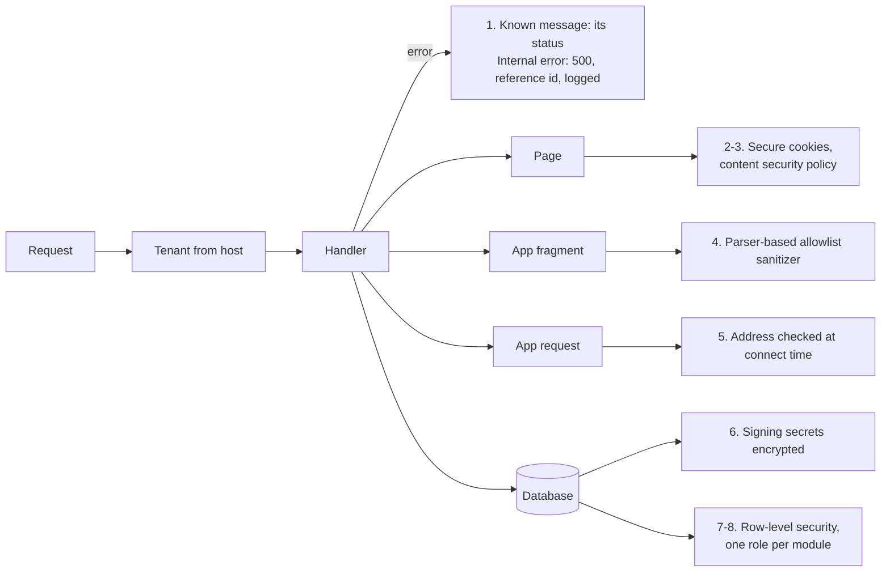

# Work package 15 — Hardening: implementation plan

**For whoever implements this, human or AI:** do the tasks in order. One task is one pull request on `main`. A task that needs an open pull request carries its commits and says "Includes #N" in its title. Work packages 9, 10 and 11 are on `main`, and work package 14 should be, for task 3's admin pages.

**Goal:** close the gaps found while building work packages 9 to 12. Each was seen in the code on `main` on 2026-11-25:
- internal error text sent to callers;
- cookies without `Secure`;
- no content security policy;
- a regex sanitizer;
- app addresses checked only when an app is installed;
- signing secrets stored in plain text;
- no second line of defence for tenant isolation in the database.

**Architecture:** each fix sits behind the seam that already exists, so callers do not change:
- the error reply (`answerSafely`);
- the cookie builders;
- one response-header step in the Hono adapter;
- `cleanFragment`'s signature;
- the server's `sendRequest` for apps;
- the connections adapter;
- the Prisma adapters.

**Global constraints:** every rule in section 3 of `2026-11-16-build-plan-master.md` applies, except that pull requests are never stacked. Size each pull request at about 120 lines of code and tests.

## Review focus

1. No reply ever contains a Prisma, Node or stack-trace message. Task 1.
2. No fragment bypass from the test list reaches a page: nested tags, entity-encoded `javascript:`, SVG event attributes, `` with unusual spacing. Task 4.
3. A host that resolves to a public address at install and to `127.0.0.1` later is refused later. Task 5.
4. A database dump without `SECRETS_KEY` reveals no signing secret, and events still verify after the change. Task 6.
5. A query in module A that forgets its tenant filter still returns only the current tenant's rows. Task 7.

---

### Task 1: Internal errors stay internal

`describeError` keeps its job for domain errors, which are plain `Error`s thrown by services with messages written for people.

A new `classifyError(error) -> { message, internal: boolean }` treats these as internal:
- any error whose `name` starts with `PrismaClient`;
- `TypeError`, `ReferenceError` and `SyntaxError` (other than the JSON parse step, which already answers `invalid_json`);
- anything that is not an `Error`.

`answerSafely` answers an internal error with 500 `{ error: "Something went wrong", reference: <uuid> }` and logs the reference with the full error (no request body).

Tests:
- A Prisma-named error gives 500 and its text does not appear in the reply.
- `Change set not found` still gives 404 with its message.
- A domain error with no listed status still gives 422 with its message.

### Task 2: Secure cookies

`cart_id`, `visitor_id` and, from work package 14, `merchant_session` get `Secure` whenever the server is not in development (`allowLocalHttp` false). This is one `cookieAttributes({ secure })` helper used by all three.

Tests:
- In production mode every `Set-Cookie` has `Secure`.
- In development none does, so plain `http://localhost` keeps working.

### Task 3: Content security policy and other response headers

One response step in the Hono adapter adds these headers to every HTML reply:
- `content-security-policy: default-src 'self'; script-src 'self'; object-src 'none'; base-uri 'none'; frame-ancestors 'self'; form-action 'self'`;
- `x-content-type-options: nosniff`;
- `referrer-policy: same-origin`.

JSON replies get `nosniff`. htmx for the admin pages is served from the store's own origin (`/assets/htmx.min.js`, vendored at a pinned version with its licence), never from a CDN, so `script-src 'self'` holds. Storefront pages load no scripts today.

Tests: the storefront, an admin page and a JSON route each carry their headers, and no inline `<script>` or `on*=` attribute appears in any page the theme engine renders.

### Task 4: Parser-based sanitizer

`cleanFragment` keeps its signature. Inside, `stripActiveContent` is replaced by an HTML parser (`parse5`, pinned) and an allowlist:
- **Tags:** `p`, `div`, `span`, `strong`, `em`, `ul`, `ol`, `li`, `a`, `img`, `h2`–`h4`, `br`.
- **Attributes:** `class`, `id`, `href` and `src` (`https:` or same-origin only), `alt`, `title`, and htmx's `hx-get`, `hx-target` and `hx-swap` (still scoped by `scopeHtmxRequests`).

Everything else is dropped with its contents for `script` and `style`, and is unwrapped otherwise. The output is serialised by the parser, never by string joins.

Tests: every case in the existing sanitizer tests, plus the review-focus bypass list, with the expected output written out.

### Task 5: App addresses checked when connecting

The server's app `sendRequest` uses a fetch whose DNS lookup runs `checkAppAddress`'s `isPrivate` on every resolved address, at connect time. That is an `undici` `Agent` with a `connect.lookup` hook, used only for app requests. A private address fails the request with `App address is not public`, which the slot loader already treats as "no fragment".

Tests:
- A lookup that answers `127.0.0.1` on its second call is refused on the second request.
- Local http still works in development.

### Task 6: Encrypted signing secrets

The connections adapter encrypts `signing_secret` with AES-256-GCM. The key is `SECRETS_KEY` (32 bytes, base64), and each value is stored as `v1:<iv>:<tag>:<ciphertext>`. It decrypts when it reads.

`node --env-file-if-exists=.env scripts/encrypt-signing-secrets.ts` is a one-off script. It encrypts existing plain rows and reports a count, with no secrets.

The server refuses to start with connections stored but no `SECRETS_KEY`.

Tests:
- A round trip works, and a wrong key fails.
- A plain row is migrated once.
- An event signed after the migration verifies with the same secret as before.

### Task 7: Row-level security

Each module's Prisma client is wrapped by a client extension. The extension runs every query in a transaction that first runs `SELECT set_config('app.tenant_id', $1, true)` with the call's tenant id.

Each table gets `ALTER TABLE … ENABLE ROW LEVEL SECURITY` and a policy `USING (tenant_id = current_setting('app.tenant_id')::uuid)`, in one migration per module. Platform routes (work package 12) that create stores run as the tenancy module's own role, through a policy for inserts only.

Tests: a database test that leaves out the tenant filter on purpose and still sees only the current tenant's rows.

### Task 8: One database role per module

Each module connects as its own role, granted only its own schema. The tenant app gains a setting per module (`<MODULE>_DATABASE_URL`), and falls back to `DATABASE_URL` in development.

**Needs the owner first:** a database user allowed to create roles on the Supabase project. The roles are created by a migration script the owner runs, and their passwords are written into the owner's `.env`, never into the repository.

Test: as the catalog role, reading `orders.orders` is refused.

## Done when

All pull requests are merged. The checks in tasks 1 to 7 pass on the development database, and task 8 has run with the owner's database user.
