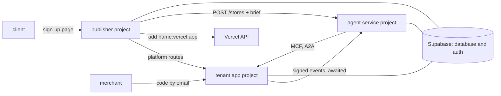
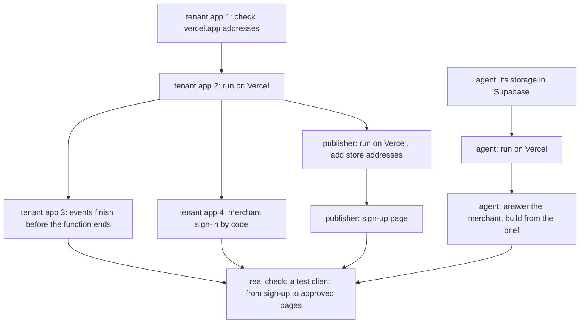

# Work package 16 — The prototype on Vercel: the tenant app's part

**For whoever implements this, human or AI:** do the tasks in order. One task is one pull request on `main`, at most 200 lines. A task that needs an open pull request carries its commits and says "Includes #N" in its title. No AI attribution anywhere.

**Goal:** a test client signs up, gets a store at its own `vercel.app` address, signs in as its merchant with an emailed code, asks the store's agent for pages, and approves them, with nobody at a keyboard. The prototype is for testing only.

**Owner decisions, 2026-11-28:**
- Hosting is Vercel's free Hobby plan, one project per repository.
- Store addresses are `vercel.app` addresses only.

**The other two plans:**
- The publisher's part is planned in `the-market-org/factory`, and the agent service's in `the-market-org/commerce-agent`.
- They are private, and this plan names only what they do at the boundary.

## What Vercel changes (from Vercel's docs, read 2026-11-28)
- Code runs per request, for up to 300 seconds. Nothing may rely on work after the reply unless it is handed to Vercel's after-the-reply mechanism.
- A project's domains can be added through Vercel's API.
- Whether any free `name.vercel.app` address can be added to a project is not stated. Task 1 checks it.

## Order across the three repositories

## Global constraints
- Production mode: `NODE_ENV=production`, so HTTPS only, `Secure` cookies, and `SECRETS_KEY` required. `vercel.app` addresses are HTTPS.
- Every secret lives in Vercel's environment settings, never in the repository.
- Migrations run as the owner role from CI on merge to `main`, never from a Vercel function.

## Review focus
1. No event is lost when a function ends after its reply. Task 3.
2. A sign-in code works once, for its own email, and only for the store whose merchant it is. Task 4.
3. A store's address reaches only that store. Task 1.
4. Nothing written to local disk is relied on between requests. Task 2.
5. A slow agent (up to about 60 seconds for a build) still gets its event. Task 3.

---

### Task 1: check `vercel.app` store addresses (owner and implementer)
- Create the tenant app's Vercel project, deployed from `main`.
- Add a second address, `shop-test-<random>.vercel.app`, through Vercel's API or dashboard.
- Check that it serves the project, and that the tenant app sees it as the request's host.

The result is written in the log. If Vercel refuses such addresses, stop: store addresses by path (`/s/<slug>/…`) become their own plan, and tasks 2 to 5 wait.

### Task 2: run on Vercel
- An entry point that exports the existing Hono app for Vercel's Node runtime, with `vercel.json` setting the maximum duration to 300 seconds.
- The environment names are listed in the README.
- Check, in Supabase's docs, the connection mode for code that runs per request, and use it for every module's role.
- A CI job runs `pnpm db <module> migrate deploy` for every module on merge to `main`, as the owner role.

Tests: the entry exports the app, and every module's settings are read from the environment.

### Task 3: events finish before the function ends
- Event delivery is handed to Vercel's after-the-reply mechanism (checked in Vercel's docs for the Node runtime), instead of being left un-awaited.
- The post timeout becomes `EVENT_DELIVERY_TIMEOUT_MS`, by default 5,000 locally and 280,000 on Vercel, so an agent that builds while answering still gets its event.

Tests: delivery is passed to the after-reply hook, and the timeout comes from the setting.

### Task 4: merchant sign-in by code
`/admin/sign-in` asks for an email address.
1. The server sends `POST <SUPABASE_URL>/auth/v1/otp { email, create_user: false }` with the publishable key.
2. The next page asks for the code, and the server sends `POST /auth/v1/verify { type: "email", email, token }`.
3. The returned access token is checked by the identity socket (ES256, from `IDENTITY_KEYS_URL`, the-market#160) and becomes the existing session cookie.

The pasted-token form stays only when `NODE_ENV` isn't production.
- **Owner action:** Supabase's email template for sign-in includes the code (`{{ .Token }}`).
- **New settings:** `SUPABASE_URL` and `SUPABASE_PUBLISHABLE_KEY`.

Tests, with a fake Supabase:
- the code is sent with `create_user: false`;
- a wrong code shows the form again with Supabase's message;
- a right code for another store's merchant gets no session on this store;
- the session cookie keeps its current rules.

### Task 5: the real check
On Vercel, after the publisher's and the agent's parts:
1. A test client signs up.
2. The client's store answers at its `vercel.app` address.
3. The merchant signs in with the emailed code.
4. The merchant sends "a shop selling handmade candles", and the agent's change set appears.
5. Approving and applying it changes the storefront, and the agent receives the signed events.

Each approval is the owner's.

## Open questions for the owner
1. **Agent token renewal.** The publisher's agent tokens last 7 days, which is enough for tests. Renewal is planned when tests run longer.
2. **Task 1's fallback.** If `vercel.app` addresses can't be added per store, store addresses move to paths.
