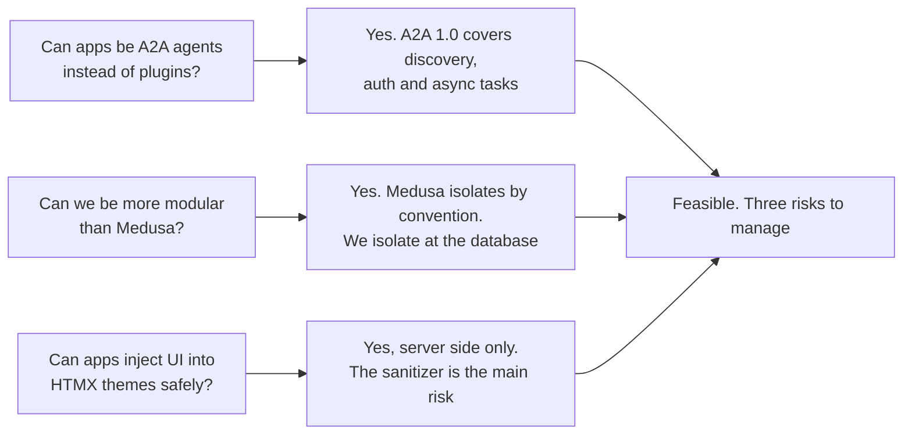
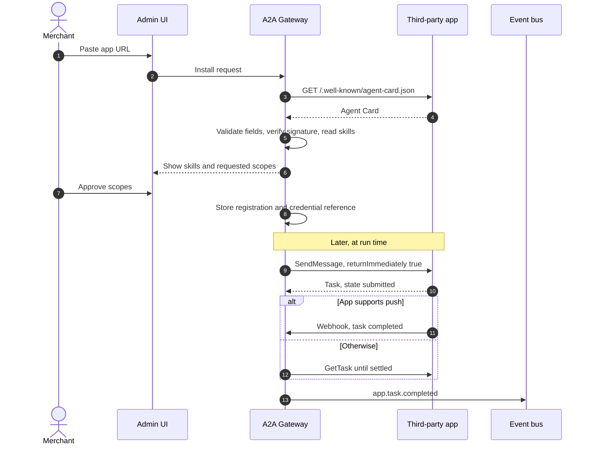
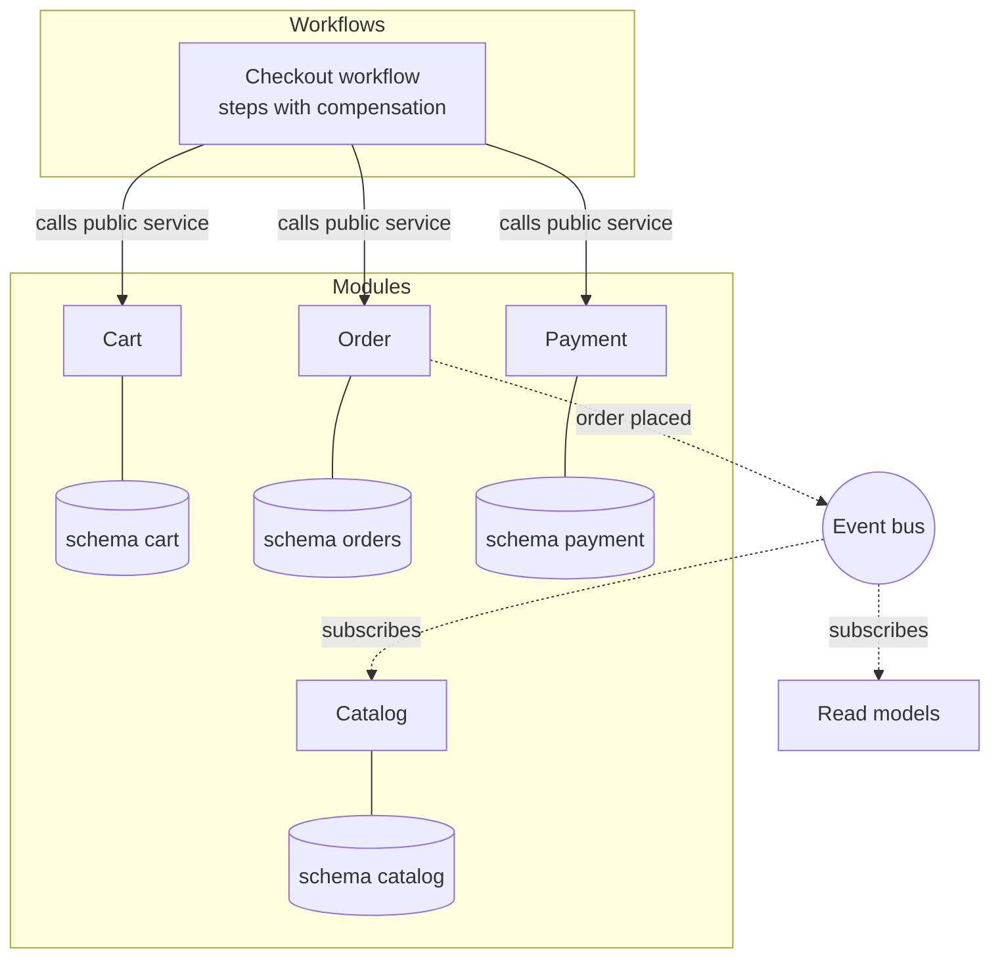
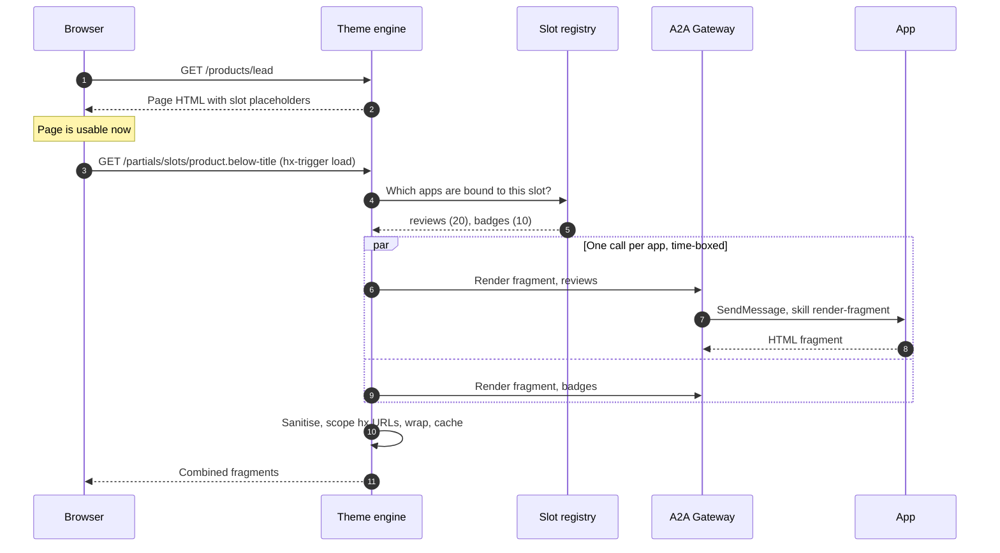

# Phase 1 — Research and feasibility

Date: 2026-11-15. Status: draft for owner review.

Everything marked **Verified** was read from the linked official page on 2026-11-15. Everything marked **Our design** is a proposal. Anything marked **Unverified** still needs checking before code depends on it.

## Summary

| Area | Verdict | Biggest risk |
|---|---|---|
| A2A app ecosystem | Feasible | No third-party apps speak A2A for commerce yet; we must ship an app SDK |
| Hyper-modular backend | Feasible | Cross-module queries are slower without joins; needs a read model |
| HTMX theme injection | Feasible | HTML sanitising; a regex sanitizer is not safe enough for production |

## 1. A2A integration pattern

Source: [A2A specification](https://a2a-protocol.org/latest/specification/), version 1.0.0.

### What the protocol gives us (Verified)

- **Discovery.** An agent publishes an Agent Card at `/.well-known/agent-card.json`. Required fields: `name`, `description`, `supportedInterfaces`, `version`, `capabilities`, `defaultInputModes`, `defaultOutputModes`, `skills`.
- **Skills.** Each skill has `id`, `name`, `description`, `tags`, and optional `examples`, `inputModes`, `outputModes`.
- **Transports.** Each entry in `supportedInterfaces` has `url`, `protocolBinding` (`JSONRPC`, `GRPC` or `HTTP+JSON`) and `protocolVersion`.
- **JSON-RPC methods.** `SendMessage`, `SendStreamingMessage`, `GetTask`, `ListTasks`, `CancelTask`, `SubscribeToTask`, four push-notification config methods, and `GetExtendedAgentCard`. The version travels in an `A2A-Version` header.
- **Tasks.** A task has `id`, `status.state`, `artifacts`. Terminal states: completed, failed, canceled, rejected. Interrupted states: input-required, auth-required.
- **Three ways to wait.** Poll `GetTask`; stream over Server-Sent Events; or register a webhook and receive push notifications. `returnImmediately: true` makes `SendMessage` return as soon as the task exists.
- **Security.** The card declares `securitySchemes` (API key, HTTP auth, OAuth2, OpenID Connect, mutual TLS). Cards may be signed with JWS. Webhook senders must reject private addresses to prevent SSRF.
- **Caching.** Cards should be served with `Cache-Control` and `ETag`; clients should revalidate.

**Unverified:** the exact JSON spelling of enum values on the wire (the skeleton uses `TASK_STATE_COMPLETED` style). Check the spec's JSON section and proto file before the first real integration.

### How the-market uses it (Our design)

Design rules:

1. **Install is by URL.** The merchant pastes a URL or picks from a directory. The directory is only a list of URLs, so a self-hosted store needs no central marketplace.
2. **The gateway is the only door.** Core modules never call an app. They publish an event or ask the gateway to run a skill. This keeps app failures out of core code.
3. **Scopes are ours, not A2A's.** A2A authenticates the caller. What an app may read or change is a the-market permission (`catalog.read`, `theme.slot:product.below-title`), granted by the merchant at install.
4. **Skill addressing is a convention.** A2A does not route a message to a skill. We send one data part shaped `{ skillId, input }`, and will publish this as an A2A extension.
5. **Both directions.** The platform also publishes its own Agent Card so apps and outside agents can call store skills (for example "search products").
6. **Polling first, push second.** The prototype polls. Push notifications come when a real app needs them.

### Feasibility

| Question | Answer |
|---|---|
| Is the protocol stable enough? | 1.0.0 is released. Names changed between 0.3 and 1.0, so pin `A2A-Version` and keep protocol types in one package. |
| Is it fast enough for page rendering? | Not if called per page view. Fragments must be cached, time-boxed and rendered lazily (section 3). |
| What about apps that are not AI agents? | Fine. An "agent" here is any HTTPS service with a card. A tax calculator needs no model. |
| Main risk | Ecosystem cold start. Mitigation: ship an app SDK and two or three first-party apps. |

## 2. Medusa-inspired modularity

Sources: [Medusa architecture](https://docs.medusajs.com/learn/introduction/architecture), [module isolation](https://docs.medusajs.com/learn/fundamentals/modules/isolation), [module links](https://docs.medusajs.com/learn/fundamentals/module-links).

### How Medusa v2 works (Verified)

- Four layers: API routes, then workflows, then modules, then PostgreSQL. The HTTP server is Express.
- A module cannot resolve another module's service. Each module has its own container.
- Modules are combined by **workflows**, whose steps have roll-back logic.
- Cross-module relations use **module links**: a link table holding both record ids, with no foreign keys, kept in sync by `db:sync-links`.
- Cross-module reads use **Query** (`query.graph`).
- Medusa injects a PostgreSQL connection into every module. Injecting one module's service into another is possible as a documented last resort.

### Where we go further (Our design)

| Concern | Medusa v2 | the-market |
|---|---|---|
| Isolation is enforced by | Containers and convention | A PostgreSQL schema and database role per module, so another module's tables cannot be read |
| Module to module calls | Not allowed, with an escape hatch | Not allowed, no escape hatch |
| Communication | Workflows, links, Query | Events (outbox), workflows (sagas), read models |
| Cross-module relations | Link tables, no foreign keys | Same idea: ids only, in a `links` schema |
| Cross-module reads | Query graph engine | Small read models built from events; no graph engine in the MVP |
| Where a module runs | In process | In process by default; same contract can be served remotely over A2A |
| HTTP layer | Express | Framework-independent handlers, Hono adapter |
| Module footprint | Framework package set | One `defineModule` call and one folder |

Rules:

1. A module owns one schema and is the only writer and reader of it.
2. A module receives only a context: its name, its schema, publish and subscribe. See `packages/core/src/module-types.ts`.
3. Only workflows may call more than one module.
4. Ids cross module boundaries; objects do not. An order line stores `variantId` plus a snapshot of title and price.
5. Events are written to an outbox table in the same transaction as the change, then delivered.

### Feasibility

| Question | Answer |
|---|---|
| Does per-module schema cost performance? | No extra connections are needed; it is one database. The cost is losing joins across modules. |
| How do list pages get joined data? | Read models updated from events. This adds eventual consistency, which is acceptable for storefront listing but not for stock at checkout. Checkout reads the owning module directly through a workflow. |
| Is this too heavy for an SMB? | The merchant never sees it. One process, one database, one command to start. |
| Main risk | Over-splitting early. Mitigation: start with catalog, cart, order, customer, payment, apps, agent; split only when a boundary hurts. |

## 3. HTMX theme engine

Source: [htmx documentation](https://htmx.org/docs/), version 2.0.11.

### What htmx gives us (Verified)

- Attributes `hx-get`, `hx-post`, `hx-trigger`, `hx-target`, `hx-swap` let any element request HTML and swap it in.
- Lazy loading with `hx-trigger="load"`, `revealed` or `intersect`.
- Out-of-band swaps (`hx-swap-oob`) update several regions from one response.
- Response headers such as `HX-Trigger`, `HX-Retarget`, `HX-Reswap` let the server steer the client.
- Security controls: `hx-disable` blocks htmx processing for an element and everything inside it, and injected content cannot override it. Config defaults: `selfRequestsOnly: true`, `allowScriptTags: true`, `allowEval: true`. The docs recommend a Content Security Policy.

### Theme model (Our design)

A theme is a folder of server-rendered templates and partials. A page is a layout plus partials; each partial has its own URL so htmx can refresh it alone. Templates are TypeScript functions that return strings in the MVP, so there is no template language to learn or parse.

Apps never ship JavaScript to the storefront. They inject through **named slots**:

Safety and performance rules:

| Rule | Why |
|---|---|
| Slots load after the page (`hx-trigger="load"`) | An app can never delay first paint |
| Each fragment has a time budget; failures render nothing | One broken app cannot break a page |
| Fragments are sanitised on the server: no scripts, no inline handlers, no `javascript:` URLs | Apps cannot run code in the shopper's browser |
| `hx-*` request URLs must start with `/apps/{appId}/` | An app cannot make the shopper's browser call core or admin routes |
| Apps receive plain page values (ids, locale), never session data | Least privilege |
| Set `allowScriptTags: false` and `allowEval: false`, plus a strict CSP | Defence in depth if the sanitizer misses something |
| Fragments are cached per app, slot and page values | Most page views cost zero app calls |
| Merchants choose which app fills which slot and in what order | Control stays with the store owner |

### Other frontends

The backend returns JSON from the same handlers that feed the theme engine. HTMX themes are one consumer. A React or Vue storefront is another consumer that calls the JSON API and may render slot fragments itself or ignore them.

### Feasibility

| Question | Answer |
|---|---|
| Can htmx do a full storefront? | Yes for catalogue, cart and checkout pages. Rich client widgets (image zoom, payment fields) still need small scripts, shipped by the theme, not by apps. |
| Is server-side sanitising enough? | Only with a real HTML parser and an allowlist. The skeleton's regex sanitizer shows the interface, not the final safety level. |
| Main risk | Sanitizer bypass. Mitigation: parser-based allowlist, CSP, htmx eval off, and fragments confined by `hx-disable` where an app needs no interactivity. |

## Open questions for the owner

1. Answered 2026-11-15: the central agent starts on OpenRouter. Still open: must a self-hosted store work with no model at all?
2. Should apps be allowed any client-side JavaScript in a sandboxed iframe later, or never?
3. Is a hosted app directory part of the commercial offer or the open-source core?
